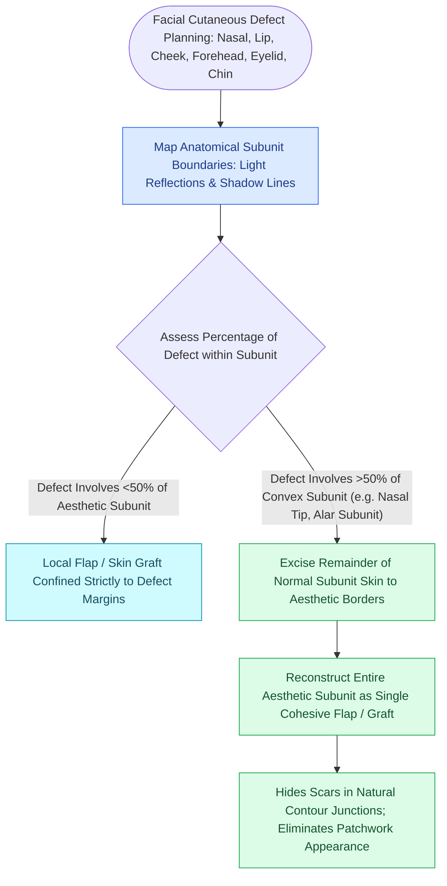

# Gonzalez-Ulloa facial aesthetic subunits guide complete subunit reconstruction

## Active Recall

> [!question]- What is the clinical rationale for excising the remaining normal tissue of an aesthetic subunit when a defect involves >50% of its area?
> *Answer / Clinical Rationale*: Replacing the entire subunit allows all perimeter scar lines to be placed within the natural shadow-casting valleys and ridges at subunit boundaries, avoiding noticeable patches and contour irregularities.

> [!question]- Which facial anatomical regions are most sensitive to the aesthetic subunit principle?
> *Answer / Clinical Rationale*: The **nose (dorsum, tip, alar subunits)**, **lips (philtrum, lateral upper lip subunits)**, and **forehead**.

## Core Clinical & Mechanistic Principles
In 1956, Mario Gonzalez-Ulloa established the **aesthetic subunit principle** of facial reconstruction. The human face is divided into distinct topographical regions defined by underlying bony contours, subcutaneous fat distribution, and skin thickness: **Forehead, Eyes/Periorbital, Nose, Lips, Cheeks, Chin, and Neck**.

### The Subunit Replacement Philosophy
1. **Light Reflections & Natural Shadows**: The boundaries between subunits form natural ridges and valleys that cast shadows. Scars placed precisely along these junctions become virtually imperceptible.
2. **The 50% Rule**: If a surgical defect encompasses **greater than 50% of an aesthetic subunit** (particularly on the nose, lip, or forehead), excising the remaining normal tissue of that subunit and reconstructing the *entire subunit as a single unit* yields superior aesthetic outcomes compared to patching the defect.
3. **Preventing Trapdoor Deformity**: Replacing an entire subunit avoids circular scar contracture and "[[The Zitelli bilobed flap restricts rotation to ninety degrees to prevent pincushioning|pincushioning]]" within a flat surface.

## Connected Concepts & Graph Traversal
- **Incision Placement**: [[Relaxed skin tension lines minimize scar hypertrophy along perpendicular muscular vectors|Relaxed Skin Tension Lines (RSTLs)]]
- **Diagnostic Evaluation**: [[Composite chondrocutaneous auricular graft transfers reconstruct complex alar and helical defects|Composite Auricular Graft]]
- **Anatomical Foundation**: [[Gilles fan flaps and Webster-Bernard cheek advancements reconstruct large lower lip defects|Gilles Fan Flap]]
- **Proportional Baseline**: [[Facial horizontal fifths and vertical thirds define baseline aesthetic analysis and proportions|Facial Fifths and Thirds]]
- **Aesthetic Subunit Application**: [[Cheek reconstruction partitions defects into suborbital, preauricular, and buccomandibular aesthetic zones to direct tissue recruitment along relaxed skin tension lines|Cheek Aesthetic Zones]]
- **Surgical Craft**: [[Forehead aesthetic subunit reconstruction divides the forehead into midline, paramedian, and lateral zones to optimize scar camouflage and brow symmetry|Forehead Aesthetic Subunits]]
- **Diagnostic Assessment**: [[Philtral subunit reconstruction requires Abbe cross-lip flaps or bilateral melolabial advancement to restore three-dimensional contour|Philtral Subunit Reconstruction]]
