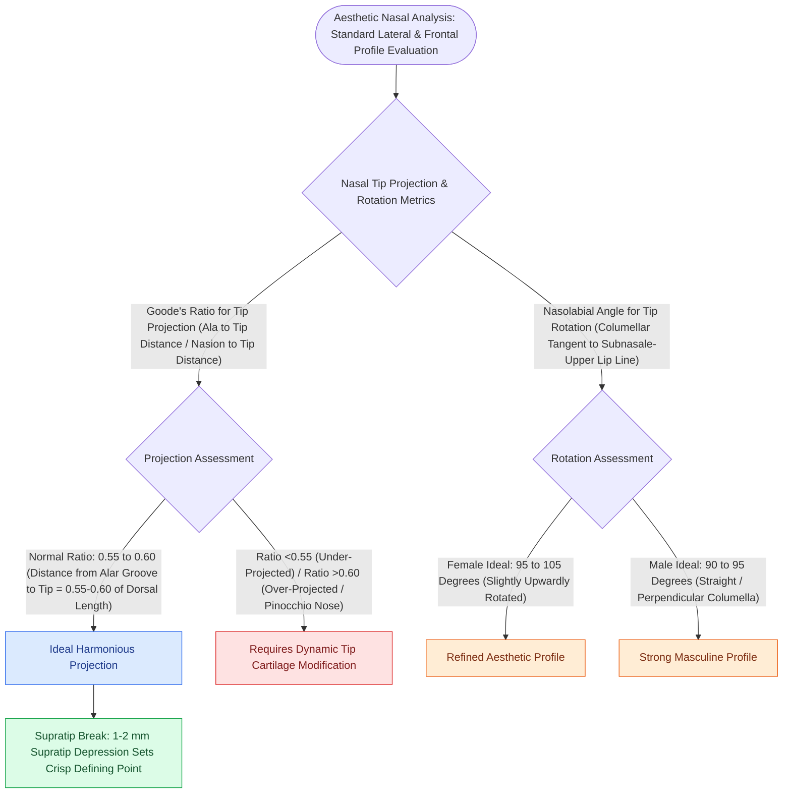

# Goode's ratio and nasolabial angles define standard aesthetic nasal tip proportions

## Active Recall

> [!question]- What is the ideal numerical value for Goode's ratio of nasal tip projection?
> *Answer / Clinical Rationale*: **$0.55\text{ to }0.60$** (ratio of projection from alar crease to dorsal length from nasion to tip).

> [!question]- What are the ideal gender-specific values for the nasolabial angle?
> *Answer / Clinical Rationale*: **$90^\circ\text{–}95^\circ$ in men** and **$95^\circ\text{–}105^\circ$ in women**.

## Core Clinical & Mechanistic Principles
Quantitative nasal analysis utilizes standardized angular and proportional relationships to guide functional and aesthetic rhinoplasty planning.

### Aesthetic Landmark Standards
- **Goode's Method**: [[The Anderson tripod theory governs nasal tip projection, rotation, and support dynamics|Tip projection]] is measured along a perpendicular line from the alar-facial groove to the nasal tip ($BC$). Dorsal length is measured from nasion to tip ($AC$). Normal projection is $0.55\text{–}0.60 \times AC$.
- **Simons' Method**: Tip projection equals the length of the upper lip from subnasale to the vermilion border ($1:1$ ratio).
- **Crumley's Method**: The projection, dorsal length, and vertical height form a $3:4:5$ right triangle.

## Connected Concepts & Graph Traversal
- **Dynamic Control**: [[The Anderson tripod theory governs nasal tip projection, rotation, and support dynamics|Anderson Tripod Theory]]
- **Tip Rotation**: [[Lateral crural steal and overlay maneuvers dynamically modify tip rotation and projection|Lateral Crural Steal & Overlay]]
- **Rigid Stabilization**: [[Tongue-in-groove and septal extension grafts provide rigid columellar and tip stabilization|Septal Extension Grafts]]
- **Anatomical Foundation**: [[Cephalic trim of lower lateral cartilages must preserve at least six millimeters of lateral crus|Cephalic Trim 6-mm Rule]]
- **High-Stakes Safety**: [[Pollybeak deformities arise from cartilaginous over-projection or supratip soft tissue fibrosis|Pollybeak Deformity]]
- **Surgical Craft**: [[Spreader grafts restore internal nasal valve patency and prevent inverted-V deformity|Spreader Grafts]]
- **Alar Aesthetic Proportion**: [[Alar subunit reconstruction requires non-anatomical rigid cartilage grafting to counteract scar contracture and prevent alar rim notching|Alar Subunit Reconstruction]]
