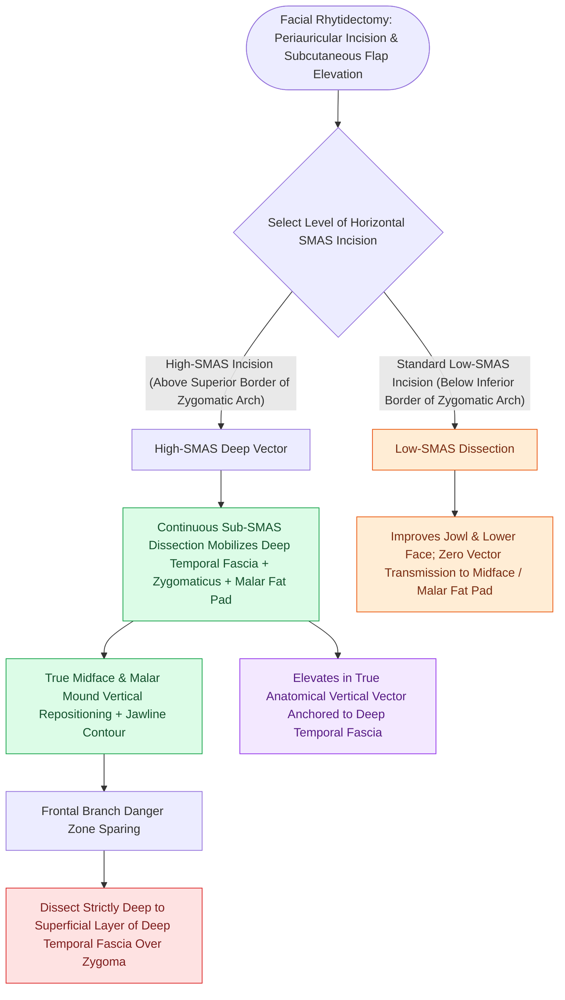

# High-SMAS rhytidectomy extends dissection above the zygomatic arch to rejuvenate the midface

## Active Recall

> [!question]- Where is the SMAS incised in a High-SMAS rhytidectomy, and what aesthetic benefit does this provide?
> *Answer / Clinical Rationale*: **Superior to the zygomatic arch** along a line from the lateral canthus to the helical root, enabling simultaneous repositioning of the **malar fat pad and midface** in continuity with the jowls and neck.

> [!question]- What motor nerve is at highest risk during dissection over the zygomatic arch?
> *Answer / Clinical Rationale*: The **frontal (temporal) branch of the facial nerve**, which crosses the midpoint of the zygomatic arch.

## Core Clinical & Mechanistic Principles
Introduced by Fritz Barton, the **High-[[MACS lift and SMAS plication provide vertical vector elevation via suspension purse-string sutures|SMAS]] Rhytidectomy** enters the sub-SMAS surgical plane **superior to the zygomatic arch**, incising along a line connecting the lateral canthus to the helical root.

This allows the entire midface, malar fat pad, and jowl complex to be mobilized and suspended as a **continuous, unbroken biomechanical sheet**.

### Frontal Branch Danger Over the Arch
- The **frontal (temporal) branch of CN VII** crosses the zygomatic arch within the sub-SMAS / sub-TPF loose areolar tissue (see [[Pitanguy's line defines the danger zone for the frontal branch of the facial nerve|Pitanguy's Line]]).

## Connected Concepts & Graph Traversal
- **Deep-Plane Technique**: [[Deep-plane rhytidectomy mobilizes the skin and SMAS as a composite flap across retaining ligaments|Deep-Plane Rhytidectomy]]
- **Nerve Landmark**: [[Pitanguy's line defines the danger zone for the frontal branch of the facial nerve|Pitanguy's Line]]
- **Midface SOOF**: [[Suborbicularis oculi fat SOOF elevation restores malar projection and midface youthfulness|SOOF Elevation]]
- **Anatomical Foundation**: [[MACS lift and SMAS plication provide vertical vector elevation via suspension purse-string sutures|MACS Lift (Minimal Access Cranial Suspension)]]
- **Surgical Craft**: [[The great auricular nerve emerges at Erb's point and is vulnerable during rhytidectomy|Great Auricular Nerve (GAN)]]
