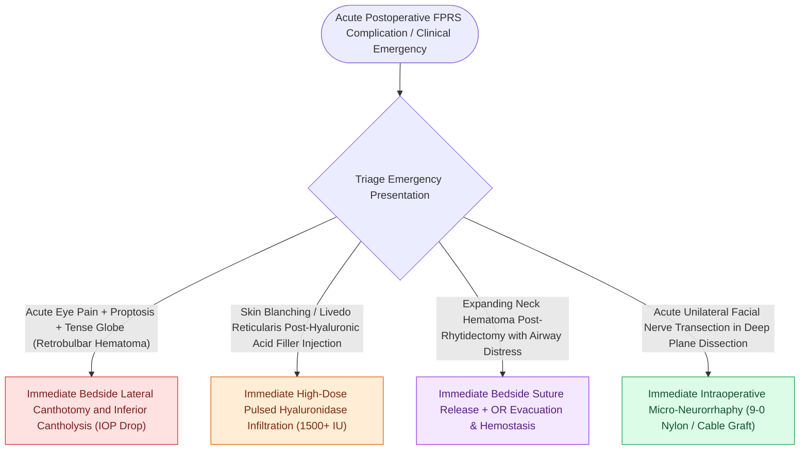

# High-stakes FPRS complications require proactive landmarking and emergency rescue protocols

## Active Recall

> [!question]- What is the immediate bedside emergency intervention for an acute retrobulbar hematoma?
> *Answer / Clinical Rationale*: Immediate bedside **lateral canthotomy and inferior cantholysis** without waiting for imaging.

> [!question]- What antibiotic must be administered whenever medicinal leeches are applied to a congested free flap?
> *Answer / Clinical Rationale*: **Ciprofloxacin** (or an anti-pseudomonal fluoroquinolone) to cover ***Aeromonas hydrophila***.

## Core Clinical & Mechanistic Principles
Complications in Facial Plastic and Reconstructive Surgery carry severe aesthetic, functional, and life-threatening consequences. Proactive anatomical landmarking and rapid emergency rescue protocols are required across all seven tiers.

### Master FPRS Complication Rescue Matrix

> [!CAUTION] **Tier I: Frontal Branch Facial Nerve Transection**
> - **Critical Landmark**: [[Pitanguy's line defines the danger zone for the frontal branch of the facial nerve|Pitanguy's line]] ($0.5\text{ cm}$ below tragus to $1.5\text{ cm}$ above lateral brow); Deep temporal fascia proper.
> - **Failure Mode**: Elevating in the sub-TPF innominate fat layer over the zygomatic arch, transecting the frontal branch.
> - **Rescue Protocol**: Immediate microscopic [[Epineural neurorrhaphy and cable nerve grafting restore facial continuity within twelve months|epineural neurorrhaphy]] (9-0/10-0 nylon); if nerve is permanently lost, static brow suspension or contralateral brow botulinum toxin balancing.

> [!WARNING] **Tier II: Paramedian Forehead Flap Ischemia & Necrosis**
> - **Critical Landmark**: Supratrochlear artery ($1.7\text{–}2.2\text{ cm}$ lateral to midline); $1.2\text{–}1.5\text{ cm}$ base width.
> - **Failure Mode**: Narrowing the pedicle base $<1.2\text{ cm}$ or dissecting superficially within $1\text{ cm}$ of the supraorbital rim.
> - **Rescue Protocol**: Dissect subperiosteally in the lowest $1\text{ cm}$ above the orbital rim. If congested, remove compressive bolster sutures and apply warm compresses/nitropaste.

> [!CAUTION] **Tier III: Inverted-V Deformity & Internal Valve Collapse**
> - **Critical Landmark**: Upper lateral cartilage (ULC) attachment to dorsal septum; Internal nasal valve ($10^\circ\text{–}15^\circ$).
> - **Failure Mode**: Excessive cartilaginous dorsal hump resection without stabilizing ULCs.
> - **Rescue Protocol**: Reconstruct with bilateral autologous cartilaginous [[Spreader grafts restore internal nasal valve patency and prevent inverted-V deformity|Spreader Grafts]] or turn-in spreader flaps.

> [!CAUTION] **Tier IV: Post-Blepharoplasty Cicatricial Ectropion & [[Upper blepharoplasty requires precise skin crease marking to avoid lagophthalmos|Lagophthalmos]]**
> - **Critical Landmark**: Middle lamella; [[Endoscopic browlift releases the conjoint tendon and arcus marginalis along the supraorbital rim|Arcus marginalis]]; $10\text{–}12\text{ mm}$ intact upper lid skin.
> - **Failure Mode**: Over-resection of upper lid skin or middle lamellar scar contracture in lower lid.
> - **Rescue Protocol**: Lubricating ointments and moisture chambers; perform [[Lateral canthopexy and lateral tarsal strip suspension prevent post-blepharoplasty ectropion|Lateral Tarsal Strip Suspension]] and [[Full-thickness and split-thickness skin grafts differ in primary contraction and vascular take|full-thickness skin graft]] for severe deficiency.

> [!WARNING] **Tier V: Gracilis Muscle Transfer Vector Distortion**
> - **Critical Landmark**: Zygomaticus major vector; Modiolus and deep temporal fascia anchors.
> - **Failure Mode**: Pulling the oral commissure horizontally toward the earlobe rather than superolaterally toward the temple.
> - **Rescue Protocol**: Anchor the proximal muscle belly to the deep temporal fascia and zygomatic arch, matching the exact excursion vector of the contralateral smile.

> [!CAUTION] **Tier VI: Acute [[Post-blepharoplasty retrobulbar hematoma requires immediate bedside decompression to prevent blindness|Retrobulbar Hematoma]] & [[Acute retrobulbar hematoma in facial trauma requires immediate bedside lateral canthotomy|Orbital Compartment Syndrome]]**
> - **Critical Landmark**: Lateral canthal tendon; Intraocular pressure ($IOP > 40\text{ mmHg}$).
> - **Failure Mode**: Uncontrolled orbital bleeding causing central retinal artery occlusion and permanent blindness.
> - **Rescue Protocol**: **DO NOT send for CT scan**. Perform immediate bedside Lateral Canthotomy & Inferior Cantholysis.

> [!CAUTION] **Tier VII: Microvascular Free Flap Pedicle Thrombosis**
> - **Critical Landmark**: Microvascular anastomoses; Perforator pedicle.
> - **Failure Mode**: Venous thrombosis (purple/tense/dark bleeding) or arterial occlusion (pale/cool/flat/no bleeding).
> - **Rescue Protocol**: Immediate OR exploration within 2 hours; Fogarty thrombectomy, tPA flush, venous revision, and medicinal leeching with Ciprofloxacin coverage.

## Connected Concepts & Graph Traversal
- **Orbital Emergency**: [[Acute retrobulbar hematoma in facial trauma requires immediate bedside lateral canthotomy|Lateral Canthotomy]]
- **Microvascular Crisis**: [[Microvascular free flap salvage requires urgent re-exploration within two hours of vascular compromise|Free Flap Salvage]]
- **Ectropion Rescue**: [[Lateral canthopexy and lateral tarsal strip suspension prevent post-blepharoplasty ectropion|Lateral Tarsal Strip]]
- **High-Stakes Safety**: [[Pollybeak deformities arise from cartilaginous over-projection or supratip soft tissue fibrosis|Pollybeak Deformity]]
- **Structural / Flap Alternative**: [[Champy lines of ideal osteosynthesis dictate monocortical miniplate fixation along mandibular tension zones|Champy's Principle of Osteosynthesis]]
- **Emergency Protocol**: [[Frostbite tissue salvage prioritizes rapid warm water bath thawing and delayed tissue demarcation over early debridement|Frostbite Rewarming Protocol]]
