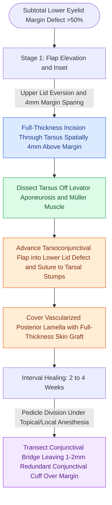

# Hughes tarsoconjunctival flaps reconstruct extensive lower eyelid defects using upper eyelid posterior lamella sharing

## Active Recall

> [!question]- Why must the inferior 4 mm of tarsal plate be strictly preserved at the upper eyelid donor site during a Hughes tarsoconjunctival flap harvest?
> *Answer / Clinical Rationale*: Preserving a minimum of **4 mm of intact inferior tarsus** maintains upper eyelid structural stability, prevents distortion of the superior marginal arcade, and prevents postoperative **upper eyelid entropion, margin buckling, and trichiasis**.

> [!question]- Why is Müller's muscle dissected and freed from the conjunctival flap during superior mobilization in the Hughes procedure?
> *Answer / Clinical Rationale*: Dissection must transition to a **subconjunctival plane posterior to Müller's muscle**; including Müller's muscle transmits sympathetic retractor tone to the lower lid and leads to postoperative **upper eyelid retraction and lagophthalmos**.

## Core Clinical & Mechanistic Principles
The Hughes tarsoconjunctival pedicle flap is the definitive workhorse procedure for reconstructing full-thickness lower eyelid defects encompassing greater than 50% to 100% of the horizontal eyelid margin. Because eyelid integrity requires a rigid, mucous membrane-lined inner surface (posterior lamella) and a pliable, epithelialized outer surface (anterior lamella), the Hughes technique recruits vascularized autogenous tarsus and conjunctiva from the abundant upper eyelid to reconstitute the missing posterior lamellar framework.

Surgical execution follows a strict two-stage sequence:
1. **Donor Site Harvest**: The upper eyelid is everted over a Desmarres retractor. A horizontal incision is placed through the tarsal plate exactly 4 mm superior to the lid margin. This 4 mm residual tarsal strip preserves upper eyelid stability and margin vascularity. Dissection proceeds superiorly in the avascular pre-tarsal plane anterior to the tarsus and posterior to the levator aponeurosis. At the superior tarsal border, the dissection transitions posterior to Müller's muscle into a pure subconjunctival plane within the superior fornix, mobilizing a tension-free pedicle while avoiding upper lid retraction.
2. **Lower Lid Inset**: The composite tarsoconjunctival flap is advanced inferiorly into the lower eyelid gap. The tarsal segment is secured to the medial and lateral residual tarsal stumps (or periorbita at the lateral orbital rim) using interrupted 6-0 polyglactin sutures on a spatula needle (S-14), setting the superior tarsal border flush with the desired lower lid margin. The inferior conjunctival fornix and capsulopalpebral fascia are sutured to the bottom of the flap.
3. **Anterior Lamellar Coverage**: The anterior lamella is resurfaced with a [[Full-thickness and split-thickness skin grafts differ in primary contraction and vascular take|full-thickness skin graft]] harvested from retroauricular, preauricular, or contralateral upper eyelid skin, or alternatively with a local musculocutaneous advancement flap.
4. **Second-Stage Division**: After 2 to 4 weeks of vascular inosculation, the conjunctival bridge pedicle is transected under local anesthesia. The incision is angled to leave 1 to 2 mm of redundant conjunctival cuff that rolls anteriorly over the neo-margin, ensuring that keratinized skin does not abrade the cornea.

### Complication Management
- **Upper Eyelid Retraction**: Results from incorporating Müller's muscle or levator fibers into the pedicle; prevented by meticulous hydrodissection and surgical release of retractors from conjunctiva.
- **Eyelid Margin Erythema & Granuloma**: Pyogenic granulomas forming along the transected conjunctival margin respond to topical fluorometholone drops or office cautery with silver nitrate.
- **Entropion and Trichiasis**: Caused by harvesting tarsus closer than 4 mm to the upper lid margin, which buckles the donor margin inward.

## Connected Concepts & Graph Traversal
- **Canthal Anchoring**: [[Lateral canthopexy and lateral tarsal strip suspension prevent post-blepharoplasty ectropion|Lateral Canthopexy & Tarsal Strip]]
- **Corneal Protection**: [[Upper eyelid platinum weights and lateral tarsal strips protect the cornea in flaccid facial paralysis|Corneal Protection Mechanics]]
- **Graft Bed Mechanics**: [[Skin graft bolsters and negative pressure wound therapy optimize graft bed inosculation|Skin Graft Inosculation]]
- **Adjacent Tissue Mobilization**: [[Advancement flaps recruit adjacent tissue laxity along a linear vector without rotation|Advancement Flaps]]
- **Upper Blepharoplasty Landmarks**: [[Upper blepharoplasty requires precise skin crease marking to avoid lagophthalmos|Upper Eyelid Anatomy & Crease Marking]]
- **Lower Blepharoplasty Vectors**: [[Lower blepharoplasty addresses fat herniation while preserving the inferior oblique muscle|Lower Eyelid Retractor Anatomy]]
