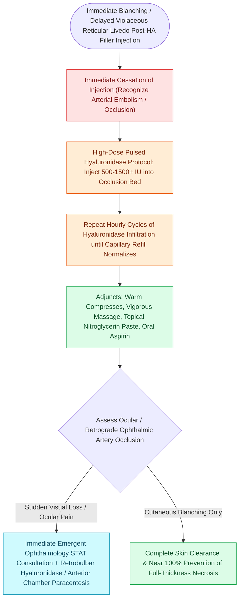

# Hyaluronic acid filler vascular occlusion requires immediate high-dose pulsed hyaluronidase to prevent skin necrosis and blindness

## Active Recall

> [!question]- What is the immediate pharmacological antidote for hyaluronic acid filler vascular occlusion?
> *Answer / Clinical Rationale*: **High-dose pulsed hyaluronidase** (injected immediately and repeated hourly into the ischemic territory).

> [!question]- How can a glabellar or nasal dorsal filler injection cause acute blindness?
> *Answer / Clinical Rationale*: High injection pressure forces filler particles in a **retrograde direction down the supratrochlear or dorsal nasal artery into the ophthalmic artery**, where systolic flow pushes it into the **central retinal artery**.

## Core Clinical & Mechanistic Principles
**Vascular Occlusion** is the most feared, time-critical complication of cosmetic soft-tissue filler injections, occurring from direct intra-arterial embolization or external compression of nutrient [[The facial artery and facial vein provide the primary vascular supply to the anterior face|facial]] vessels:
- **High-Risk Danger Arteries**:
  1. **Facial Artery / Angular Artery / Lateral Nasal Artery**: Injections into the nasolabial fold or alar base can embolize into the lateral nasal and angular arteries, causing **ischemic necrosis of the nasal ala and tip**.
  2. **Dorsal Nasal & Supratrochlear Arteries**: Injections into the nasal dorsum or glabella can cause **retrograde arterial flow into the ophthalmic artery and central retinal artery (CRAO)**, producing **immediate, irreversible blindness within 90 minutes** and stroke.
- **Immediate Clinical Signs of Vascular Occlusion**:
  - **Immediate blanching / livedo reticularis**: Reticular, violaceous, marbled skin pattern.
  - **Severe, disproportionate ischemic pain**.
  - Delayed capillary refill ($>3\text{ seconds}$) in the affected watershed.
  - Pustule formation at 24–48 hours (if unrecognized).
- **The High-Dose Pulsed Hyaluronidase Protocol (Delorenzi Protocol)**:
  - **Immediate Action**: Stop injection immediately!
  - Flood the entire ischemic territory with **High-Dose Pulsed Hyaluronidase**:
    - Inject **$500\text{ to }1,500\text{ Units}$ of Hyaluronidase** subcutaneously and along the vascular course.
    - Repeat hourly until capillary refill normalizes.
  - Apply warm compresses and perform vigorous massage to facilitate enzymatic diffusion.
  - *For Impending Blindness*: Immediate consultation with ophthalmology for **retrobulbar / peribulbar hyaluronidase injection**, anterior chamber paracentesis, and hyperbaric oxygen therapy.

### Surgical Technique & Critical Safety Checks
- **Prevention Principles**: Always aspirate for 5 seconds before injection; use blunt-tipped microcannulas ($25\text{G}$ or larger); inject low volumes ($<0.1\text{ mL}$ per pass) under low extrusion pressure; never inject high-density fillers into the glabella or nasal tip.

## Connected Concepts & Graph Traversal
- **Facial Vascular Anatomy**: [[The facial artery and facial vein provide the primary vascular supply to the anterior face|Facial Artery Anatomy]]
- **Forehead Flap Pedicle**: [[The paramedian forehead flap is an axial interpolated flap pedicled on the supratrochlear artery|Supratrochlear Artery Pedicle]]
- **Cosmetic Neuromodulators**: [[Cosmetic botulinum toxin treats dynamic rhytids through presynaptic acetylcholine blockade|Botulinum Toxin]]
- **Wound Revision Dynamics**: [[Scar revision employs Z-plasty W-plasty and geometric broken line closure along relaxed skin tension lines|Scar Revision Techniques]]
- **Local Transposition Flaps**: [[The Zitelli bilobed flap restricts rotation to ninety degrees to prevent pincushioning|Zitelli Bilobed Flap]]
