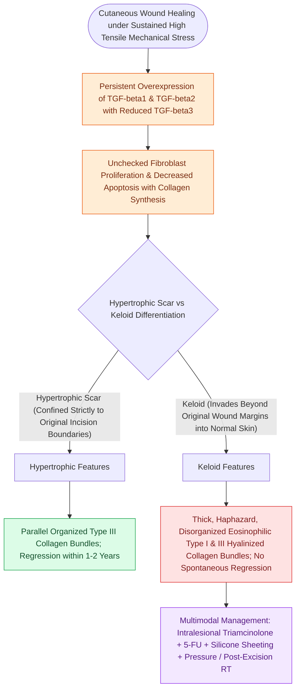

# Hypertrophic scars and keloids result from abnormal TGF-beta signaling and collagen deposition

## Active Recall

> [!question]- What is the fundamental clinical boundary and histological difference between a hypertrophic scar and a keloid?
> *Answer / Clinical Rationale*: A **hypertrophic scar remains confined within the margins** of the original wound, contains parallel organized Type III collagen bundles, and tends to regress over $1\text{–}2\text{ years}$. A **keloid extends beyond the original wound boundaries** into surrounding normal skin, contains thick, haphazardly arranged eosinophilic hyalinized Type I and III collagen bundles, and does not regress spontaneously.

> [!question]- Why does pure surgical re-excision of a keloid without adjuvant therapy carry an unacceptably high recurrence rate?
> *Answer / Clinical Rationale*: Surgical excision alone re-triggers dysregulated TGF-$\beta$ fibroplasia in a genetically predisposed host, resulting in **$>50\text{–}80\%$ recurrence**; core/intralesional excision must be paired with immediate adjuvant intralesional triamcinolone ($10\text{–}40\text{ mg/mL}$), 5-fluorouracil ($5\text{-FU}$), pressure bolsters, or postoperative superficial radiation therapy (SRT within $24\text{–}72\text{ hours}$).

## Core Clinical & Mechanistic Principles
**Hypertrophic scars and keloids** represent fibroproliferative disorders of cutaneous [[Wound healing progresses through hemostasis, inflammation, proliferation, and maturation|wound healing]] driven by persistent **TGF-$\beta 1$ / TGF-$\beta 2$ overexpression** (with decreased antifibrotic TGF-$\beta 3$), prolonged mechanical tension across [[Relaxed skin tension lines minimize scar hypertrophy along perpendicular muscular vectors|relaxed skin tension lines]], and an imbalance between **collagen synthesis and collagenase degradation** (particularly in darker Fitzpatrick skin phototypes and high-risk sites such as the earlobe, mandibular border, and presternal chest).

### Multimodal Treatment Paradigm
1. **Intralesional Triamcinolone (Kenalog 10–40 mg/mL)**: Inhibits TGF-$\beta 1$, downregulates fibroblast collagen production, and upregulates collagenase.
2. **5-Fluorouracil (5-FU)**: Pyrimidine analog ($50\text{ mg/mL}$) combined with steroid ($9:1$ 5-FU to Kenalog ratio); suppresses fibroblast proliferation.
3. **Silicone Gel Sheeting & Pressure Therapy**: Increases local hydration and temperature, downregulating fibroblast activity.
4. **Surgical Excision + Adjuvant Radiation / Injections**: Pure excision of keloids carries a $>50\text{–}80\%$ recurrence rate; requires postoperative steroid injections or superficial radiation therapy (SRT).

## Connected Concepts & Graph Traversal
- **Normal Healing**: [[Wound healing progresses through hemostasis, inflammation, proliferation, and maturation|Normal Wound Healing Phases]]
- **Tension Management**: [[Relaxed skin tension lines minimize scar hypertrophy along perpendicular muscular vectors|RSTLs & Scar Tension]]
- **Reorientation**: [[Z-plasty and W-plasty reorient scar vectors and break up linear contracture lines|Z-Plasty Scar Revision]]
- **Anatomical Foundation**: [[Alar batten and lateral crural strut grafts prevent external nasal valve inspiratory collapse|External Nasal Valve Collapse]]
- **Surgical Craft**: [[Alar subunit reconstruction requires non-anatomical rigid cartilage grafting to counteract scar contracture and prevent alar rim notching|Alar Subunit Cartilage Framework]]
