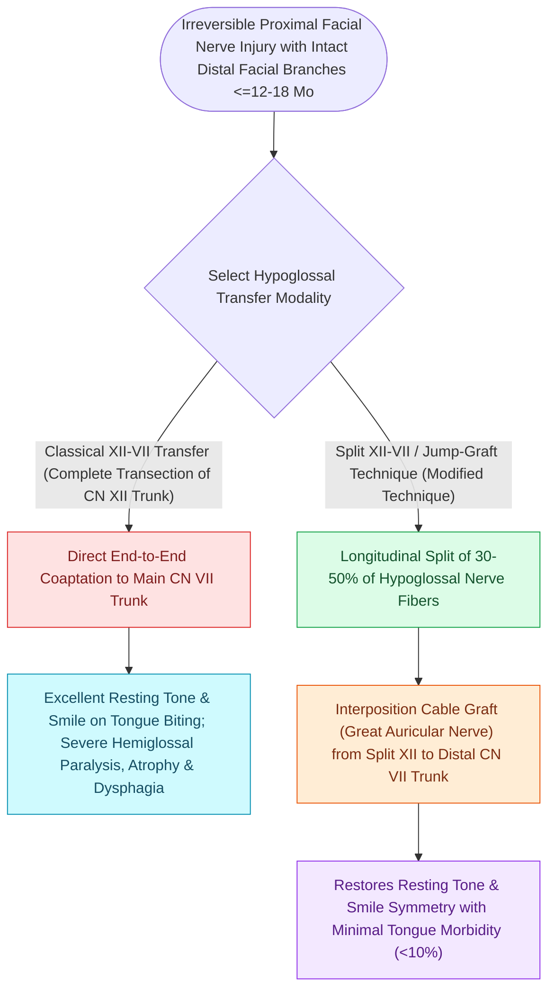

# Hypoglossal-facial nerve transfer restores resting facial symmetry and basal muscle tone

## Active Recall

> [!question]- What major functional deficit is avoided by using a side-to-end hypoglossal-facial jump graft rather than a complete end-to-end transfer?
> *Answer / Clinical Rationale*: **Ipsilateral tongue hemiatrophy and severe tongue paralysis**, preserving normal speech articulation and swallowing.

> [!question]- Within what time window from injury must a hypoglossal-facial nerve transfer be performed to succeed?
> *Answer / Clinical Rationale*: Within **$12\text{ to }18\text{ months}$**, before irreversible motor endplate degeneration and muscular fibrosis occur.

## Core Clinical & Mechanistic Principles
**Hypoglossal-to-Facial Nerve Transfer (CN XII-to-VII)** is a workhorse donor nerve transfer for restoring **resting facial symmetry and basal muscle tone** in patients with proximal facial nerve disruption (e.g., following vestibular schwannoma resection) when the distal facial nerve musculature remains viable ($<12\text{–}18\text{ [[Epineural neurorrhaphy and cable nerve grafting restore facial continuity within twelve months|months]]}$ denervation).

### Motor Characteristics: Tone vs Spontaneity
- Excellent resting tone and voluntary excursion (triggered by pushing tongue against hard palate or teeth).
- **Limitation**: Does **not provide spontaneous, emotional smile** (requires cortical motor retraining).

## Connected Concepts & Graph Traversal
- **Trigeminal Donor**: [[The masseteric nerve provides a dense motor donor for single-stage facial reanimation|Masseteric Nerve Transfer]]
- **Free Muscle**: [[Free gracilis muscle transfer provides dynamic smile restoration in chronic facial paralysis|Free Gracilis Transfer]]
- **Cable Grafts**: [[Epineural neurorrhaphy and cable nerve grafting restore facial continuity within twelve months|Cable Grafting Craft]]
- **Anatomical Foundation**: [[Cross-facial nerve grafting provides coordinated spontaneous smile excursion in children|Cross-Facial Nerve Graft (CFNG)]]
- **Surgical Craft**: [[Static fascia lata slings suspend the modiolus and nasal valve in non-innervation candidates|Static Facial Slings]]
