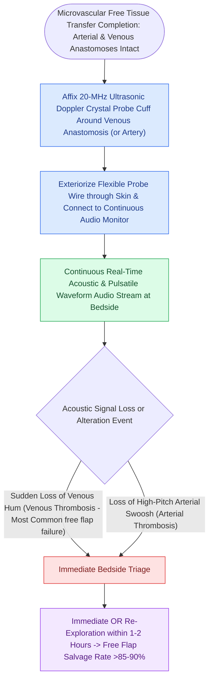

# Implantable Doppler probes provide continuous real-time monitoring of microvascular free flap pedicles

## Active Recall

> [!question]- Why is the implantable Doppler probe cuff placed on the venous pedicle rather than the arterial pedicle?
> *Answer / Clinical Rationale*: **Venous thrombosis accounts for $>80\%$ of microvascular failures**; monitoring the vein detects both primary venous thrombosis and secondary venous outflow loss from arterial failure.

> [!question]- What is the critical time window for re-exploring a compromised free flap before irreversible microvascular no-reflow occurs?
> *Answer / Clinical Rationale*: Within **$2\text{ hours}$ of vascular occlusion**.

## Core Clinical & Mechanistic Principles
The single most critical determinant of [[Microvascular free flap salvage requires urgent re-exploration within two hours of vascular compromise|free flap salvage]] following microvascular thrombosis is the **time elapsed between occlusion and surgical re-exploration ($<2\text{ hours}$)**.

The **Cook-Swartz Implantable Doppler Probe** provides **continuous, real-time audio monitoring of the venous outflow or arterial inflow pedicle**, detecting thrombosis hours before clinical skin changes become apparent.

### Probe Removal Protocol
- The probe wire exits through the surgical incision line. At postoperative Day 5–7, gentle steady traction pulls the fine wire free from its bioabsorbable cuff without injuring the pedicle.

## Connected Concepts & Graph Traversal
- **Salvage Protocol**: [[Microvascular free flap salvage requires urgent re-exploration within two hours of vascular compromise|Free Flap Salvage]]
- **Anticoagulation**: [[Postoperative free flap anticoagulation and antiplatelet protocols balance thrombosis against hematoma|Anticoagulation Protocols]]
- **Complication Matrix**: [[High-stakes FPRS complications require proactive landmarking and emergency rescue protocols|High-Stakes FPRS Matrix]]
- **Reconstructive Ladder**: [[Osteoradionecrosis of the mandible requires radical bony debridement and vascularized fibula free flap repair|Mandibular Osteoradionecrosis (ORN)]]
- **Anatomical Foundation**: [[Chimeric free flaps combine independent bone, muscle, and skin paddles on a common vascular branch|Chimeric Free Tissue Transfer]]
- **Surgical Craft**: [[Near-total lip reconstruction combines functional local muscle flaps with microvascular free flaps|Near-Total Lip Reconstruction]]
