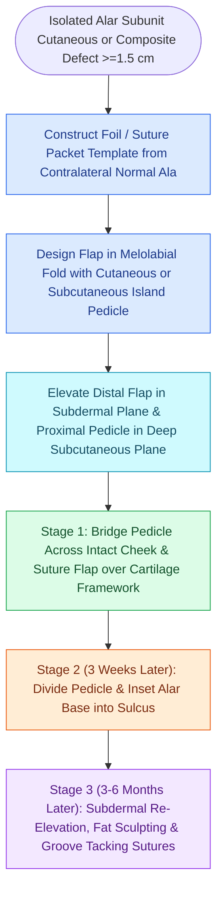

# Interpolated melolabial flaps reconstruct nasal alar defects by bridging the alar crease to prevent blunting and trapdoor deformity

## Active Recall

> [!question]- Why is a two-stage interpolated melolabial flap superior to a single-stage melolabial transposition flap for alar reconstruction?
> *Answer / Clinical Rationale*: A single-stage transposition flap crosses directly over the **alar-facial sulcus and alar groove**, obliterating these deep natural aesthetic boundaries and producing severe **pincushioning (trapdoor deformity)** and cheek-to-nose webbing. An **interpolated flap bridges over the intact cheek skin**, allowing the alar-facial junction to heal undisturbed and preserving independent 3D subunit architecture.

> [!question]- What are the comparative advantages of a cutaneous pedicle versus a subcutaneous tissue pedicled melolabial island flap?
> *Answer / Clinical Rationale*: A **cutaneous pedicled flap** provides maximum axial-random vascular reliability through the subdermal plexus, but requires secondary pedicle division at 3 weeks. A **subcutaneous tissue pedicled island flap** can be mobilized on a broad central subcutaneous fat pedicle, allowing immediate inset with minimal external tethering, though it remains prone to venous congestion if the fat pedicle is twisted or compressed.

> [!question]- How is an obliterated or blunted alar groove surgically recreated during secondary flap contouring?
> *Answer / Clinical Rationale*: The flap is re-elevated in the **subdermal plane** (leaving the underlying cartilage and lining intact), deep fibroadipose scar tissue is sculpted away, and **deep transcutaneous or dermal-to-periosteal tacking sutures (4-0 clear nylon or PDS)** are anchored to the ascending process of the maxilla to reform the sharp alar crease.

## Core Clinical & Mechanistic Principles
The medial cheek and melolabial fold provide an exceptional reservoir of skin for nasal reconstruction. The color, sebaceous pore density, and skin thickness of the melolabial region closely match the lower third of the nose. However, applying standard [[Rotation flaps redistribute closing tension along a curvilinear arc of rotation|transposition flap mechanics]] across the nasofacial boundary represents a classic reconstructive error.

### The Interpolation Advantage
The alar lobule is anatomically distinct from the cheek, separated by the deep cleft of the alar-facial sulcus and superiorly by the alar groove. 
1. **The Failure of Transposition Flaps**: Transposing a continuous cutaneous flap from the cheek across the sulcus creates an unnatural bridging web. Centripetal wound healing forces inevitably lead to severe trapdoor deformity, elevating the alar base and effacing the nostril margin.
2. **The Interpolated Design**: The flap paddle is designed in the melolabial fold using an exact template of the contralateral normal ala. The intervening skin of the alar-facial sulcus is left untouched. The flap pedicle bridges *over* the intact skin, maintaining the natural groove and eliminating webbed cicatricial tethering.

### Operative Technique & Flap Variations
- **Cutaneous Pedicle Melolabial Flap**:
  - The paddle is centered along the melolabial crease, extending superiorly toward the medial canthus.
  - The proximal cutaneous pedicle is elevated with full subcutaneous fat to protect branches of the angular and facial vessels.
  - The distal portion matching the alar subunit is carefully thinned to match recipient thickness.
  - Donor wound closure: The cheek donor site is widely undermined in the subcutaneous plane and closed primarily in layers, placing the final scar inconspicuously in the melolabial crease.
- **Subcutaneous Pedicled Island Flap**:
  - De-epithelialized or islanded skin paddle pedicled on a mobilized cylinder of subcutaneous fat.
  - Mobilized freely into the alar defect without cutaneous bridge distortion.
- **Secondary Pedicle Division & Inset (3 Weeks)**:
  - Under local anesthesia, the bridging pedicle is severed.
  - The redundant proximal tissue is trimmed or discarded, and the alar base is sculpted and inset into its anatomical position at the piriform margin.
- **Flap Refinement (Re-creation of the Alar Crease)**:
  - If the reconstructed ala appears bulky or lacks the crisp superior defining groove, secondary contouring is performed 3 to 6 months postoperatively.
  - A template of the contralateral alar crease marks the incision. The flap is elevated in the subdermal plane, intermediate scar and fat are trimmed away, and deep tacking sutures secure the dermis to the periosteum of the maxilla.

## Connected Concepts & Graph Traversal
- **Local Tip/Alar Alternative**: [[The Zitelli bilobed flap restricts rotation to ninety degrees to prevent pincushioning|Zitelli Bilobed Flap]]
- **Regional Axial Flap**: [[The paramedian forehead flap is an axial interpolated flap pedicled on the supratrochlear artery|Paramedian Forehead Flap]]
- **Subunit Topography**: [[Gonzalez-Ulloa facial aesthetic subunits guide complete subunit reconstruction|Aesthetic Subunit Principle]]
- **Facial Vascular Perfusion**: [[The facial artery and facial vein provide the primary vascular supply to the anterior face|Facial Artery Vasculature]]
- **Linear Advancement Flaps**: [[Advancement flaps recruit adjacent tissue laxity along a linear vector without rotation|Linear Advancement Flaps]]
- **Small Composite Alternative**: [[Composite chondrocutaneous auricular graft transfers reconstruct complex alar and helical defects|Composite Auricular Grafts]]
