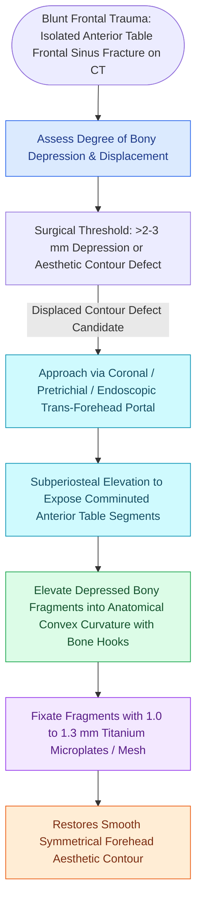

# Isolated anterior table frontal sinus fractures require open reduction and microplate fixation for contour restoration

## Active Recall

> [!question]- What is the critical clinical and radiological displacement threshold for surgical intervention in isolated anterior table frontal sinus fractures?
> *Answer / Clinical Rationale*: **Displacement exceeding $1\text{ to }2\text{ mm}$ or one table width**, causing visible forehead contour depression, aesthetic deformity, or fracture mobility on palpation. Non-displaced fractures ($<1\text{–}2\text{ mm}$) without contour depression are managed conservatively.

> [!question]- What surgical exposure corridor provides the most versatile, aesthetic access to the anterior frontal table while protecting the facial nerve?
> *Answer / Clinical Rationale*: The **coronal (bicoronal) incision** placed $3\text{–}5\text{ cm}$ behind the anterior hairline. Dissection proceeds in the subgaleal plane to $2\text{–}3\text{ cm}$ above the supraorbital rims, where the periosteum is sharply incised to enter a subperiosteal plane—protecting the **frontal branch of the facial nerve** traveling within the temporoparietal fascia (TPF).

> [!question]- What internal rigid fixation hardware is utilized to stabilize reduced anterior table bone fragments?
> *Answer / Clinical Rationale*: **Low-profile $1.0\text{–}1.3\text{ mm}$ titanium microplates or pre-curved mesh**, secured with self-drilling monocortical screws ($3\text{–}4\text{ mm}$ length), because thicker miniplates are easily palpable and visible through the thin forehead skin.

## Core Clinical & Mechanistic Principles
The **anterior table of the frontal bone** is an exceptionally thick cortical barrier ($4\text{–}12\text{ mm}$ thick) requiring substantial blunt kinetic force ($800\text{–}1,600\text{ lbs}$) to fracture:

- **Pathophysiology & Indications**:
  - *Isolated Anterior Table Injury*: Involves the convex forehead aesthetic unit without involvement of the posterior cortical wall, dural integrity, or nasofrontal outflow tract (NFOT).
  - *Consequences of Non-Operative Neglect*: Displaced fragments heal with permanent, disfiguring forehead flattening, localized concavity, contour shadows, and visible bony step-offs.
  - *Late Camouflage Alternatives*: Delayed unreduced defects require alloplastic contouring using porous polyethylene (Medpor®), custom PEEK implants, or calcium phosphate osteoconductive bone cements.

### Operative Technique & Craft Nuance
1. **Exposure & Dissection**:
   - Perform a zig-zag coronal incision in the hair-bearing scalp.
   - Elevate the scalp flap anteriorly in the loose areolar tissue plane (subgaleal).
   - Switch to a **subperiosteal plane $2\text{–}3\text{ cm}$ superior to the orbital rims** to protect the supraorbital/supratrochlear neurovascular bundles and the [[Pitanguy's line defines the danger zone for the frontal branch of the facial nerve|frontal branch]] of $\text{CN VII}$.
2. **Reduction Craft**:
   - Drill a small pilot hole in the central depressed fragment and place a **corkscrew, Carroll-Girard screw, or bone hook** deep to the edge to elevate and disimpact the fragment outward.
   - Preserve all osteoperiosteal attachments where possible to optimize bone viability.
3. **Rigid Fixation**:
   - Reconstruct the bone fragments like a 3D jigsaw puzzle.
   - Span the fracture lines with low-profile $1.0\text{–}1.3\text{ mm}$ titanium microplates or a contoured micro-mesh sheet.
   - Redrape periosteum and perform layered galeal closure to prevent hardware exposure.

## Connected Concepts & Graph Traversal
- **Posterior Table & Outflow Correlate**: [[Displaced posterior table frontal sinus fractures and nasofrontal outflow injury require obliteration or cranialization|Posterior Table Fractures & Obliteration]]
- **Facial Nerve Frontal Branch Safety**: [[Pitanguy's line defines the danger zone for the frontal branch of the facial nerve|Pitanguy Line & Frontal Branch]]
- **CMF Buttress Fixation**: [[Zygomaticomaxillary complex fractures disrupt four buttress articulations requiring multi-point reduction|ZMC Buttress Fixation]]
- **Orbital Reconstruction**: [[Orbital floor blowout fractures with muscle entrapment or significant enophthalmos mandate reconstruction|Orbital Floor Reconstruction]]
- **🔗 Endoscopic Frontal Corridor (Sinus)**: [[Draf III modified Lothrop unites both frontal sinuses into a common cavity|Endoscopic Draf III Lothrop]]
