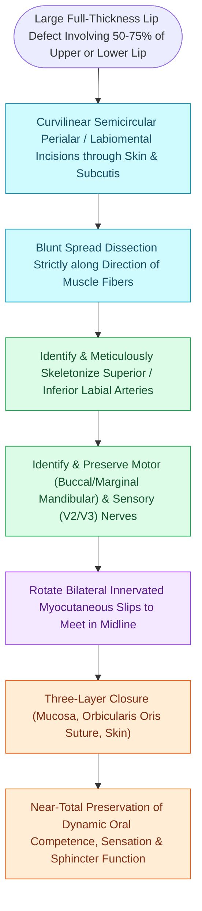

# Karapandzic orbicularis oris myocutaneous rotation flaps preserve oral sphincter innervation

## Active Recall

> [!question]- What is the principal functional advantage of a Karapandzic flap over non-innervated fan flaps?
> *Answer / Clinical Rationale*: It **preserves dynamic oral competence, motor sphincter function, and sensation** by maintaining the continuity of the facial vessels, buccal/marginal mandibular motor nerves, and mental nerves.

> [!question]- What is the primary anatomical trade-off associated with the Karapandzic flap for large lip defects?
> *Answer / Clinical Rationale*: **Microstomia** (narrowing of the oral aperture), which may require secondary commissuroplasty.

## Core Clinical & Mechanistic Principles
The **Karapandzic Flap** is a circumoral myocutaneous rotation-advancement flap designed to [[Gilles fan flaps and Webster-Bernard cheek advancements reconstruct large lower lip defects|reconstruct]] large **lower lip defects spanning $50\text{ to }80\%$ of the total lip length**.

Its revolutionary biomechanical advantage is the **preservation of the neurovascular pedicles (facial arteries and buccal/marginal mandibular motor nerves)**, maintaining dynamic oral sphincter competence.

### Management of Microstomia
- Microstomia frequently results from tissue recruitment. If severe, secondary **commissuroplasty (Dieffenbach or Converse procedure)** is performed at 3–6 months.

## Connected Concepts & Graph Traversal
- **Cross-Lip Flaps**: [[Abbe and Estlander cross-lip flaps are pedicled on the labial artery to repair lip defects|Abbe & Estlander Flaps]]
- **Alternative Lip Flaps**: [[Gilles fan flaps and Webster-Bernard cheek advancements reconstruct large lower lip defects|Gilles & Webster Flaps]]
- **Vascular Pedicle**: [[The facial artery and facial vein provide the primary vascular supply to the anterior face|Facial Artery Anatomy]]
- **Reconstructive Ladder**: [[Near-total lip reconstruction combines functional local muscle flaps with microvascular free flaps|Near-Total Lip Reconstruction]]
- **Sphincter Preservation Alternative**: [[Oral commissure reconstruction balances single-stage Estlander transpositions against staged commissuroplasty to prevent microstomia and incontinence|Oral Commissure Reconstruction]]
