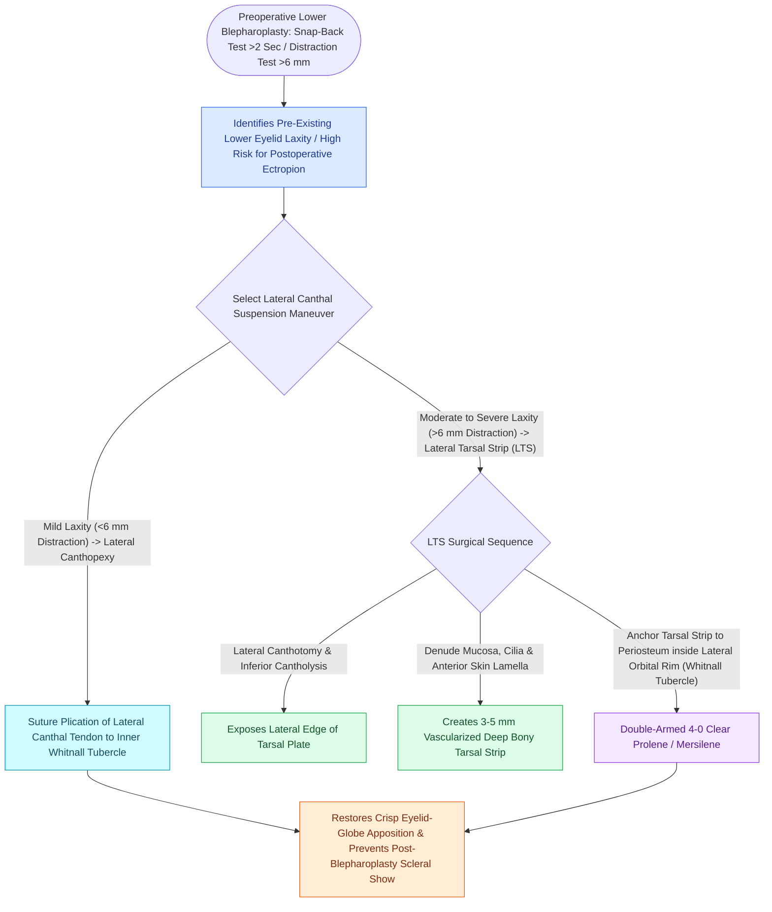

# Lateral canthopexy and lateral tarsal strip suspension prevent post-blepharoplasty ectropion

## Active Recall

> [!question]- Where on the lateral orbital rim must the lateral tarsal strip be anchored to ensure proper globe apposition?
> *Answer / Clinical Rationale*: To the **inner (posterior) aspect of the lateral orbital rim at Whitnall's tubercle**, approximately **$2\text{–}4\text{ mm}$ superior to the [[Naso-orbito-ethmoid NOE fractures staged by Markowitz and Manson require medial canthal tendon fixation|medial canthal tendon]]**, maintaining posterior vector contact with the cornea.

> [!question]- What findings on physical exam indicate the need for a lateral tarsal strip during lower blepharoplasty?
> *Answer / Clinical Rationale*: A positive **snap-back test** (slow, delayed return of lid to globe without blinking) and a **distraction test $>6\text{ mm}$**.

## Core Clinical & Mechanistic Principles
Lower eyelid malposition (**ectropion, eyelid retraction, and scleral show**) is the most common serious complication of [[Lower blepharoplasty addresses fat herniation while preserving the inferior oblique muscle|lower blepharoplasty]]. It results from unrecognized pre-existing lower eyelid laxity combined with middle lamellar scar contracture.

Preoperative assessment requires the **Snap-Back Test** and **Distraction Test ($>6\text{ mm}$ indicates severe laxity)**.

### Whitnall's Tubercle Anchoring Rule
- The lateral tarsal strip must be fixed to the **inner (posterior) aspect of the lateral orbital rim at Whitnall's tubercle** ($2\text{–}4\text{ mm}$ superior to the medial canthus).
- Fixing the tendon to the anterior rim surface results in an anterior vector that displaces the eyelid away from the globe, causing persistent tearing and [[Upper blepharoplasty requires precise skin crease marking to avoid lagophthalmos|lagophthalmos]].

## Connected Concepts & Graph Traversal
- **Blepharoplasty**: [[Lower blepharoplasty addresses fat herniation while preserving the inferior oblique muscle|Lower Blepharoplasty]]
- **Paralysis Protection**: [[Upper eyelid platinum weights and lateral tarsal strips protect the cornea in flaccid facial paralysis|Paralysis Corneal Protection]]
- **Trauma Emergency**: [[Acute retrobulbar hematoma in facial trauma requires immediate bedside lateral canthotomy|Lateral Canthotomy in Trauma]]
- **High-Stakes Safety**: [[Post-blepharoplasty retrobulbar hematoma requires immediate bedside decompression to prevent blindness|Post-Blepharoplasty Retrobulbar Hematoma]]
- **Complication Rescue**: [[Cheek flap reconstruction requires deep periosteal suspension to the orbital rim and lateral retinaculum to prevent lower eyelid retraction and ectropion|Periosteal Suspension for Ectropion Prevention]]
- **Anatomical Foundation**: [[Hughes tarsoconjunctival flaps reconstruct extensive lower eyelid defects using upper eyelid posterior lamella sharing|Hughes Tarsoconjunctival Flap]]
- **Surgical Craft**: [[Mustarde cheek rotation flaps advance malar skin for total lower eyelid anterior lamella reconstruction|Mustarde Cheek Rotation Flap]]
- **Diagnostic Assessment**: [[Tenzel semicircular rotation flaps mobilize temporal tissue for intermediate full-thickness eyelid defect closure|Tenzel Semicircular Flap]]
