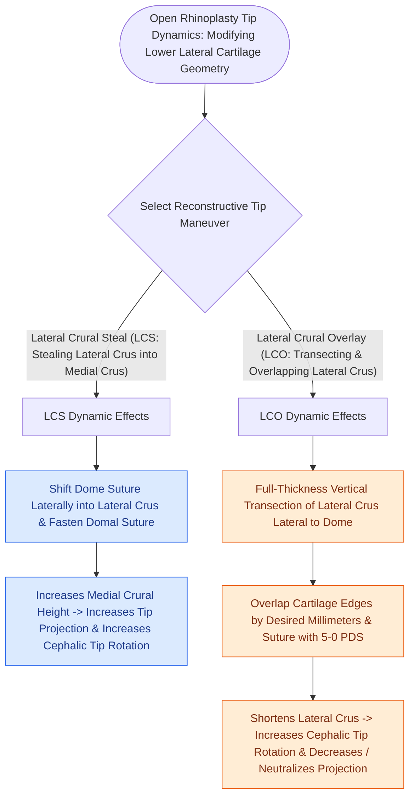

# Lateral crural steal and overlay maneuvers dynamically modify tip rotation and projection

## Active Recall

> [!question]- What is the fundamental difference in mechanism and outcome between a lateral crural steal and a lateral crural overlay?
> *Answer / Clinical Rationale*: A **steal** is a non-destructive suture technique that borrows lateral crus to lengthen the medial crura, **increasing projection and rotation**. An **overlay** divides and overlaps the lateral crus, **shortening the lateral leg to increase rotation while de-projecting the tip**.

> [!question]- Which maneuver is indicated for an over-projected, under-rotated nasal tip ("Pinocchio nose")?
> *Answer / Clinical Rationale*: A **lateral crural overlay** (often combined with medial crural overlay or tongue-in-groove setback).

## Core Clinical & Mechanistic Principles
Suture and division techniques on the lower lateral cartilages allow predictable, millimeter-level modifications of nasal tip **projection** and **rotation** based on the Anderson tripod theory.

### Step-by-Step Technical Execution
1. **Lateral Crural Steal**:
   - Elevate vestibular skin off the underside of the intermediate and lateral crura.
   - Place a horizontal mattress suture (5-0 PDS or [[Monofilament versus braided absorbable and non-absorbable sutures have distinct tissue reactivity|Prolene]]) lateral to the existing tip-defining dome, incorporating lateral crus into the medial crural pillar.
   - Result: Lengthens the medial leg of the tripod while shortening the lateral leg  $\r\r\rightarrow$ **Increases [[Goode's ratio and nasolabial angles define standard aesthetic nasal tip proportions|tip projection]] and cephalic rotation**.
2. **Lateral Crural Overlay**:
   - Divide the lateral crus at its midpoint.
   - Overlap the cut cartilage ends by $2\text{–}4\text{ mm}$ and fix with 5-0 horizontal mattress sutures.
   - Result: Shortens the lateral leg without lengthening the medial leg  $\r\r\rightarrow$ **Increases cephalic rotation while de-projecting the tip**.

## Connected Concepts & Graph Traversal
- **Tripod Theory**: [[The Anderson tripod theory governs nasal tip projection, rotation, and support dynamics|Anderson Tripod Theory]]
- **Rigid Alternative**: [[Tongue-in-groove and septal extension grafts provide rigid columellar and tip stabilization|Tongue-in-Groove]]
- **Valve Support**: [[Alar batten and lateral crural strut grafts prevent external nasal valve inspiratory collapse|Lateral Crural Strut Grafts]]
- **Anatomical Foundation**: [[Cephalic trim of lower lateral cartilages must preserve at least six millimeters of lateral crus|Cephalic Trim 6-mm Rule]]
- **High-Stakes Safety**: [[Pollybeak deformities arise from cartilaginous over-projection or supratip soft tissue fibrosis|Pollybeak Deformity]]
- **Surgical Craft**: [[Spreader grafts restore internal nasal valve patency and prevent inverted-V deformity|Spreader Grafts]]
