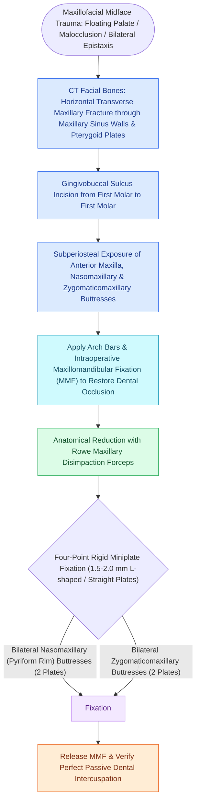

# Le Fort I fractures separate the hard palate and require bilateral buttress plate fixation

## Active Recall

> [!question]- What is the mandatory first step before applying rigid fixation plates to a Le Fort I fracture?
> *Answer / Clinical Rationale*: Placing the patient into **Maxillomandibular Fixation (MMF)** to accurately re-establish native dental occlusion before plating the buttresses.

> [!question]- Which vertical facial buttresses are plated during Le Fort I repair?
> *Answer / Clinical Rationale*: The **bilateral nasomaxillary (medial/piriform) buttresses** and **bilateral zygomaticomaxillary (lateral) buttresses** (4-point fixation).

## Core Clinical & Mechanistic Principles
Described by René Le Fort in 1901, the **Le Fort I (Guerin / Horizontal Maxillary) fracture** separates the alveolar process and hard palate from the upper midface skeleton.

### AO Rigid Internal Fixation Protocol
1. **Maxillomandibular Fixation (MMF / IMF)**:
   - The first and non-negotiable step is placing the patient into MMF (using [[Maxillomandibular fixation MMF using arch bars, hybrid systems, and IMF screws re-establishes occlusion|Erich arch bars]], hybrid MMF, or IMF screws) to **re-establish the patient's pre-morbid dental occlusion**.
2. **Four-Buttress Fixation**:
   - Expose the anterior maxilla via a maxillary gingivobuccal sulcus incision.
   - Plate the bilateral **nasomaxillary (piriform aperture) buttresses** and bilateral **zygomaticomaxillary buttresses** using four $1.5\text{–}2.0\text{ mm}$ L-shaped or straight plates.
3. **Release MMF & Verify Occlusion**:
   - Release MMF wires intraoperatively to confirm reproducible, passive dental intercuspation.

## Connected Concepts & Graph Traversal
- **Complex Patterns**: [[Le Fort II pyramidal and Le Fort III craniofacial disjunction fractures disrupt facial buttresses|Le Fort II & III]]
- **ZMC Fractures**: [[Zygomaticomaxillary complex fractures disrupt four buttress articulations requiring multi-point reduction|ZMC Fractures]]
- **Mandible Fixation**: [[Champy lines of ideal osteosynthesis dictate monocortical miniplate fixation along mandibular tension zones|Champy's Principle]]
- **Anatomical Foundation**: [[Maxillomandibular fixation MMF using arch bars, hybrid systems, and IMF screws re-establishes occlusion|Maxillomandibular Fixation (MMF / IMF)]]
- **Surgical Craft**: [[Mandible fractures require anatomical reduction and load-sharing miniplate fixation along Champy lines of ideal osteosynthesis|Mandible Fractures]]
