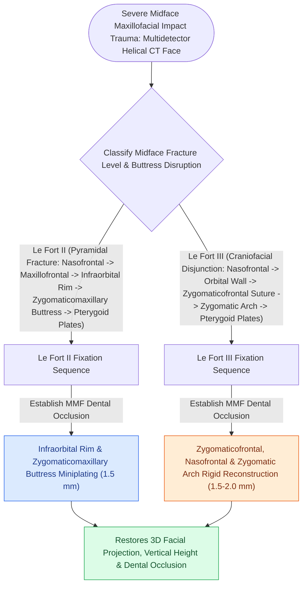

# Le Fort II pyramidal and Le Fort III craniofacial disjunction fractures disrupt facial buttresses

## Active Recall

> [!question]- What anatomical feature distinguishes a Le Fort III fracture from a Le Fort II fracture?
> *Answer / Clinical Rationale*: A **Le Fort III involves the zygomatic arches and zygomaticofrontal (ZF) sutures**, causing complete craniofacial disjunction, whereas a Le Fort II travels below the zygoma through the inferior orbital rim and ZMC buttress.

> [!question]- What is the reconstructive sequence rule for fixing high-energy panfacial / Le Fort III fractures?
> *Answer / Clinical Rationale*: Reconstruct from the **stable outer skull base boundaries inward and downward** (ZF suture  $\r\r\rightarrow$ arch  $\r\r\rightarrow$ nasofrontal  $\r\r\rightarrow$ maxilla) with dental occlusion established in MMF.

## Core Clinical & Mechanistic Principles
High-energy midface blunt trauma results in complex structural fractures that disrupt the vertical and horizontal craniofacial buttresses.

### AO Sequencing: Reconstructing "Outside-In and Top-Down"
1. **Restore Occlusion**: Apply [[Maxillomandibular fixation MMF using arch bars, hybrid systems, and IMF screws re-establishes occlusion|MMF]] to establish dental base.
2. **Reconstruct from Stable Skull Base Inward (Le Fort III)**:
   - (1) Fix Zygomaticofrontal (ZF) sutures  $\r\r\rightarrow$ (2) Fix Zygomatic arches to restore facial width/projection  $\r\r\rightarrow$ (3) Fix Nasofrontal junction  $\r\r\rightarrow$ (4) Fix ZMC buttresses  $\r\r\rightarrow$ (5) Reconstruct orbital walls.

## Connected Concepts & Graph Traversal
- **Horizontal Maxilla**: [[Le Fort I fractures separate the hard palate and require bilateral buttress plate fixation|Le Fort I Fixation]]
- **ZMC Component**: [[Zygomaticomaxillary complex fractures disrupt four buttress articulations requiring multi-point reduction|ZMC Tetrapod Fracture]]
- **Orbital Reconstruction**: [[Orbital floor blowout fractures with muscle entrapment or significant enophthalmos mandate reconstruction|Orbital Wall Repair]]
- **Diagnostic Evaluation**: [[Champy lines of ideal osteosynthesis dictate monocortical miniplate fixation along mandibular tension zones|Champy's Principle of Osteosynthesis]]
- **Anatomical Foundation**: [[Maxillomandibular fixation MMF using arch bars, hybrid systems, and IMF screws re-establishes occlusion|Maxillomandibular Fixation (MMF / IMF)]]
