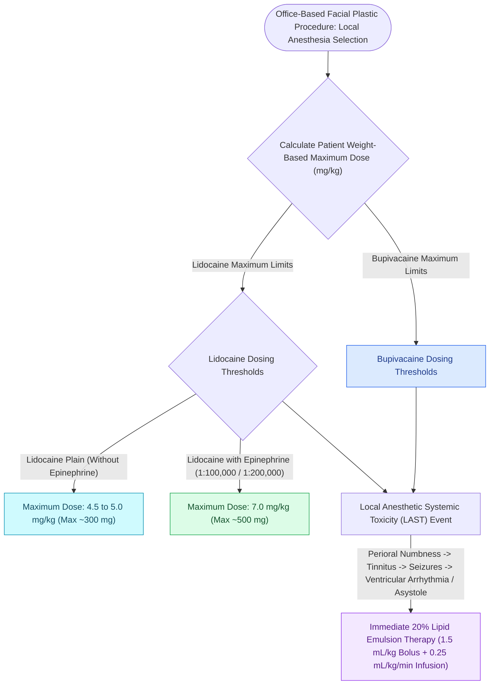

# Local anesthetic pharmacology and epinephrine limits govern safe office-based facial surgery

## Active Recall

> [!question]- What is the maximum safe dose of 1% lidocaine with 1:100,000 epinephrine in a 70-kg adult?
> *Answer / Clinical Rationale*: **$7.0\text{ mg/kg} \times 70\text{ kg} = 490\text{ mg}$** (approximately **$49\text{ mL}$** of 1% lidocaine).

> [!question]- What is the antidote and resuscitation protocol for cardiac arrest induced by local anesthetic systemic toxicity (LAST)?
> *Answer / Clinical Rationale*: **20% Intravenous Lipid Emulsion (Intralipid)** bolus ($1.5\text{ mL/kg}$) followed by continuous infusion to act as a "lipid sink" and extract lipophilic anesthetic molecules from myocardial tissue.

## Core Clinical & Mechanistic Principles
Safe office-based and operating room [[Pitanguy's line defines the danger zone for the frontal branch of the facial nerve|facial]] surgery requires strict adherence to **maximum weight-based local anesthetic dosing limits** to prevent **Local Anesthetic Systemic Toxicity (LAST)**.

### Comparative Pharmacodynamics & Duration of Action
Understanding relative durations of action guides agent selection and re-dosing safety:
- **Lidocaine (Short-Acting Standard)**:
  - *Plain Lidocaine*: The **shortest-acting** commonly used local anesthetic, with a duration of action of only **$30–60\text{ minutes}$** due to brisk local vasodilatation and rapid systemic absorption.
  - *Lidocaine with Epinephrine ($1:100,000$)*: Local vasoconstriction dramatically slows systemic clearance, extending clinical duration of action to **$120–360\text{ minutes}$ ($2–6\text{ hours}$)** while reducing peak serum levels.
- **Bupivacaine (Marcaine - Long-Acting Standard)**:
  - Highly lipophilic with $>95\%$ protein binding; represents the **longest-acting** commonly used local anesthetic, providing **$180–420\text{ minutes}$ ($3–7\text{ hours}$)** of effective sensory blockade (ideal for postoperative analgesia).

### Drug-Induced Methemoglobinemia (Benzocaine & Prilocaine)
- **Pathophysiological Mechanism**:
  - Exposure to **topical benzocaine spray** (frequently used for awake flexible endoscopy) or **prilocaine** (via its active hepatic metabolite *o-toluidine*) oxidizes normal ferrous iron ($\text{Fe}^{2+}$) in hemoglobin into ferric iron ($\text{Fe}^{3+}$), forming **methemoglobin**.
  - Ferric iron cannot bind oxygen, while simultaneously shifting the oxygen-hemoglobin dissociation curve to the left, severely impairing peripheral oxygen delivery.
- **Clinical Presentation & The Pulse Oximetry Trap**:
  - Manifests as cyanosis unresponsive to high-flow supplemental oxygen, chocolate-brown arterial blood, fatigue, and dyspnea.
  - *Diagnostic Hallmark*: The standard dual-wavelength pulse oximeter reads an absorption ratio of 1.0, causing the **oxygen saturation ($S_pO_2$) to remain fixed at approximately $85\%$**, regardless of the true arterial $P_aO_2$ (co-oximetry blood gas is mandatory for accurate diagnosis).
- **Emergency Antidote**:
  - Administer **intravenous Methylene Blue ($1–2\text{ mg/kg}$ IV over 5 minutes)**, which acts as an electron donor to NADPH-methemoglobin reductase, rapidly converting methemoglobin back to functional hemoglobin.

### Local Anesthetic Systemic Toxicity (LAST) Sequence
1. **Initial Symptoms**: Perioral numbness, metallic taste, tinnitus, lightheadedness, visual disturbances.
2. **CNS Toxicity**: Muscle twitching, confusion, **grand mal seizures**, and coma.
3. **Cardiovascular Toxicity**: Severe conduction block, refractory ventricular arrhythmias, and asystole (especially pronounced with **Bupivacaine** due to high lipid solubility and slow myocardial dissociation).
4. **Definitive Treatment**: Airway management, seizure control (Benzodiazepines), and **Immediate 20% Intravenous Lipid Emulsion (Intralipid)** rescue bolus ($1.5\text{ mL/kg}$ over 1 minute) + continuous infusion ($0.25\text{ mL/kg/min}$).

## Connected Concepts & Graph Traversal
- **🔗 Emergency Rescue / LAST Protocol (Laryngology)**: [[Local anesthetic systemic toxicity LAST is managed with airway stabilization and twenty percent intravenous lipid emulsion|20% Intravenous Lipid Emulsion Protocol]]
- **Anatomical Foundation / Sensory Blocks**: [[Erb's point and the cervical plexus provide somatic sensory innervation to the head and neck|Cervical Plexus Innervation & Erb's Point]]
- **Facial Nerve Danger Planes**: [[Pitanguy's line defines the danger zone for the frontal branch of the facial nerve|Frontal Branch Danger Plane]]
- **Tumescent Infiltration Craft**: [[Deep-plane rhytidectomy mobilizes the skin and SMAS as a composite flap across retaining ligaments|Facelift Tumescent Infiltration & Hydrodissection]]
- **🔗 Rhinology Hemostasis & Local Blocks (Sinus)**: [[TIVA and greater palatine canal blocks optimize surgical field visibility in FESS|Greater Palatine Canal & Sphenopalatine Blocks]]
