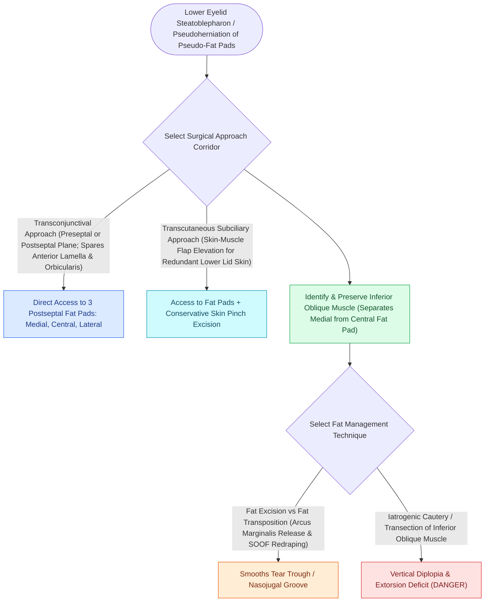

# Lower blepharoplasty addresses fat herniation while preserving the inferior oblique muscle

## Active Recall

> [!question]- What extraocular muscle separates the medial and central fat compartments of the lower eyelid?
> *Answer / Clinical Rationale*: The **inferior oblique muscle**. It must be identified and protected during fat transposition or excision to prevent postoperative diplopia.

> [!question]- Why is transconjunctival fat transposition preferred over aggressive fat resection in patients with prominent tear trough deformities?
> *Answer / Clinical Rationale*: Fat transposition uses the patient's native vascularized fat to fill the hollow tear trough valley, avoiding a hollowed, skeletonized orbital appearance.

## Core Clinical & Mechanistic Principles
Lower blepharoplasty manages pseudoherniated orbital fat, tear trough deformities, and skin redundancy through **Transconjunctival** or **Subciliary (Transcutaneous)** approaches.

### Transconjunctival Fat Transposition (Hamra / Loeb)
- **Tear Trough Effacement**: Instead of aggressive fat excision (which causes an aged, hollow "skeletonized" orbit), the medial and central fat pads are mobilized and **transposed subperiosteally across the inferior orbital rim** over the tear trough / [[Endoscopic browlift releases the conjoint tendon and arcus marginalis along the supraorbital rim|arcus marginalis]].
- **Transcutaneous Warning**: Subciliary skin-muscle flaps carry a much higher risk of **cicatricial ectropion** due to middle lamellar scarring compared to transconjunctival approaches.

## Connected Concepts & Graph Traversal
- **Upper Lid**: [[Upper blepharoplasty requires precise skin crease marking to avoid lagophthalmos|Upper Blepharoplasty]]
- **Ectropion Shield**: [[Lateral canthopexy and lateral tarsal strip suspension prevent post-blepharoplasty ectropion|Lateral Tarsal Strip]]
- **Trauma Parallel**: [[Pediatric white-eyed blowout fractures cause muscle entrapment requiring emergent surgical release|Orbital Trauma & Inferior Rectus]]
- **High-Stakes Safety**: [[Post-blepharoplasty retrobulbar hematoma requires immediate bedside decompression to prevent blindness|Post-Blepharoplasty Retrobulbar Hematoma]]
- **Anatomical Foundation**: [[Hughes tarsoconjunctival flaps reconstruct extensive lower eyelid defects using upper eyelid posterior lamella sharing|Hughes Tarsoconjunctival Flap]]
- **Surgical Craft**: [[Tenzel semicircular rotation flaps mobilize temporal tissue for intermediate full-thickness eyelid defect closure|Tenzel Semicircular Flap]]
- **Disease Mechanism Differential**: [[Blepharochalasis causes episodic painless eyelid edema leading to atrophic skin laxity, orbital fat pseudoherniation, and secondary ptosis|Blepharochalasis]]
