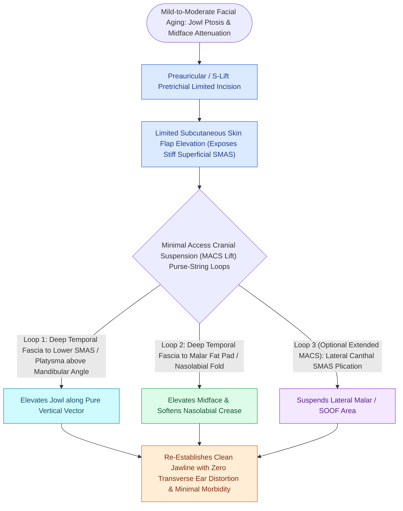

# MACS lift and SMAS plication provide vertical vector elevation via suspension purse-string sutures

## Active Recall

> [!question]- What rigid anatomical structure serves as the superior anchor for MACS lift purse-string sutures?
> *Answer / Clinical Rationale*: The **deep temporal fascia (DTF) proper**, $1.0\text{ cm}$ superior to the zygomatic arch.

> [!question]- What vector of elevation is prioritized in the MACS lift compared to traditional lateral SMASectomy?
> *Answer / Clinical Rationale*: A **strictly vertical (cranial) vector**, directly counteracting gravity and preventing the "windblown" lateral pull of older techniques.

## Core Clinical & Mechanistic Principles
The **Minimal Access Cranial Suspension (MACS) Lift** (developed by Tonnard and Verpaele) utilizes **pure vertical vector purse-string suspension sutures** anchored to the deep temporal fascia to elevate the jowls, malar fat pad, and neck through a short preauricular incision without extensive sub-[[High-SMAS rhytidectomy extends dissection above the zygomatic arch to rejuvenate the midface|SMAS]] dissection.

### MACS Lift vs Deep-Plane Rhytidectomy
- **MACS Lift / Plication**: Folded SMAS-on-SMAS without ligament release; shorter operative time and lower nerve risk; excellent for mild-to-moderate laxity.
- **Deep-Plane Rhytidectomy**: Releases zygomatic and masseteric retaining ligaments; provides superior, tension-free midface and jowl mobilization (see [[Deep-plane rhytidectomy mobilizes the skin and SMAS as a composite flap across retaining ligaments|Deep-Plane Rhytidectomy]]).

## Connected Concepts & Graph Traversal
- **Deep-Plane Alternative**: [[Deep-plane rhytidectomy mobilizes the skin and SMAS as a composite flap across retaining ligaments|Deep-Plane Rhytidectomy]]
- **Ligament Anatomy**: [[Facial retaining ligaments require surgical release to mobilize ptotic midface tissues|Facial Retaining Ligaments]]
- **Neck Rejuvenation**: [[Corset platysmaplasty and lateral suspension restore the youthfulness of the cervicomental angle|Platysmaplasty]]
- **Diagnostic Evaluation**: [[Composite chondrocutaneous auricular graft transfers reconstruct complex alar and helical defects|Composite Auricular Graft]]
- **Anatomical Foundation**: [[High-SMAS rhytidectomy extends dissection above the zygomatic arch to rejuvenate the midface|High-SMAS Technique (Fritz Barton)]]
