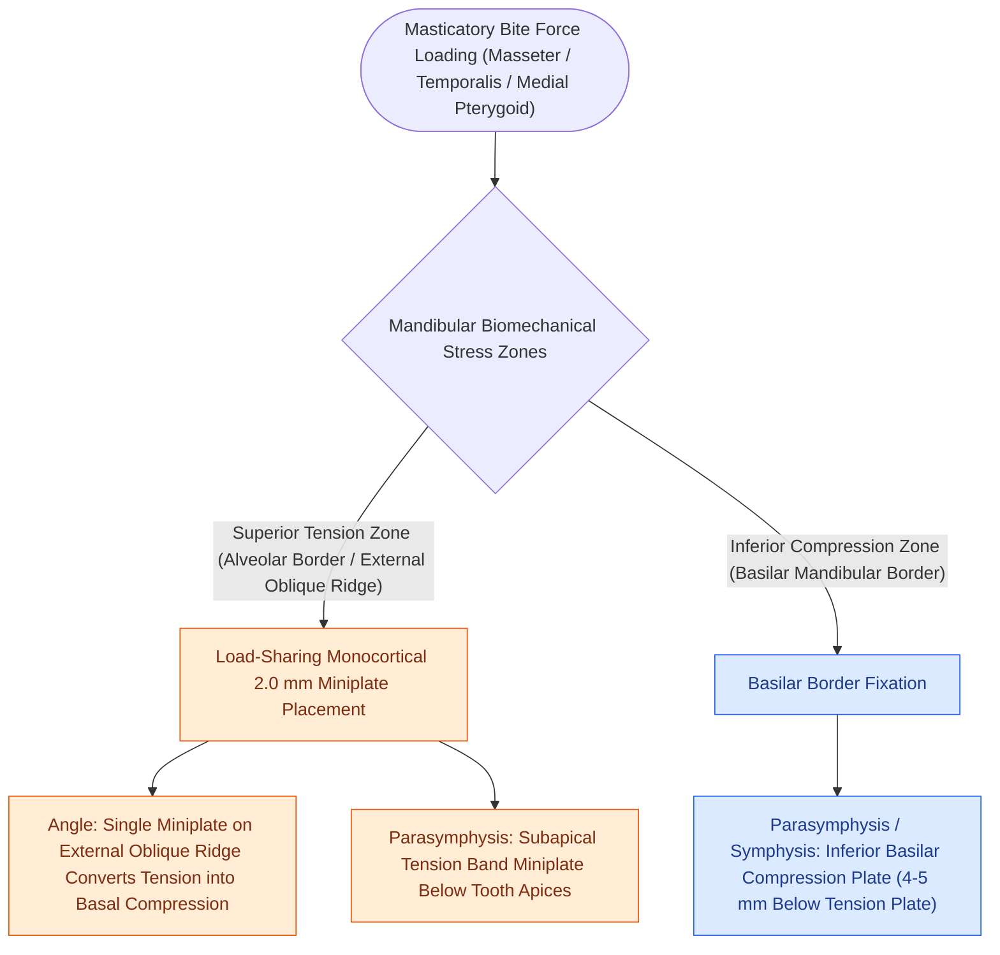
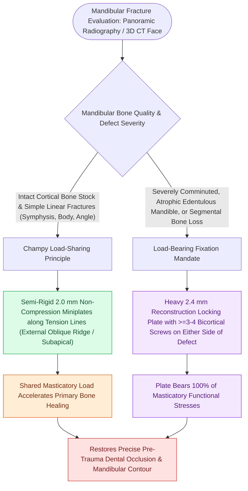

# Mandible fractures require anatomical reduction and load-sharing miniplate fixation along Champy lines of ideal osteosynthesis

## Active Recall

> [!question]- Why does Champy's biomechanical principle permit the use of a single, monocortical 2.0 mm miniplate to stabilize an isolated mandibular angle fracture?
> *Answer / Clinical Rationale*: Fixation along the **external oblique ridge** places the miniplate precisely along the **primary tension line** of the mandible. When the patient bites, masticatory muscle vectors create tension along this superior plate; because the superior plate resists tension, the natural bite force is mechanically converted into compression across the basilar border, stabilizing the fracture without requiring a bulky inferior plate.

> [!question]- What anatomical structure exiting between the mandibular premolars must be meticulously visualized and protected during parasymphyseal fracture exposure?
> *Answer / Clinical Rationale*: The **mental nerve** (terminal sensory branch of the inferior alveolar nerve / CN $V_3$), which exits the mental foramen between the first and second premolars to provide sensation to the lower lip and chin.

## Core Clinical & Mechanistic Principles

**Mandibular fractures** are the second most common facial fracture, occurring in predictable anatomic distributions: **condyle / subcondyle** (25–35%), **angle** (25–30%), **parasymphysis / symphysis** (15–20%), **body** (10–15%), and ramus/coronoid (<5%). Because the mandible is a rigid horseshoe-shaped ring articulating bilaterally at the temporomandibular joints, a fracture at one site frequently correlates with a secondary fracture on the contralateral side (e.g., parasymphysis fracture combined with contralateral angle or subcondylar fracture).

Biomechanical loading of the mandible creates distinct internal stress distribution:
- **Tension Zone**: Located superiorly along the **alveolar border and external oblique ridge**. During mastication, masseter, medial pterygoid, and temporalis muscle vectors pull the superior border apart.
- **Compression Zone**: Located inferiorly along the **basilar border of the mandible**.

**Champy's Principles of Ideal Osteosynthesis (1975)** establish that non-rigid, load-sharing [[Champy lines of ideal osteosynthesis dictate monocortical miniplate fixation along mandibular tension zones|monocortical miniplates]] (2.0 mm systems) placed along the anatomical **lines of tension** utilize physiologic masticatory muscle forces to convert distracting tension into natural bone compression at the basilar border:
- **Symphysis & Parasymphysis**: Two miniplates are required (a superior tension-band plate placed below tooth roots, and an inferior compression plate 4–5 mm below the first).
- **Angle**: A single monocortical 2.0 mm miniplate placed on the superior tension border along the **external oblique ridge** (transorally).
- **Body**: A tension band plate (or arch bar) superiorly, and a 2.0 mm miniplate along the inferior border.

### Surgical Technique & Craft Nuance: MMF, Reduction, & Fixation

1. **Maxillomandibular Fixation (MMF)**: The bedrock initial step for all dentate mandible fractures. Re-establishing the patient's pre-morbid **dental occlusion** is the ultimate anatomical guide:
   - Apply [[Maxillomandibular fixation MMF using arch bars, hybrid systems, and IMF screws re-establishes occlusion|Erich arch bars]] with 24- or 26-gauge circumdental stainless steel wires, or use rapid MMF hybrid screw systems.
   - Secure the maxillary and mandibular arches in tight centric occlusion using intermaxillary wire loops or elastics.
2. **Transoral Surgical Exposure**:
   - **Angle Fractures**: Incise the gingivobuccal mucosa over the external oblique ridge from the anterior border of the ascending ramus down to the second molar. Elevate a subperiosteal flap.
   - **Parasymphysis / Symphysis**: Incise the lower labial vestibule 5 mm from the mucogingival junction, leaving a generous mucosal cuff for two-layer watertight closure. Identify and preserve the **mental nerve** exiting the mental foramen below the premolar apices.
3. **Plating Craft & Screw Rules**:
   - Place a monocortical **2.0 mm titanium miniplate** secured with monocortical 6 mm screws along the external oblique ridge for angle fractures.
   - For parasymphysis fractures, place the superior plate monocortically below the apices of the canine and incisor roots, and the inferior plate bicortically along the basal border.
   - Release MMF wires intraoperatively to verify reproducible, smooth occlusion, stable temporomandibular joint seating, and absence of malocclusion or step-offs.
### Key Consultation Supplies
- Coaxial surgical headlight
- Wooden tongue depressors and cheek retractors
- Flexible nasopharyngoscope with video tower (for airway and vocal fold motility evaluation)
- Antifog solution (Fred™)
- Dental explorer and periodontal probe (to assess dental fractures, subluxation, and tooth mobility via Miller classification)
- Erich arch bars, 24- and 26-gauge stainless steel circumdental wires, wire twister, wire cutters, and 2.0 mm intermaxillary fixation (IMF) screws
- Chlorhexidine 0.12% oral rinse

## References
1. Diangelis, A.J., Andreasen, J.O., Ebeleseder, K.A., et al. (2012). Guidelines for the management of traumatic dental injuries: 1. Fractures and luxations of permanent teeth. *Dent Traumatol*, 28:2-12.
2. Ellis III, E., Schubert, W. (2020). Mandible Fractures. *AO Foundation Surgery Reference*.
3. Kellman, R.M. (2020). Maxillofacial Trauma. In Flint, P.W., et al. (Eds.), *Cummings Otolaryngology Head and Neck Surgery* 7e (pp. 286-310). Philadelphia, PA: Elsevier.
4. Miles, B.A., Smith, J.E. (2013). Mandibular Fractures. In Johnson, J.J., Rosen, C.A. (Eds.), *Bailey’s Head and Neck Surgery-Otolaryngology* 5e (pp. 1195-1208). Baltimore, MD: Lippincott Williams & Wilkins.
5. Zide, M.F., Kent, J.N. (1983). Indications for open reduction of mandibular condyle fractures. *J Oral Maxillofac Surg*, 41(2):89-98.

## Connected Concepts & Graph Traversal
- **Champy's Foundation**: [[Champy lines of ideal osteosynthesis dictate monocortical miniplate fixation along mandibular tension zones|Champy's Principle & Fixation]]
- **Condylar Fracture Management**: [[Mandibular condyle fractures managed via open versus closed reduction depend on displacement and occlusion|Condylar Fracture Algorithms]]
- **🔗 Free Flap Reconstruction Alternative (Head and Neck)**: [[The fibula osteocutaneous free flap provides up to twenty-five centimeters of vascularized bone for mandible reconstruction|Fibula Free Flap Reconstruction]]
- **Trismus Complication**: [[Coronoidectomy relieves severe trismus caused by temporalis impingement under displaced zygomatic arch|Trismus & Coronoidectomy]]
- **Midface Occlusal Sequencing**: [[Panfacial fracture reconstruction proceeds from known stable peripheral buttresses to central occlusion|Panfacial Sequencing]]
