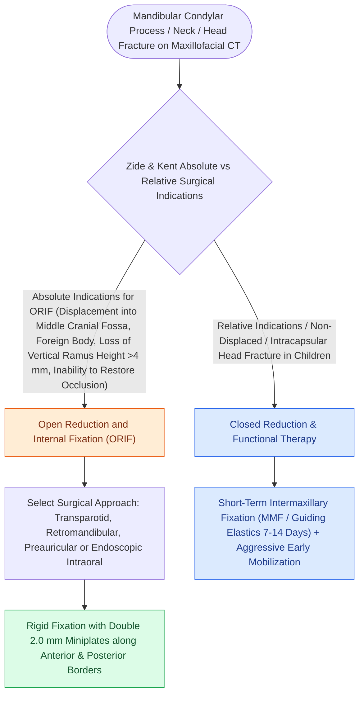

# Mandibular condyle fractures managed via open versus closed reduction depend on displacement and occlusion

## Active Recall

> [!question]- What are the absolute indications for open reduction of a mandibular condyle fracture (Zide and Kent)?
> *Answer / Clinical Rationale*: (1) **Displacement into the middle cranial fossa**, (2) **Lateral extracapsular dislocation**, (3) **Inability to restore dental occlusion with closed MMF**, and (4) **Intra-articular foreign body**.

> [!question]- What surgical approach provides the most direct line-of-sight exposure for subcondylar and condylar neck fractures?
> *Answer / Clinical Rationale*: The **retromandibular (transparotid or retroparotid) approach**, placed parallel to the posterior border of the ramus.

## Core Clinical & Mechanistic Principles
**Mandibular Condyle Fractures** represent **$25\text{–}35\%$ of all mandibular fractures**. Management involves choosing between **Closed Reduction with Maxillomandibular Fixation (MMF)**, **Open Reduction and Internal Fixation (ORIF)** based on **Zide and Kent criteria**, and **Conservative Functional Therapy**:
- **Conservative Protocol (No MMF)**: Undisplaced or minimally displaced condylar head, neck, or subcondylar fractures with normal, reproducible pre-injury dental occlusion and preserved mandibular excursion do not require MMF. They are successfully managed with a **soft/non-chewing diet for 4 to 6 weeks**, analgesia, guided physical therapy, and close weekly occlusal monitoring.
- **Closed Reduction with MMF**: Indicated for minimally displaced fractures with mild occlusal discrepancy, managed with 10–14 days of intermaxillary fixation followed by active range-of-motion therapy to prevent ankylosis.
- **ORIF**: Indicated for absolute Zide and Kent criteria (displacement into the middle cranial fossa, lateral extracapsular dislocation, foreign bodies, or loss of vertical ramus height precluding occlusal restoration).

### Surgical Approaches to the Condyle
- **Preauricular Approach**: For high condylar neck and head [[Panfacial fracture reconstruction proceeds from known stable peripheral buttresses to central occlusion|fractures]].
- **Retromandibular / Transparotid Approach**: Direct line-of-sight to the condylar neck and subcondyle (requires identifying the facial nerve marginal and buccal branches).
- **Submandibular (Risdon) Approach**: For low subcondylar fractures.

## Connected Concepts & Graph Traversal
- **Mandible Fixation**: [[Champy lines of ideal osteosynthesis dictate monocortical miniplate fixation along mandibular tension zones|Champy's Mandible Fixation]]
- **Occlusion Setup**: [[Maxillomandibular fixation MMF using arch bars, hybrid systems, and IMF screws re-establishes occlusion|MMF & Occlusion]]
- **Facial Nerve Safety**: [[The marginal mandibular nerve courses deep to platysma over the facial vessels|Marginal Mandibular Nerve]]
- **Pathological Mechanism**: [[Orbital apex syndrome and superior orbital fissure syndrome manifest with ophthalmoplegia and vision loss|Orbital Apex Syndrome (OAS)]]
- **Diagnostic Evaluation**: [[Coronoidectomy relieves severe trismus caused by temporalis impingement under displaced zygomatic arch|Mandibular Coronoidectomy]]
- **Anatomical Foundation**: [[Panfacial fracture reconstruction proceeds from known stable peripheral buttresses to central occlusion|Panfacial Fracture Sequencing]]
- **Critical Safety / Complication**: [[Osteoradionecrosis of the mandible requires radical bony debridement and vascularized fibula free flap repair|Mandibular Osteoradionecrosis (ORN)]]
- **🔗 Differential Diagnosis (Head & Neck) (Head and Neck)**: [[Internal derangement of the temporomandibular joint is staged by the Wilkes classification from reducing clicking to disc perforation|TMJ Internal Derangement & Wilkes Staging]]
