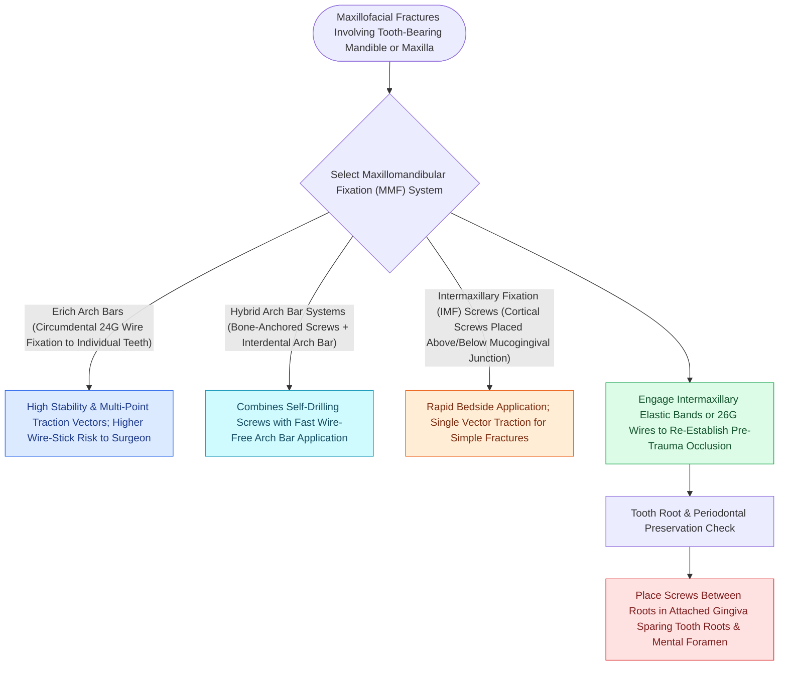

# Maxillomandibular fixation MMF using arch bars, hybrid systems, and IMF screws re-establishes occlusion

## Active Recall

> [!question]- Why must MMF screws be inserted apical to the mucogingival junction?
> *Answer / Clinical Rationale*: To prevent **iatrogenic drill or screw injury to dental roots** and avoid tearing mobile unattached alveolar mucosa.

> [!question]- Why is establishing maxillomandibular fixation mandatory before placing rigid plates across mandibular or Le Fort fractures?
> *Answer / Clinical Rationale*: Dental occlusion is the ultimate spatial template of the lower and midface; plating without MMF leads to **malocclusion and step-off deformities**.

## Core Clinical & Mechanistic Principles
**Maxillomandibular Fixation (MMF / Intermaxillary Fixation / IMF)** is the mandatory foundational first step in craniomaxillofacial trauma surgery, re-establishing the patient’s **pre-morbid dental occlusion (Angle Class I)** prior to applying rigid internal plate fixation.

### The Angle Occlusion Classification
- **Class I (Normal)**: Mesiobuccal cusp of maxillary first molar occludes in the buccal groove of [[Champy lines of ideal osteosynthesis dictate monocortical miniplate fixation along mandibular tension zones|mandibular]] first molar.
- **Class II (Retrognathic / Overjet)**: Mandibular molar occludes distal to maxillary molar.
- **Class III (Prognathic / Underbite)**: Mandibular molar occludes mesial to maxillary molar.

## Connected Concepts & Graph Traversal
- **Mandible Plating**: [[Champy lines of ideal osteosynthesis dictate monocortical miniplate fixation along mandibular tension zones|Champy's Mandible Plating]]
- **Le Fort Fractures**: [[Le Fort I fractures separate the hard palate and require bilateral buttress plate fixation|Le Fort I Fixation]]
- **Condyle Fractures**: [[Mandibular condyle fractures managed via open versus closed reduction depend on displacement and occlusion|Condyle Fractures]]
- **Pathological Mechanism**: [[Orbital apex syndrome and superior orbital fissure syndrome manifest with ophthalmoplegia and vision loss|Orbital Apex Syndrome (OAS)]]
- **Diagnostic Evaluation**: [[Coronoidectomy relieves severe trismus caused by temporalis impingement under displaced zygomatic arch|Mandibular Coronoidectomy]]
- **Anatomical Foundation**: [[Panfacial fracture reconstruction proceeds from known stable peripheral buttresses to central occlusion|Panfacial Fracture Sequencing]]
- **Critical Safety / Complication**: [[Osteoradionecrosis of the mandible requires radical bony debridement and vascularized fibula free flap repair|Mandibular Osteoradionecrosis (ORN)]]
