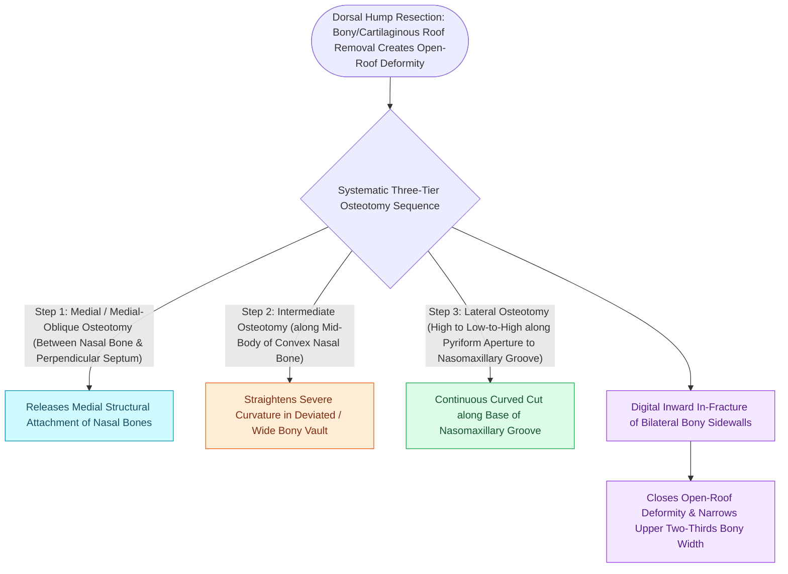

# Medial, intermediate, and lateral osteotomies close open roof deformities after hump resection

## Active Recall

> [!question]- What is an open roof deformity, and how is it surgically corrected?
> *Answer / Clinical Rationale*: It is the flattened, unroofed bony plateau resulting from dorsal hump resection. It is corrected by performing **lateral and medial osteotomies** to medialize the nasal bones and recreate a triangular apex.

> [!question]- Why must lateral osteotomies begin above the anterior insertion of the inferior turbinate?
> *Answer / Clinical Rationale*: To preserve **Webster's triangle** and avoid medializing the inferior turbinate attachment, which would cause severe nasal airway obstruction.

## Core Clinical & Mechanistic Principles
Surgical reduction of a bony dorsal hump unroofs the nasal pyramid, creating a flat plateau known as an **open roof deformity**. Controlled **nasal osteotomies** are required to mobilize the nasal bones medially, narrowing the wide bony vault and closing the open roof.

### Avoiding Nasal Airway Stenosis
- **Preserving Webster's Triangle**: Lateral osteotomies must start **superior to the insertion of the inferior turbinate** at the pyriform aperture to preserve **Webster's triangle** of bone, [[Spreader grafts restore internal nasal valve patency and prevent inverted-V deformity|preventing]] iatrogenic nasal valve narrowing.
- **Rocker Deformity**: Extending medial osteotomies too superiorly into the dense frontal bone causes an unstable "rocker" pivot.

## Connected Concepts & Graph Traversal
- **Valve Preservation**: [[Spreader grafts restore internal nasal valve patency and prevent inverted-V deformity|Spreader Grafts]]
- **Supratip Deformity**: [[Pollybeak deformities arise from cartilaginous over-projection or supratip soft tissue fibrosis|Pollybeak Deformities]]
- **Facial Trauma**: [[Le Fort II pyramidal and Le Fort III craniofacial disjunction fractures disrupt facial buttresses|Midface Fractures]]
- **Anatomical Foundation**: [[Cephalic trim of lower lateral cartilages must preserve at least six millimeters of lateral crus|Cephalic Trim 6-mm Rule]]
- **Surgical Craft**: [[Alar batten and lateral crural strut grafts prevent external nasal valve inspiratory collapse|External Nasal Valve Collapse]]
