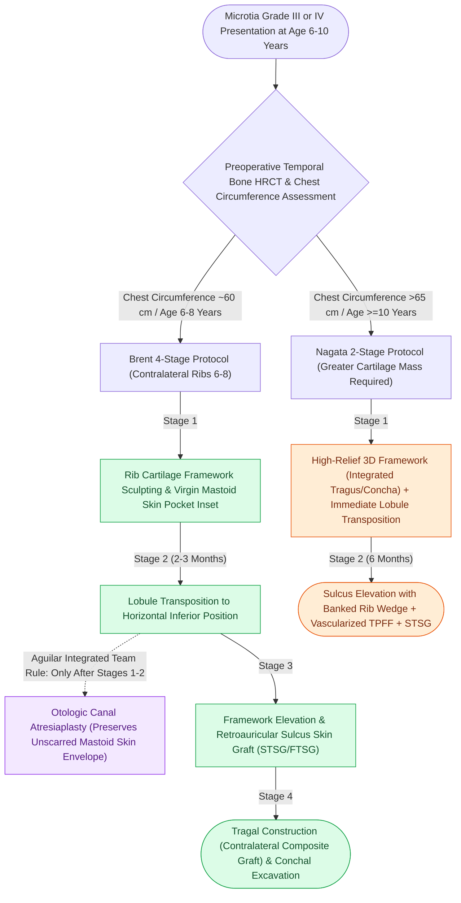

# Microtia autologous costal cartilage framework stages balance four-stage Brent and two-stage Nagata reconstruction protocols

## Active Recall

> [!question]- Why must the first two surgical stages of microtia reconstruction (framework fabrication and lobule transposition) strictly precede external auditory canal atresiaplasty?
> *Answer / Clinical Rationale*: Creating an external auditory canal first creates **dense surgical scarring and compromises the dermal subdermal vascular plexus** of the mastoid skin envelope, jeopardizing cartilage framework viability and making proper anatomical orientation of the framework nearly impossible.

> [!question]- What ribs are harvested for autologous framework construction, and how is the helical rim secured to the base plate according to Brent?
> *Answer / Clinical Rationale*: The **contralateral sixth, seventh, and eighth ribs** are harvested extraperichondrially; the synchondrosis of ribs 6 and 7 forms the base plate (concha and antihelix), while the flexible floating 8th rib is carved and bent around the perimeter to form the helical rim, anchored with **5-0 or 4-0 stainless steel wire**.

> [!question]- How does the timing, patient age threshold, and Stage 2 fascial coverage differ between the Brent and Nagata microtia reconstruction protocols?
> *Answer / Clinical Rationale*: **Brent** initiates reconstruction earlier at **age 6 to 8 years** (chest circumference $\sim 60\text{ cm}$) using a delicate 4-stage protocol requiring less cartilage volume, whereas **Nagata** delays to **age 10 years or older** (chest circumference $>65\text{ cm}$) because carving the single-stage integrated tragus, antitragus, and concha requires greater rib cartilage mass, and Stage 2 elevation uses a vascularized **temporoparietal fascia flap (TPFF)** plus banked cartilage wedge and split-thickness skin graft.

## Core Clinical & Mechanistic Principles
Surgical reconstruction of congenital microtia (Marx Grades I–IV; Aguilar Grades I–III) represents the pinnacle of autologous facial reconstructive complexity. The multi-tiered architecture of the auricle is fabricated using autologous rib cartilage sculpted to replicate the three-dimensional cartilaginous skeleton. Success requires strict coordination between the plastic reconstructive surgeon and the pediatric otologist, adherence to extraperichondrial rib harvest, tension-free skin envelope expansion, and rapid salvage with a [[Pitanguy's line defines the danger zone for the frontal branch of the facial nerve|temporoparietal fascia]] flap if framework exposure develops.

### Rib Cartilage Harvesting Mechanics
1. **Harvest Site Selection**:
   - Contralateral sixth, seventh, and eighth costal cartilages are harvested. Contralateral harvest ensures that the natural three-dimensional curvature of the costochondral junction matches the projection of the reconstructed antihelical complex and concha.
   - **Extraperichondrial Dissection**: Dissection must leave the posterior thoracic perichondrium undisturbed on the underlying pleural wall. This preserves donor-site cartilaginous regeneration and minimizes the risk of pneumothorax.
   - Intraoperative submersion of the wound under saline during Valsalva ventilation confirms pleural integrity.
2. **Framework Assembly**:
   - *Base Plate*: The contiguous synchondrosis of ribs 6 and 7 forms the main foundation, sculpted to represent the conchal bowl, antihelix, and superior/inferior crura.
   - *Helical Rim*: The slender 8th costal cartilage is thinned, curved around the base plate perimeter, and rigidly fixed with 4-0 or 5-0 stainless steel monofilament wires. Knots are wound and buried deeply into cartilage clefts to prevent delayed skin erosion.

### Staging Protocols: Brent vs Nagata vs Aguilar Integrated
- **Brent Four-Stage Protocol**:
  1. *Stage 1*: Rib cartilage harvest, framework sculpting, and inset into a virgin mastoid skin pocket with continuous scalp-vein needle suction.
  2. *Stage 2* ($2\text{ to }3\text{ months later}$): Lobule transposition — transposing the vertically oriented vestigial earlobe into an anatomical horizontal position below the framework.
  3. *Stage 3*: Framework elevation from the mastoid with skin graft placement (FTSG or STSG) to construct the retroauricular sulcus.
  4. *Stage 4*: Tragal construction and conchal bowl excavation using a contralateral chondrocutaneous composite graft.
- **Nagata Two-Stage Protocol**:
  1. *Stage 1*: 3D framework fabrication integrating the antihelix, tragus, antitragus, and conchal projection, combined with immediate single-stage lobule transposition. Requires significantly greater cartilage volume (patient age $\ge 10$ years, chest circumference $>65\text{ cm}$).
  2. *Stage 2* ($6\text{ months later}$): Framework elevation supported by a banked cartilage block, wrapped with an elevated temporoparietal fascia flap (TPFF) and covered by a split-thickness skin graft.
- **Aguilar Integrated 5-Stage Microtia-Atresia Sequence**:
  - *Plastic Surgery Priority*: Reconstructive framework inset (Stage I) and lobule transposition (Stage II) **must strictly precede** middle ear canal atresia drill-out by the otologist (Stage III).
  - *Surgical Rationale*: Performing canal atresia surgery first produces circumferential dense scar tissue, disrupts the subdermal vascular network of the mastoid skin, and obliterates landmarks needed to accurately align the framework.

### Complications and Salvage Strategies
1. **Pneumothorax and Atelectasis**: Atelectasis is the most common postoperative complication; small pleural breaches are repaired immediately with catheter evacuation and layered closure.
2. **Skin Envelope Ischemia**: Excessive framework projection beneath an unexpanded skin pocket creates dermal blanching and pressure necrosis. If cutaneous breakdown exposes $>5\text{ mm}$ of cartilage framework, emergency debridement and coverage with a vascularized temporoparietal fascia flap and skin graft is mandatory to prevent suppurative chondritis and framework loss.
3. **Wire Extrusion**: Stainless steel wires that migrate through the skin must be clipped and removed once the framework has achieved permanent fibrous consolidation.

## Connected Concepts & Graph Traversal
- **Cartilage Warping Dynamics**: [[Costal cartilage harvest and concentric carving prevent structural graft warping in revision rhinoplasty|Costal Cartilage Carving & Warping]]
- **Alloplastic Microtia Repair**: [[Porcine and porous polyethylene Medpor frameworks provide synthetic alternatives in microtia repair|Medpor Framework Reconstruction]]
- **🔗 Embryologic Derivation (Otology)**: [[The six auricular hillocks of His derive from the first and second branchial arches to form the pinna|Hillocks of His Embryology]]
- **🔗 Infectious Perichondritis (Otology)**: [[Acute perichondritis of the auricle requires antipseudomonal therapy to prevent cartilage necrosis|Auricular Perichondritis]]
- **Skin Graft Physiology**: [[Full-thickness and split-thickness skin grafts differ in primary contraction and vascular take|Full-Thickness vs Split-Thickness Grafts]]
