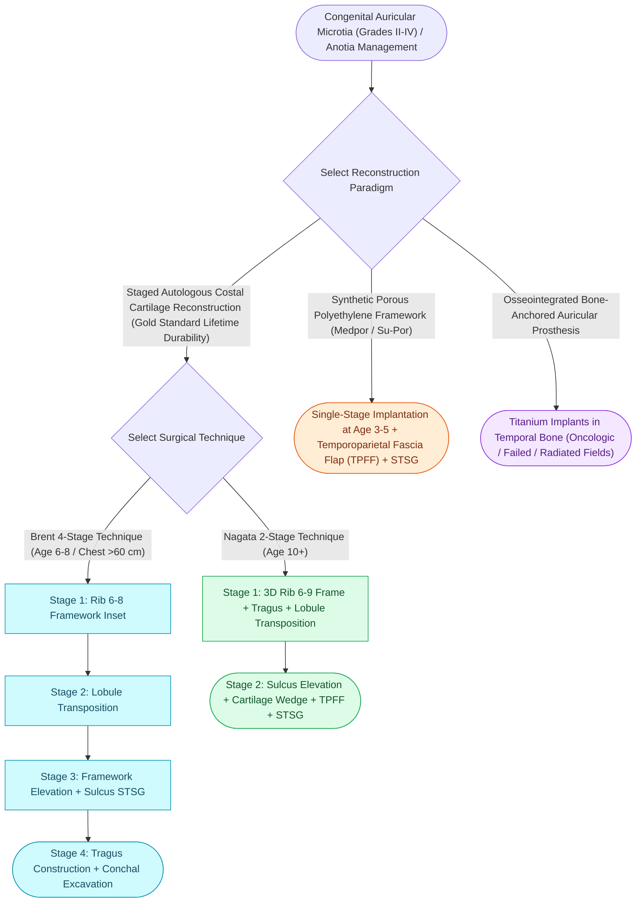

# Microtia reconstruction spans staged autologous costal cartilage frameworks and porous polyethylene implants

## Active Recall

> [!question]- Why does the auricular framework precede atresiaplasty when both are planned?
> *Answer / Clinical Rationale*: Atresia surgery scars and thins the mastoid-region skin envelope the cartilage framework depends on — reconstruct the ear first, drill the canal after.

> [!question]- State the core trade of autologous versus porous polyethylene reconstruction.
> *Answer / Clinical Rationale*: Autologous: donor-site morbidity and later start, but living durable tissue. Alloplastic: earlier, no rib harvest, but lifetime implant exposure/fracture risk under a flap-dependent cover.

## Core Clinical & Mechanistic Principles
- Autologous doctrine: **Nagata** (two stages, framework from synchondrotic ribs 6-9, age ~10 with sufficient chest circumference) versus **Brent** (three-four stages, younger start) — living tissue, lifetime durability, donor-site cost (chest scar, rare pneumothorax).
- Alloplastic alternative: **porous polyethylene (Medpor-type) framework under a temporoparietal fascia flap** with skin graft — earlier age, no rib harvest, single-stage-capable; trades exposure/fracture risk over a lifetime for the donor site.
- Prosthetic ears on osseointegrated implants excel for acquired total [[Composite conchal cartilage grafts provide three-dimensional structural support and cutaneous coverage for auricular and facial defects|defects]], failed reconstructions, and radiated fields.
- Sequencing with hearing: **framework before atresiaplasty** (canal surgery scars the virgin skin the framework needs); bone-conduction devices decouple hearing from the reconstruction calendar. Syndromic company: hemifacial microsomia, Treacher Collins — the ear is often not the only field.

### Management & Critical Safety Checks
- Selection is a values conversation: donor-site tolerance, age and anatomy, surgeon-technique availability, and the family's risk preferences — presented as options, not verdicts.
- TPF flap integrity is the alloplastic operation's insurance policy; its vascular anatomy (superficial temporal) is protected from the first incision.

## Connected Concepts & Graph Traversal
- **Prominent Ear Suturing**: [[Mustarde and Furnas sutures correct antihelical effacement and conchal hypertrophy|Mustarde & Furnas Sutures]]
- **Synthetic Framework Alternative**: [[Porcine and porous polyethylene Medpor frameworks provide synthetic alternatives in microtia repair|Medpor Frameworks]]
- **Ear Cartilage Scoring**: [[Stenstrom and Chongchet cartilage scoring utilizes Gibson's principle to fold the antihelix|Gibson's Scoring Principle]]
- **Nerve Vulnerability**: [[The great auricular nerve emerges at Erb's point and is vulnerable during rhytidectomy|Great Auricular Nerve]]
- **Cartilage Graft Physics**: [[The caudal septal extension graft controls tip projection and rotation via rigid septal overlap|Costal Cartilage Kinetics]]
- **Framework Material Alternative**: [[Composite conchal cartilage grafts provide three-dimensional structural support and cutaneous coverage for auricular and facial defects|Composite Conchal Grafts]]
