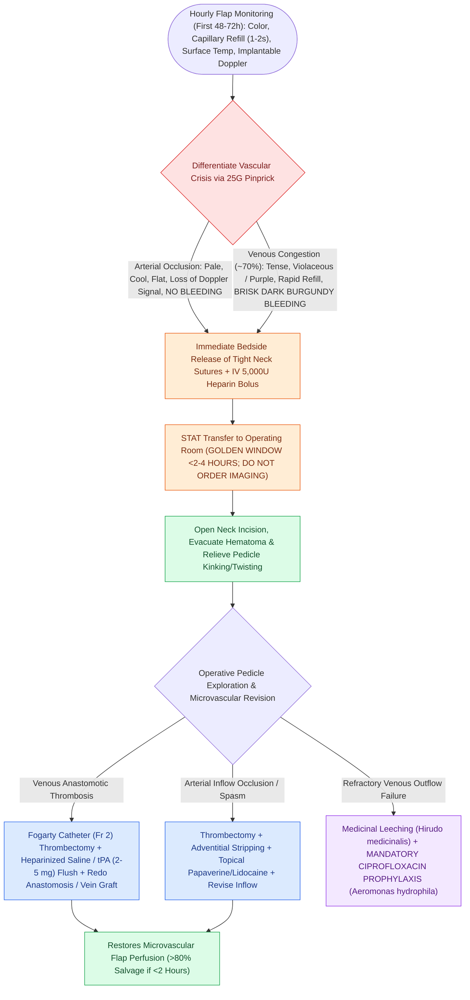

# Microvascular free flap salvage requires urgent re-exploration within two hours of vascular compromise

## Active Recall

> [!question]- How does the pinprick bleeding of a venous-congested free flap differ from that of an arterially-occluded flap?
> *Answer / Clinical Rationale*: An **arterially-occluded flap** shows **zero bleeding** upon 25G needle puncture. A **venous-congested flap** produces immediate, **brisk, dark burgundy/black blood** due to trapped deoxygenated venous pooling.

> [!question]- Why is prophylactic Ciprofloxacin mandatory whenever medicinal leeches (Hirudo medicinalis) are applied?
> *Answer / Clinical Rationale*: To prevent catastrophic soft tissue infection by ***Aeromonas hydrophila***, an enteric symbiotic bacterium present within the leech gut.

## Core Clinical & Mechanistic Principles
Free [[The radial forearm free flap provides thin, pliable fasciocutaneous tissue for oral and pharyngeal defects|tissue]] transfer success rates exceed $>95\%$, but microvascular pedicle thrombosis occurs in $3\text{–}6\%$ of cases. The primary determinant of flap salvage is **time to operating room re-exploration (salvage rate $>80\%$ if $<2\text{ hours}$; drops to $<20\%$ if $>6\text{ hours}$)**.

### Why Aeromonas Prophylaxis is Non-Negotiable
- The digestive tract of the medicinal leech (*Hirudo medicinalis*) carries the symbiotic gram-negative bacterium ***Aeromonas hydrophila***.
- Leeches secrete **hirudin** (potent thrombin inhibitor) to decompress venous congestion, but will cause devastating soft-tissue myonecrosis and flap loss without prophylactic **Ciprofloxacin**.

## Connected Concepts & Graph Traversal
- **🔗 Donor Flaps (Head and Neck)**: [[The radial forearm free flap provides thin, pliable fasciocutaneous tissue for oral and pharyngeal defects|Radial Forearm]]
- **Anatomical Foundation**: [[The fibula free flap provides vascularized cortical bone for composite mandibular reconstruction|Fibula Flap]]
- **Complication Matrix**: [[High-stakes FPRS complications require proactive landmarking and emergency rescue protocols|High-Stakes FPRS Complications]]
- **Surgical Craft**: [[Preserving the distal five centimeters of the fibula prevents ankle instability and talar tilt|Distal Fibular Preservation Rule]]
- **Diagnostic Assessment**: [[The anterolateral thigh free flap provides versatile soft tissue volume based on the LCFA|Anterolateral Thigh (ALT) Flap]]
