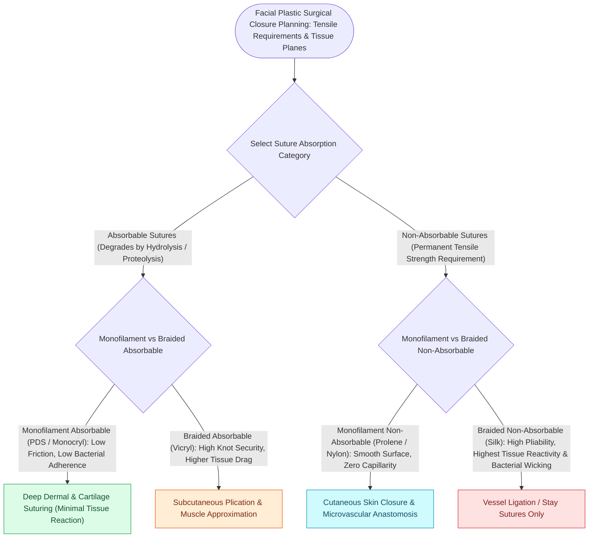

# Monofilament versus braided absorbable and non-absorbable sutures have distinct tissue reactivity

## Active Recall

> [!question]- Why is Polydioxanone (PDS) preferred over Vicryl or Monocryl for structural cartilage graft fixation in rhinoplasty?
> *Answer / Clinical Rationale*: PDS retains **$50\%$ of its tensile strength for $4\text{ to }6\text{ weeks}$**, providing prolonged mechanical support while cartilage grafts undergo fibrous integration and healing.

> [!question]- What is the primary disadvantage of braided sutures compared to monofilament sutures in contaminated or skin wounds?
> *Answer / Clinical Rationale*: Braided sutures exhibit **capillarity (wicking)**, harboring bacteria within the multi-strand interstices, and elicit higher inflammatory tissue reactivity.

## Core Clinical & Mechanistic Principles
Suture selection in facial plastic surgery dictates **wound tensile strength retention, knot security, tissue drag, and inflammatory tissue reactivity**.

### The Suture Reactivity Rule
- **Braided Natural Sutures (Silk, Gut)**: High [[The anterolateral thigh free flap provides versatile soft tissue volume based on the LCFA|tissue]] reactivity and capillary "wicking" of bacteria; contraindicated in clean facial skin closures.
- **Monofilament Synthetics (Prolene, Monocryl, PDS)**: Lowest tissue drag, negligible inflammatory response, and no bacterial wicking.

## Connected Concepts & Graph Traversal
- **Deep Dermal Closure**: [[Fusiform ellipse geometry requires a three-to-one ratio to prevent standing cutaneous cones|Fusiform Ellipse Closure]]
- **Otoplasty Sutures**: [[Mustarde and Furnas sutures correct antihelical effacement and conchal hypertrophy|Mustarde & Furnas Sutures]]
- **Structural Rhinoplasty**: [[Tongue-in-groove and septal extension grafts provide rigid columellar and tip stabilization|Cartilage Graft Fixation]]
- **Anatomical Foundation**: [[The anterolateral thigh free flap provides versatile soft tissue volume based on the LCFA|Anterolateral Thigh (ALT) Flap]]
- **Surgical Craft**: [[Facial retaining ligaments require surgical release to mobilize ptotic midface tissues|Facial Retaining Ligaments]]
