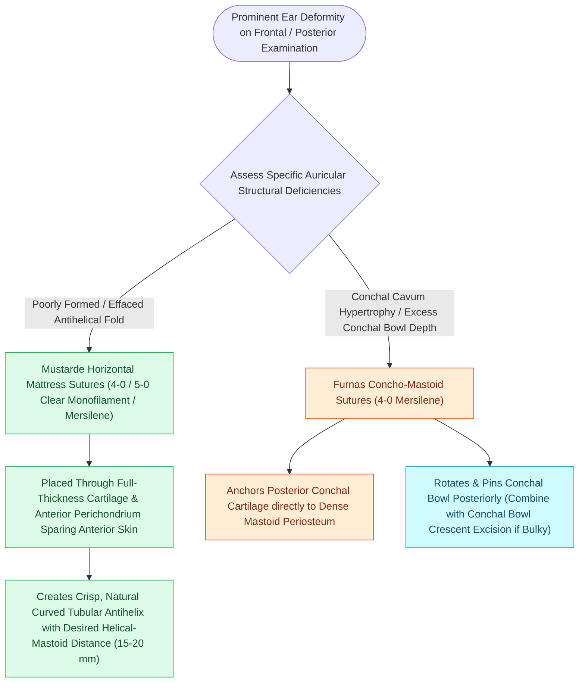

# Mustarde and Furnas sutures correct antihelical effacement and conchal hypertrophy

## Active Recall

> [!question]- What anatomical deformities do Mustarde and Furnas sutures each correct, and what anatomical layer must Furnas sutures anchor to?
> *Answer / Clinical Rationale*: **Mustardé horizontal mattress sutures** recreate an **effaced or absent antihelical fold**, whereas **Furnas concha-mastoid setback sutures** correct **conchal bowl hypertrophy/excess depth** by anchoring the posterior conchal cartilage directly to the **deep mastoid fascia / periosteum**.

> [!question]- What complications occur if Mustardé sutures are placed with excessive tension or if the middle third of the auricle is over-corrected relative to the poles?
> *Answer / Clinical Rationale*: Excessive Mustardé tension creates an unnaturally sharp, **"creased" or "pinched" antihelix** with cartilage buckling; over-correcting the middle third while leaving the superior pole and lobule prominent produces the classic **"telephone ear" deformity** (whereas over-correcting the poles produces a "reverse telephone ear").

## Core Clinical & Mechanistic Principles
Prominent ear deformity is primarily caused by two distinct anatomical abnormalities that frequently coexist:
1. **Effacement / Absence of the Antihelical Fold** ($>60\%$ of cases) $\rightarrow$ corrected with **Mustardé** horizontal mattress sutures (or [[Stenstrom and Chongchet cartilage scoring utilizes Gibson's principle to fold the antihelix|Gibson cartilage scoring]]).
2. **Conchal Bowl Hypertrophy / Excess Depth** ($>50\%$ of cases) $\rightarrow$ corrected with **Furnas** concha-mastoid setback sutures (plus crescentic conchal cartilage excision if bulky).

- **Normative Anthropometric Geometry & Timing**:
  - Normal auriculocephalic angle is **$20^\circ\text{–}30^\circ$** (prominence defined as $>30^\circ\text{–}40^\circ$); normal helico-mastoid distance is **$15\text{–}20\text{ mm}$** at the superior, middle, and lobular levels, with inter-ear symmetry within $2\text{–}3\text{ mm}$.
  - Operative otoplasty is typically performed at **age 5 to 6 years** when the auricle reaches $\sim 85\text{–}90\%$ of adult size prior to school entry; in contrast, **neonatal ear molding** initiated within the first $1\text{–}3\text{ weeks}$ of life exploits circulating maternal estrogen-induced hyaluronic acid cartilage plasticity to correct deformity non-surgically.

### Suture Placement Metrics & Operative Craft
- **Mustardé Sutures (Antihelical Fold Creation)**:
  - Non-absorbable horizontal mattress sutures (typically 4-0 clear nylon or braided polyester/Mersilene) are placed through the full thickness of the cartilage and anterior perichondrium (sparing anterior skin) from the posterior exposure.
  - **Suture Placement Metrics**: Mattress suture limbs are anchored approximately **$8\text{ mm}$ on either side of the proposed antihelical fold crest** (yielding a total bite span of **$\sim 16\text{ mm}$**). Successive horizontal mattress sutures along the vertical trajectory of the antihelix are spaced **$2\text{ mm}$ apart** to produce uniform, gentle cylindrical curling without sharp cartilage buckling or step-offs.
- **Furnas Sutures (Conchal Setback)**:
  - Interrupted non-absorbable sutures (4-0 Mersilene) placed from the posterior conchal bowl cartilage to the dense mastoid periosteum, rotating and seating the conchal bowl posteriorly into the mastoid hollow.

### Avoiding the "Telephone Ear" Deformity
- **Telephone Ear Deformity**: Occurs when the middle third of the auricle is over-corrected while the superior pole and lobule remain prominent.
- **Reverse Telephone Ear Deformity**: Occurs when the superior and inferior poles are over-corrected while the middle third protrudes.
- **Conchal Cartilage Resection**: If conchal setback with Furnas sutures narrows the external auditory meatus, a crescent of conchal bowl cartilage must be resected.

## Connected Concepts & Graph Traversal
- **Cartilage Scoring**: [[Stenstrom and Chongchet cartilage scoring utilizes Gibson's principle to fold the antihelix|Gibson's Principle Scoring]]
- **Framework Reconstruction**: [[Microtia autologous costal cartilage framework stages balance four-stage Brent and two-stage Nagata reconstruction protocols|Microtia Reconstruction]]
- **Helical Rim Advancement**: [[Advancement flaps recruit adjacent tissue laxity along a linear vector without rotation|Antia-Buch Flap]]
- **Diagnostic Evaluation**: [[Composite chondrocutaneous auricular graft transfers reconstruct complex alar and helical defects|Composite Auricular Graft]]
- **Anatomical Foundation**: [[Postoperative free flap anticoagulation and antiplatelet protocols balance thrombosis against hematoma|Microvascular Anticoagulation Protocols]]
