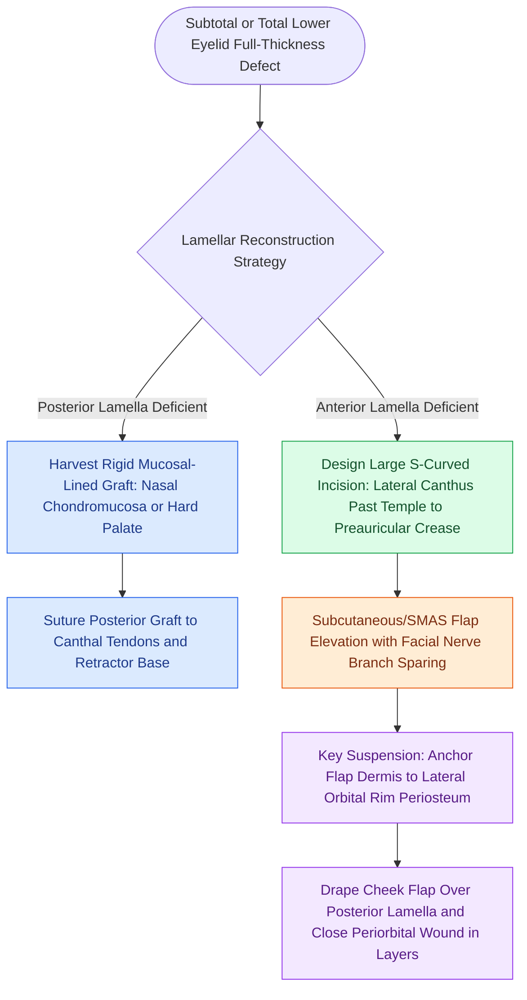

# Mustarde cheek rotation flaps advance malar skin for total lower eyelid anterior lamella reconstruction

## Active Recall

> [!question]- What is the primary biomechanical failure mode of a Mustarde cheek rotation flap, and how is it prevented surgically?
> *Answer / Clinical Rationale*: The primary failure mode is **severe gravitational downward ectropion and lower lid retraction** caused by the weight of the mobilized cheek flap; it is prevented by arching the incision **superiorly above the lateral canthus toward the temple** and firmly securing the deep flap dermis to the **lateral orbital rim periosteum** superior to the canthal insertion.

> [!question]- Why must a Mustarde cheek rotation flap be combined with a rigid mucosal composite graft for total lower eyelid reconstruction?
> *Answer / Clinical Rationale*: The Mustarde flap provides **only anterior lamellar skin and subcutaneous tissue**; reconstructing a functional eyelid requires a rigid, mucous-membrane-lined posterior lamella (e.g., **nasal septal chondromucosal graft or hard palate mucosal graft**) to prevent corneal ulceration and maintain margin stability.

## Core Clinical & Mechanistic Principles
The Mustarde cheek rotation-advancement flap is an extensive regional procedure indicated for subtotal to total lower eyelid anterior lamellar defects, particularly when local periorbital tissue is exhausted by trauma, neoplasm, or radiation. As a regional [[Advancement flaps recruit adjacent tissue laxity along a linear vector without rotation|advancement flap]] that incorporates a wide rotational arc, the Mustarde procedure recruits lax tissue from the malar and preauricular aesthetic units to resurface the entire infraorbital region.

Critical surgical and biomechanical principles include:
1. **Incision Arc and Superior Trajectory**: The incision starts at the subciliary defect margin, arches upward beyond the lateral canthus, extends above the zygomatic arch onto the temple toward the hairline, and then curves downward into the preauricular crease to the ear lobule. The superior elevation of the temporal incision is paramount: gravitational force and tissue contraction exert a downward vector; arching the incision high ensures that rotational advancement produces an upward and medial suspension vector.
2. **Surgical Dissection Plane**: Dissection proceeds in the subcutaneous plane over the malar eminence and superficial to the parotid fascia preauricularly. Care is taken to identify and preserve the temporal and zygomatic branches of the facial nerve beneath the deep fascia.
3. **Bilamellar Rule**: The Mustarde flap provides cutaneous coverage and subcutaneous bulk but possesses neither rigid skeletal framework nor mucosal lining. It is contraindicated to leave the flap unlined. The posterior lamella must be reconstructed concurrently with an autogenous mucosal-bearing structural graft, such as:
   - Nasal septal chondromucosal graft (providing cartilaginous rigidity and respiratory mucosal lining).
   - Hard palate mucosal graft.
   - Conchal cartilage graft combined with oral mucosal transfer.
4. **Rigid Periosteal Suspension**: To overcome gravitational downward descent and cheek flap weight, non-absorbable suspension sutures (4-0 polypropylene) are placed through the deep dermis of the flap and anchored to the periosteum of the lateral orbital rim well above the level of the lateral canthus.

### Mustarde Versus Alternative Flaps
While historically widely performed, the classic Mustarde flap requires extensive facial incisions, produces a large adynamic cheek segment, and carries high rates of persistent lower eyelid ectropion and prolonged facial edema. For isolated lower eyelid defects, the staged Hughes tarsoconjunctival flap or single-stage Tenzel semicircular flap provides superior functional blinking, better dynamic orbicularis tone, and substantially reduced facial scarring. The Mustarde flap remains primarily indicated for massive combined lower eyelid and superior cheek resections where periorbital tissue cannot provide coverage.

## Connected Concepts & Graph Traversal
- **Rotational Biomechanics**: [[Rotation flaps redistribute closing tension along a curvilinear arc of rotation|Curvilinear Flap Rotation Arc]]
- **Lateral Canthal Suspension**: [[Lateral canthopexy and lateral tarsal strip suspension prevent post-blepharoplasty ectropion|Lateral Canthopexy Mechanics]]
- **Posterior Lamella Reconstruction**: [[Hughes tarsoconjunctival flaps reconstruct extensive lower eyelid defects using upper eyelid posterior lamella sharing|Hughes Tarsoconjunctival Flap]]
- **Rhytidectomy Danger Zones**: [[The great auricular nerve emerges at Erb's point and is vulnerable during rhytidectomy|Cervicofacial Nerve Vulnerability]]
- **Facial Aesthetic Units**: [[Gonzalez-Ulloa facial aesthetic subunits guide complete subunit reconstruction|Facial Aesthetic Subunits]]
- **Skin Grafting Contrasts**: [[Full-thickness and split-thickness skin grafts differ in primary contraction and vascular take|Skin Graft Dynamics]]
