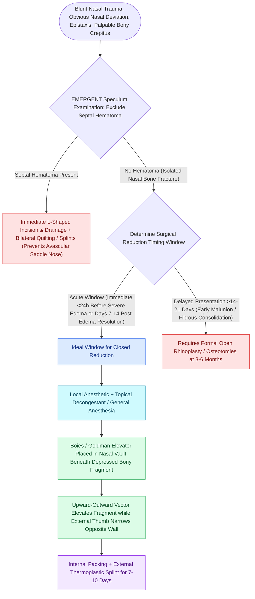

# Nasal bone fractures are reduced within seven to fourteen days using closed reduction under local or general anesthesia

## Active Recall

> [!question]- Why is closed reduction of nasal bone fractures ideally performed between 7 and 14 days post-injury in adult patients?
> *Answer / Clinical Rationale*: Operating during the 7 to 14 day window allows acute post-traumatic soft tissue edema to subside so that subtle bony contour asymmetries can be accurately visualized and palpated, while taking advantage of the biological window before fibrous osteocartilaginous consolidation (malunion) occurs.

> [!question]- What catastrophic aesthetic and structural complication occurs if an acute septal hematoma is missed on anterior rhinoscopy?
> *Answer / Clinical Rationale*: **Avascular necrosis and resorption of the septal quadrangular cartilage** followed by septal abscess and loss of dorsal and tip support, resulting in severe **saddle nose deformity** (supratip depression and columellar retraction) and permanent nasal valve obstruction.

## Core Clinical & Mechanistic Principles

**Nasal bone fractures** are the most common fractures of the facial skeleton and the third most common fracture of the entire human body. Because the paired nasal bones are thin, paired trapezoids supported centrally by the perpendicular plate of the ethmoid, vomer, and cartilaginous quadrangular septum, lateral blunt force impacts produce unilateral or bilateral in-fracture/out-fracture deformities with C-shaped septal deflection.

The clinical diagnosis of nasal bone fractures is **purely clinical**, based on physical examination and palpation (nasal deviation, crepitus, mobile bony step-offs, ecchymosis, epistaxis, and intranasal airway obstruction). Plain radiographs (nasal bone series) have low diagnostic sensitivity and specificity and do not alter surgical decision-making.

The single most critical immediate physical examination step is **anterior rhinoscopy with a nasal speculum to rule out a septal hematoma**. An unevacuated subperichondrial septal hematoma deprives the avascular quadrangular cartilage of nutrient diffusion, causing cartilage necrosis and bacterial abscess formation within 48 to 72 hours, resulting in devastating **[[Saddle nose deformity requires multi-tier dorsal and caudal structural reconstruction|saddle nose deformity]]** and nasal collapse.

The optimal window for **closed reduction is within 7 to 14 days in adults (3 to 7 days in children)**. Performing reduction during this interval allows acute soft tissue edema to resolve (allowing precise visual assessment of aesthetic dorsal alignment) before permanent fibrous union and early osteotomy consolidation fix the fragments into malunion.

### Surgical Technique & Craft Nuance: Closed Reduction & Splinting

1. **Anesthesia**: Closed reduction can be performed under local anesthesia with sedation in clinic or general anesthesia in the OR:
   - Topical mucosal vasoconstriction and anesthesia with cotton pledgets soaked in 4% lidocaine with 0.05% oxymetazoline.
   - Bilateral external infraorbital and infratrochlear / external nasal nerve blocks using 1% lidocaine with 1:100,000 epinephrine.
2. **Instrumentation**:
   - **Boies Nasal Elevator**: Flat, blunt instrument used to elevate depressed lateral nasal bones.
   - **Goldman Septal Displacer / Walsham Forceps**: Paired forceps (one blade covered with rubber tubing placed intranasally, one blade externally) used to mobilize and disimpact impacted lateral nasal bones.
   - **Asch Septal Forceps**: Straight blades introduced bilaterally along the nasal septum to grasp, elevate, and straighten the fractured quadrangular cartilage.
3. **Reduction Technique**: The Boies elevator is inserted into the nasal cavity along the undersurface of the depressed nasal bone up to (but not exceeding) the level of the medial canthal tendon (to avoid cribriform plate injury). The elevator applies upward, anterior, and outward force while the surgeon's external thumb applies counter-pressure against the contralateral displaced nasal bone, snapping the fragments back into midline anatomical alignment.
### Key Consultation Supplies
- Coaxial surgical headlight
- Nasal speculum (short and medium blade)
- Cotton pledgets, bayonet forceps, and 10 Fr Frazier suction
- Topical anesthetic / decongestant solution (0.05% oxymetazoline + 1% to 4% lidocaine)
- Injectable 1% lidocaine with 1:100,000 epinephrine with 3 mL syringe and 27-gauge needles
- Boies nasal elevator
- Asch septal straightening forceps and Walsham disimpaction forceps
- Silastic Doyle septal splints with 3-0 nylon suture on straight/curved needle
- Absorbable nasal packing (NasoPore®, Surgicel®)
- External nasal splinting supplies: Mastisol® / tincture of benzoin, Steri-Strips®, and heat-malleable thermoplastic splint (Aquaplast®) or padded aluminum splint

> [!example]- **Operative Note Template: Closed reduction of nasal bone fracture under general anesthesia**
> **PROCEDURE**: Closed [[Zygomaticomaxillary complex fractures disrupt four buttress articulations requiring multi-point reduction|reduction]] of nasal bone fracture under general anesthesia
> **PRE-PROCEDURAL DIAGNOSIS**: Displaced fracture of the nasal bones and nasal septum
> **POST-PROCEDURAL DIAGNOSIS**: Displaced nasal bone fracture status-post successful closed reduction
> **SURGEON**: [Surgeon Name, MD]
> **ASSISTANT**: [Resident/Fellow Name, MD]
>
> **PROCEDURE IN DETAIL**:
> Informed consent was obtained. The patient was brought to the operating room and general endotracheal anesthesia was induced. Eye protection with Lacri-Lube and eye shields was placed. The nasal cavity was decongested with 0.05% oxymetazoline cotton pledgets for 10 minutes.
>
> External and internal examination revealed a depressed, medially in-fractured right nasal bone, lateral out-fracture of the left nasal bone, and C-shaped septal deflection. An Asch septal forceps was introduced bilaterally along the nasal septum, elevating and realigning the cartilaginous and bony septum in the midline. A Boies elevator was then placed intranasally beneath the right nasal bone, advancing to the level of the medial canthus. Upward and lateral outward force was applied with the Boies elevator while external digital counter-pressure was applied over the left nasal dorsum, resulting in an audible and palpable reduction of the nasal bones into straight anatomical midline alignment.
>
> Repeat anterior rhinoscopy confirmed absence of septal hematoma and a patent bilateral nasal airway. Tincture of benzoin and Steri-Strips were applied across the dorsum, followed by the application of a form-fitted thermoplastic external nasal cast (Aquaplast). The patient was extubated and transferred to the PACU in stable condition.

> [!example]- **Operative Note Template: Office closed reduction of nasal bone fracture under local anesthesia**
> **PROCEDURE**: Office closed reduction of nasal bone fracture under local anesthesia
> **PRE-PROCEDURAL DIAGNOSIS**: Acute displaced nasal bone fracture
> **POST-PROCEDURAL DIAGNOSIS**: Nasal bone fracture status-post closed reduction
> **SURGEON**: [Surgeon Name, MD]
> **ASSISTANT**: [Resident/Fellow Name, MD]
>
> **PROCEDURE IN DETAIL**:
> Informed consent was obtained. Topical anesthesia was achieved with cotton pledgets soaked in 4% lidocaine and 0.05% oxymetazoline placed in bilateral nasal passages for 15 minutes. Regional nerve blocks were performed with 1% lidocaine with 1:100,000 epinephrine targeting bilateral infraorbital, supratrochlear, and external nasal nerves as well as direct mucosal septal infiltration.
>
> A Boies elevator was carefully inserted beneath the depressed nasal bone up to the level of the intercanthal line. Controlled superior-lateral vector elevation was performed with simultaneous manual external molding. Palpation and visual inspection confirmed restoration of normal dorsal contour and symmetry. Anterior rhinoscopy verified an intact, non-fluctuant nasal septum with absence of septal hematoma. Mastisol and Steri-Strips were applied, followed by a customized external thermoplastic splint. The patient tolerated the procedure well with minimal epistaxis.

## References
1. Chegar, B.E., Tatum, S.A. (2020). Nasal Fractures. In Flint, P.W., et al. (Eds.), *Cummings Otolaryngology Head and Neck Surgery* 7e (pp. 457-469). Philadelphia, PA: Elsevier.
2. Fusetti, S., Cornelius, C.P., Gellrich, N., et al. (2020). Treatment of Nasal Bone. *AO Foundation Surgery Reference*.
3. Gillman, G.S., Rivera-Serrano, C.M. (2013). Nasal Fractures. In Johnson, J.J., Rosen, C.A. (Eds.), *Bailey’s Head and Neck Surgery-Otolaryngology* 5e (pp. 1241-1254). Baltimore, MD: Lippincott Williams & Wilkins.

## Connected Concepts & Graph Traversal
- **Adjacent Complex Fractures**: [[Naso-orbito-ethmoid NOE fractures staged by Markowitz and Manson require medial canthal tendon fixation|NOE Fractures]]
- **Midface Buttress Integration**: [[Zygomaticomaxillary complex fractures disrupt four buttress articulations requiring multi-point reduction|ZMC & Midface Fractures]]
- **🔗 Epistaxis Control (Sinus)**: [[Kiesselbach plexus anterior epistaxis is managed with cautery and anterior nasal packing|Epistaxis Protocols]]
- **Secondary Reconstructive Rhinoplasty**: [[Saddle nose deformity requires multi-tier dorsal and caudal structural reconstruction|Saddle Nose Reconstruction]]
- **Pediatric Facial Trauma**: [[Pediatric white-eyed blowout fractures cause muscle entrapment requiring emergent surgical release|Pediatric Facial Trauma]]
