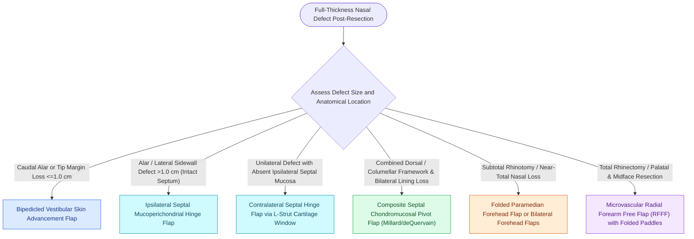

# Nasal lining reconstruction employs bipedicled vestibular, ipsilateral or contralateral septal mucoperichondrial hinge flaps, and turbinate flaps to prevent cicatricial airway stenosis

## Active Recall

> [!question]- What are the anatomical limits and mobilization vectors of a bipedicled vestibular skin advancement flap?
> *Answer / Clinical Rationale*: A bipedicled flap is created by an **extended intercartilaginous incision** between the upper and lower lateral cartilages, remaining attached medially to the septum/columella and laterally to the piriform aperture. It can advance inferiorly **up to 1.0 cm** to line the caudal alar rim or hemi-tip, leaving an upper donor defect that heals by secondary intention or skin grafting.

> [!question]- How is an ipsilateral vs contralateral septal mucoperichondrial hinge flap designed and delivered to line a full-thickness nasal defect?
> *Answer / Clinical Rationale*: An **ipsilateral hinge flap** is incised anteriorly and superiorly, then reflected **180° outward like a page in a book** based on the dorsal septum or superior labial artery, placing mucosal surface inward and raw perichondrium outward. A **contralateral hinge flap** is delivered across the midline through an **excised cartilaginous L-strut window** to line the opposite nasal vault.

> [!question]- Why is vascularized flap lining preferred over free skin grafts when reconstructing nasal lining in full-thickness defects?
> *Answer / Clinical Rationale*: Thin skin grafts placed inside the nasal vault undergo **severe primary and secondary cicatricial contraction**, leading to internal and external valve stenosis, alar retraction, and graft failure over exposed structural cartilage. Vascularized lining flaps provide durable, mucus-secreting, contractile-resistant tissue and an immediate capillary bed for structural framework grafts.

## Core Clinical & Mechanistic Principles
Reconstruction of full-thickness nasal defects requires strict adherence to the tripartite principle: independent restoration of **mucosal lining, rigid cartilaginous/bony framework, and external cutaneous cover**. Nasal lining constitutes the most technically demanding layer; failure to achieve vascularized, non-contractile lining results in inevitable structural framework exposure, ischemic necrosis, and crippling cicatricial airway stenosis. Surgical planning respects [[Gonzalez-Ulloa facial aesthetic subunits guide complete subunit reconstruction|facial aesthetic subunits]] to reconstruct natural three-dimensional nasal contours.

### Classification of Local Nasal Lining Flaps
The choice of lining flap is determined by defect size, vertical level, and remaining vascular supply:

1. **Bipedicled Vestibular Skin Advancement Flap**:
   - **Indications**: Full-thickness alar or hemi-tip defects with a vertical dimension $\le 1.0\text{ cm}$.
   - **Dissection**: Released via an extended intercartilaginous incision parallel to the caudal border of the lateral crus. The flap receives dual axial-perforator [[Facial angiosomes and perforator choke zones determine cutaneous flap survival boundaries|vascular supply]] from medial columellar branches and lateral alar base vessels.
   - **Advancement**: Mobilized caudally to form the new alar rim lining. The denuded cephalic donor site over the upper lateral cartilage granulates or receives a thin split-thickness skin graft without causing airway compromise.

2. **Ipsilateral Septal Mucoperichondrial Hinge Flap**:
   - **Indications**: Large full-thickness defects of the nasal dorsum, lateral sidewall, hemi-tip, or ala.
   - **Biomechanics**: Based either superiorly along the nasal dorsum (anterior/posterior ethmoidal vessels) or caudally along the nasal floor (septal branch of the superior labial artery and sphenopalatine artery). 
   - **Turnover**: The flap is reflected $180^\circ$ horizontally or vertically like a page in a book. The epithelial mucosal surface faces the nasal cavity while the exposed raw perichondrium faces externally, creating an ideal vascularized bed to receive structural cartilage grafts.

3. **Contralateral Septal Mucoperichondrial Hinge Flap**:
   - **Indications**: Unilateral full-thickness defects where ipsilateral septal mucosa is scarred, absent, or insufficient.
   - **Cartilaginous Window Technique**: A rectangular window is excised in the quadrangular cartilage (preserving a 1.0–1.5 cm dorsal and caudal L-strut for bridge support). The contralateral mucoperichondrium is elevated, hinged through the cartilaginous window, and turned into the ipsilateral nasal defect.

4. **Composite Septal Chondromucosal Pivot Flap (deQuervain / Millard)**:
   - **Indications**: Major central full-thickness loss of the lower two-thirds of the nose requiring simultaneous lining and L-strut framework.
   - **Vascular Pivot**: Based on the septal branch of the superior labial artery at the anterior nasal spine. A composite block of quadrangular cartilage and bilateral mucoperichondrium is rotated $90^\circ$ anteriorly out of the nasal cavity to reconstruct the dorsal septum and columella.

5. **Inferior Turbinate Flap**:
   - **Indications**: Lateral sidewall, alar base, and vestibular lining defects.
   - **Design**: An anteriorly based mucoperiosteal flap pedicled on the terminal branches of the angular and lateral nasal arteries. The inferior turbinate bone can be included (osteomucoperiosteal) or stripped off to provide pliable mucosal lining.

### Operative Steps for Septal Hinge Flaps
1. **Mucoperichondrial Dissection**: Infiltrate septal submucosa with 1% lidocaine with 1:100,000 epinephrine. Make vertical and horizontal incisional borders using an angled Beaver blade or Cottle elevator, ensuring the base is wide enough ($\ge 1.5\text{ cm}$) to maintain robust arterial flow.
2. **Framework Integration**: Fasten auricular conchal or septal cartilage framework grafts directly to the perichondrial surface using 5-0 polydioxanone mattress sutures.
3. **External Coverage**: Drape an interpolated paramedian forehead flap or melolabial flap over the framework, completely sandwiching the cartilage between the lining flap and covering flap.

## Connected Concepts & Graph Traversal
- **Trilaminar Architecture**: [[Total nasal reconstruction requires three-layer structural restoration of lining, cartilage, and cover|Total Nasal Reconstruction]]
- **Cartilaginous Framework**: [[Auricular conchal cartilage grafts provide curved structural support for the alar and nasal valves|Conchal Cartilage Grafts]]
- **Forehead Flap Coverage**: [[The paramedian forehead flap is an axial interpolated flap pedicled on the supratrochlear artery|Paramedian Forehead Flap]]
- **Internal Valve Support**: [[Spreader grafts restore internal nasal valve patency and prevent inverted-V deformity|Spreader Grafts]]
- **Septal Mucosal Flaps**: [[Nasal septal perforation repair requires bilateral mucosal advancement flaps and interposition grafts|Septal Mucosal Advancement]]
- **🔗 Microvascular Free Transfer (Head_and_Neck)**: [[The radial forearm free flap provides thin, pliable fasciocutaneous tissue for oral and pharyngeal defects|Radial Forearm Free Flap]]
