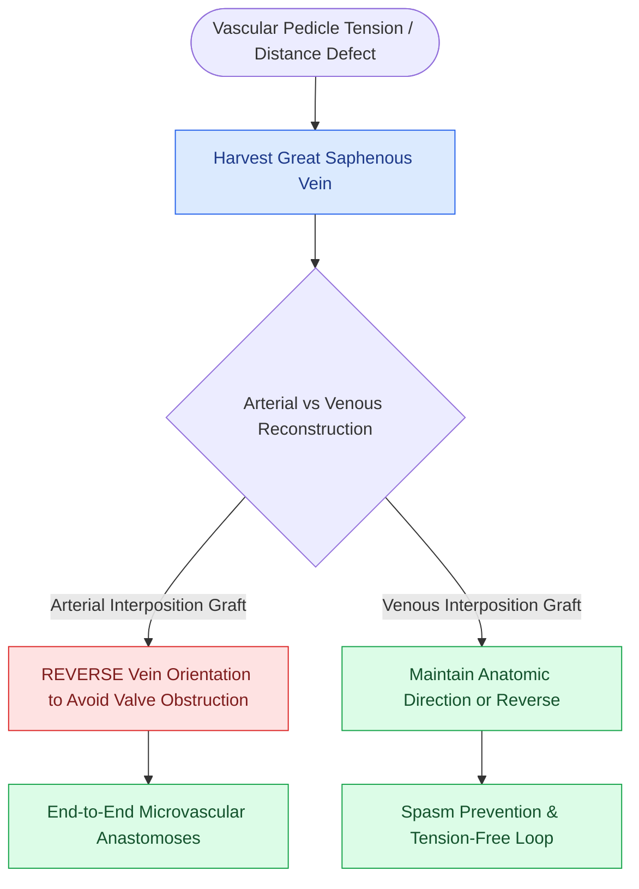

# Nasal septal perforation repair requires bilateral mucosal advancement flaps and interposition grafts

## Active Recall

> [!question]- Why is an interposition graft (e.g., ADM or temporalis fascia) placed between bilateral mucosal flaps during septal perforation repair?
> *Answer / Clinical Rationale*: It acts as a **biological scaffold and physical barrier** that prevents direct reperforation if microscopic dehiscence or delayed healing occurs in the overlying mucosal suture lines.

> [!question]- Why must the mucosal suture lines on the left and right sides of the septum be staggered?
> *Answer / Clinical Rationale*: To prevent overlapping bilateral incision lines, which would create a focal area of ischemia and cause **immediate recurrent perforation**.

## Core Clinical & Mechanistic Principles
Surgical closure of a symptomatic **nasal septal perforation** (causing whistling, crusting, epistaxis, and nasal obstruction) requires a **three-layer tension-free closure**: bilateral vascularized mucosal [[Advancement flaps recruit adjacent tissue laxity along a linear vector without rotation|advancement flaps]] separated by an interposition graft.

### Surgical Sizing Thresholds
- **Small ($<1.0\text{ cm}$)**: $>90\text{–}95\%$ closure rate with local bipedicled mucosal flaps.
- **Medium ($1.0\text{–}2.0\text{ cm}$)**: Requires bilateral inferior and superior bipedicled advancement flaps + ADM interposition.
- **Large ($>2.0\text{ cm}$)**: Requires facial artery musculomucosal (FAMM) flap, microvascular free flap (radial forearm), or custom silicone septal button placement.

## Connected Concepts & Graph Traversal
- **Saddle Nose**: [[Saddle nose deformity requires multi-tier dorsal and caudal structural reconstruction|Saddle Nose Deformity]]
- **Spreader Grafts**: [[Spreader grafts restore internal nasal valve patency and prevent inverted-V deformity|Spreader Grafts]]
- **Graft Materials**: [[Monofilament versus braided absorbable and non-absorbable sutures have distinct tissue reactivity|Suture & PDS Plate]]
- **Diagnostic Evaluation**: [[Composite chondrocutaneous auricular graft transfers reconstruct complex alar and helical defects|Composite Auricular Graft]]
- **Mucosal Flap Technique**: [[Nasal lining reconstruction employs bipedicled vestibular, ipsilateral or contralateral septal mucoperichondrial hinge flaps, and turbinate flaps to prevent cicatricial airway stenosis|Nasal Lining Reconstruction]]
