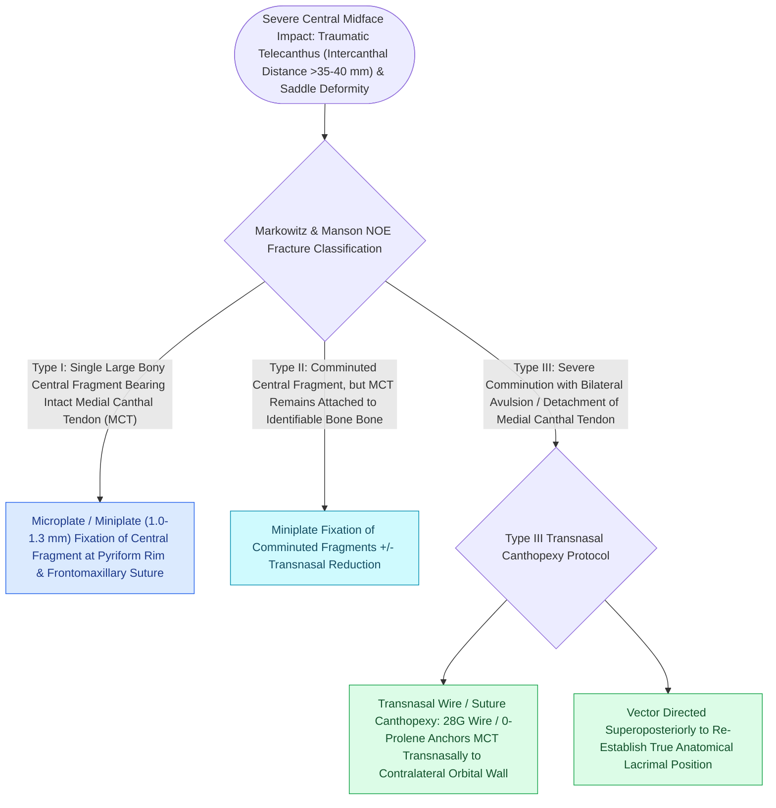

# Naso-orbito-ethmoid NOE fractures staged by Markowitz and Manson require medial canthal tendon fixation

## Active Recall

> [!question]- What is the critical anatomical landmark that defines the Markowitz-Manson classification of NOE fractures?
> *Answer / Clinical Rationale*: The **central bone fragment of the frontal process of the maxilla bearing the insertion of the Medial Canthal Tendon (MCT)**.

> [!question]- In what direction must the transnasal [[Lateral canthopexy and lateral tarsal strip suspension prevent post-blepharoplasty ectropion|canthopexy]] wire pull to restore natural medial canthal position in a Type III NOE fracture?
> *Answer / Clinical Rationale*: **Posterosuperiorly and medially**, pulling the tendon behind the anterior lacrimal crest to ensure intimate globe-canthal contact.

## Core Clinical & Mechanistic Principles
**Naso-Orbito-Ethmoid (NOE) Fractures** involve traumatic comminution of the central upper midface [[Zygomaticomaxillary complex fractures disrupt four buttress articulations requiring multi-point reduction|buttress]] where the nasal bones, frontal process of maxilla, ethmoid labyrinth, and lacrimal bones converge.

The defining diagnostic landmark is the **central bone fragment bearing the insertion of the Medial Canthal Tendon (MCT)**.

### Physical Exam & Telecanthus
- **Traumatic Telecanthus**: Intercanthal distance $>35\text{–}40\text{ mm}$ (normal $\sim 30\text{–}32\text{ mm}$, equal to interpupillary distance / 2 or palpebral fissure width).
- **Bimanual Examination (Furnas Test)**: Clamp central fragment with Kelly clamp intranasally while palpating the MCT externally to test mobility.

## Connected Concepts & Graph Traversal
- **ZMC Fractures**: [[Zygomaticomaxillary complex fractures disrupt four buttress articulations requiring multi-point reduction|ZMC Tetrapod Fractures]]
- **Orbital Trauma**: [[Orbital floor blowout fractures with muscle entrapment or significant enophthalmos mandate reconstruction|Orbital Floor Reconstruction]]
- **Canthal Support**: [[Lateral canthopexy and lateral tarsal strip suspension prevent post-blepharoplasty ectropion|Canthopexy Principles]]
- **Pathological Mechanism**: [[Orbital apex syndrome and superior orbital fissure syndrome manifest with ophthalmoplegia and vision loss|Orbital Apex Syndrome (OAS)]]
- **Diagnostic Evaluation**: [[Coronoidectomy relieves severe trismus caused by temporalis impingement under displaced zygomatic arch|Mandibular Coronoidectomy]]
- **Anatomical Foundation**: [[Panfacial fracture reconstruction proceeds from known stable peripheral buttresses to central occlusion|Panfacial Fracture Sequencing]]
