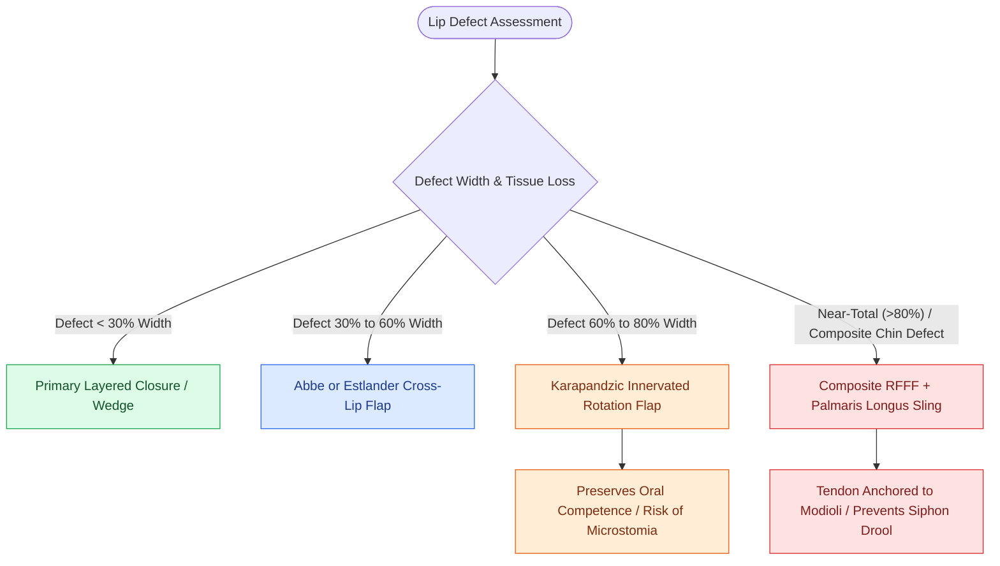

# Near-total lip reconstruction combines functional local muscle flaps with microvascular free flaps

## Active Recall

> [!question]- Why is the palmaris longus tendon harvested in continuity with a radial forearm flap during total lower lip reconstruction?
> *Answer / Clinical Rationale*: To serve as a **static suspension sling anchored to the bilateral oral modioli / zygomatic arches**, preventing gravity-induced sagging and severe oral incontinence (drooling).

> [!question]- What local flap can be combined with a free flap to provide dynamic sphincter innervation in subtotal lip defects?
> *Answer / Clinical Rationale*: A **Karapandzic innervated myocutaneous flap**.

## Core Clinical & Mechanistic Principles
Defects involving **$>80\%$ of the lower lip combined with the chin and anterior mandible** (often following advanced squamous cell carcinoma ablation or ballistic trauma) exceed the elastic capacity of regional tissues and cannot be closed with local advancement flaps alone without causing severe, crippling microstomia.

- **Reconstructive Algorithm**:
  1. **Subtotal Lip Defects ($60\text{–}80\%$ loss)**: Reconstructed using an innervated [[Karapandzic orbicularis oris myocutaneous rotation flaps preserve oral sphincter innervation|Karapandzic myocutaneous rotation flap]], preserving the neurovascular bundles (facial artery and buccal/marginal mandibular motor branches) to maintain dynamic oral sphincter competence.
  2. **Near-Total and Total Lip Defects ($>80\%$ loss)**: Requires microvascular free tissue transfer using a [[The radial forearm free flap provides thin, pliable fasciocutaneous tissue for oral and pharyngeal defects|Radial Forearm Free Flap (RFFF)]] incorporating a vascularized **Palmaris Longus Tendon sling** or an [[The anterolateral thigh free flap provides versatile soft tissue volume based on the LCFA|Anterolateral Thigh (ALT) flap]] with vascularized tensor fascia lata.
  3. **Modiolus Anchoring**: The harvested tendon graft is sutured under tension between the residual oral modioli or anchored bilaterally to the zygomatic arches/periosteum, establishing a static suspension sling that counteracts gravity, prevents lower lip ptosis, and restores static oral continence.

### Functional Assessment: Incontinence vs Microstomia
- Static suspension with palmaris longus restores **static oral continence** at rest. Dynamic voluntary pucker can be enhanced by transferring functioning local innervated muscle slips (depressor anguli oris / masseter).

## Connected Concepts & Graph Traversal
- **Innervated Dynamic Flap**: [[Karapandzic orbicularis oris myocutaneous rotation flaps preserve oral sphincter innervation|Karapandzic Rotation Flap]]
- **Cheek Advancement Alternative**: [[Gilles fan flaps and Webster-Bernard cheek advancements reconstruct large lower lip defects|Webster-Bernard Cheek Advancements]]
- **🔗 Thin Fasciocutaneous Donor (Head and Neck)**: [[The radial forearm free flap provides thin, pliable fasciocutaneous tissue for oral and pharyngeal defects|Radial Forearm Free Flap Harvest]]
- **Bulky Donor Alternative**: [[The anterolateral thigh free flap provides versatile soft tissue volume based on the LCFA|ALT Flap with Tensor Fascia Lata]]
- **Complex Bony Mandible Reconstruction**: [[Osteoradionecrosis of the mandible requires radical bony debridement and vascularized fibula free flap repair|Fibula Free Flap Reconstruction]]
- **Reconstructive Ladder**: [[Vermilion reconstruction requires mucosal advancement, tongue flaps, or vermilionectomy with mucosal lip crawl|Vermilion Reconstruction]]
