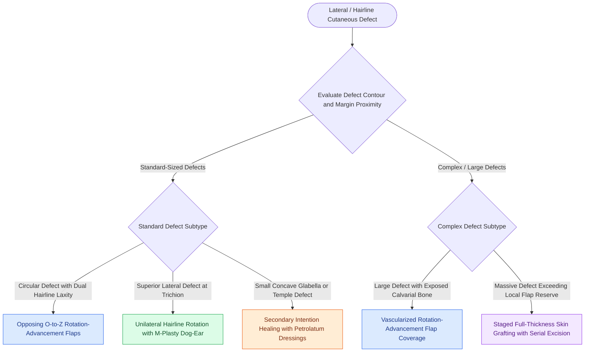

# O-to-Z rotation-advancement flaps and secondary intention healing reconstruct lateral forehead defects and concave anatomical transition zones

## Active Recall

> [!question]- In which anatomical areas of the forehead does healing by secondary intention achieve cosmetic outcomes comparable or superior to flap reconstruction?
> *Answer / Clinical Rationale*: Secondary intention healing achieves excellent cosmetic results in **concave anatomical zones**, specifically the **medial canthal-glabellar junction** and the **temporal fossa**. In contrast, secondary intention over the convex paramedian forehead or central frontal bossing produces unsightly, depressed, hypopigmented, telangiectatic scars with a high risk of cicatricial brow distortion.

> [!question]- What is the geometric advantage of an O-to-Z flap design over a single large rotation flap for forehead defect repair?
> *Answer / Clinical Rationale*: An **O-to-Z closure utilizes two opposing curvilinear rotation-advancement flaps** pivoting in opposite directions around a circular defect. By recruiting tissue symmetrically from two separate directions, the required circumference arc and flap size are halved, distributing wound tension across dual vectors and avoiding large diagonal scars across forehead rhytids.

## Core Clinical & Mechanistic Principles
Reconstruction of sizable cutaneous defects of the lateral forehead and temporal transition zone requires balancing tissue mobility against the curvilinear borders of the anterior hairline and lateral eyebrow. While linear advancement is standard in the central forehead, [[Rhombic and Limberg flaps transpose tissue into sixty-degree and one-hundred-twenty-degree defects|transposition flaps]] and rotation-advancement flaps exploit the greater laxity of the temple to close wounds under minimal closure tension.

Curvilinear rotation mechanics and secondary intention are guided by distinct anatomic principles:
1. **O-to-Z Rotation-Advancement Design**: Converts a round ("O") defect into a lazy "Z" closure line. Two opposing curved incision lines are extended from opposite sides of the defect: one sweeping superiorly along the anterior trichion and the other sweeping inferiorly along a transverse forehead furrow or lateral brow margin. The two flaps are widely undermined in the subfascial or subcutaneous plane and rotated toward each other. The resulting central diagonal scar rests in a natural skin crease, while peripheral incision limbs hide along the hairline.
2. **Unilateral Hairline Rotation Flap**: For superior lateral forehead defects near the frontal-temporal junction, a single large inferiorly based rotation flap following the anterior hairline provides robust vascularity. The pivotal standing cone located medially is excised using an M-plasty or W-plasty to avoid encroaching onto the eyebrow cilia.
3. **Healing by Secondary Intention**: Zitelli's cosmetic appraisal demonstrates that wound contracture and re-epithelialization vary dramatically based on underlying skeletal contour. Concave regions (the medial glabella and shallow temple fossa) exhibit minimal wound tension and contract symmetrically, producing flat, pale, inconspicuous scars. However, secondary intention over the convex calvarium or within 1 cm of the eyebrow leads to persistent granulation, hypertrophic contracture, and upward brow retraction.
4. **Management of Bone and Pericranium**: Secondary intention or skin grafting requires a viable vascularized wound bed. Intact, vascularized pericranium readily granulates within 2 to 3 weeks. If the pericranium is resected leaving bare cortical bone, secondary intention will fail and lead to osteonecrosis; coverage requires vascularized local flaps or preliminary [[Full-thickness and split-thickness skin grafts differ in primary contraction and vascular take|full-thickness skin graft]] placement followed by delayed serial excision.

### Staged Serial Excision for Massive Forehead Wounds
- **Temporary Skin Graft Staging**: In extensive forehead defects ($>5\text{ to }6\text{ cm}$) where local flap mobilization would cause extreme brow distortion, the wound bed is initially resurfaced with a full-thickness or split-thickness skin graft. After 4 to 6 months of graft maturation and tissue relaxation, serial partial excisions of the graft are performed in the subgaleal plane, advancing normal forehead skin inward until the entire graft is replaced by adjacent forehead skin.

## Connected Concepts & Graph Traversal
- **Calvarial Bone Management**: [[Calvarial bone denuded of periosteum requires outer table burring to diploic bone or vascularized flap coverage to prevent osteonecrosis|Denuded Calvarial Management]]
- **Scalp Rotation Mechanics**: [[Scalp local flap design exploits loose temporoparietal tissue laxity and galeal scoring to reconstruct rigid vertex defects|Scalp Local Flap Dynamics]]
- **Linear Advancement Comparison**: [[Advancement flaps recruit adjacent tissue laxity along a linear vector without rotation|Linear Advancement Biomechanics]]
- **Subunit Preservation**: [[Gonzalez-Ulloa facial aesthetic subunits guide complete subunit reconstruction|Facial Subunit Restoration]]
- **Vascular Angiosomes**: [[Facial angiosomes and perforator choke zones determine cutaneous flap survival boundaries|Facial Angiosomes & Perforators]]
