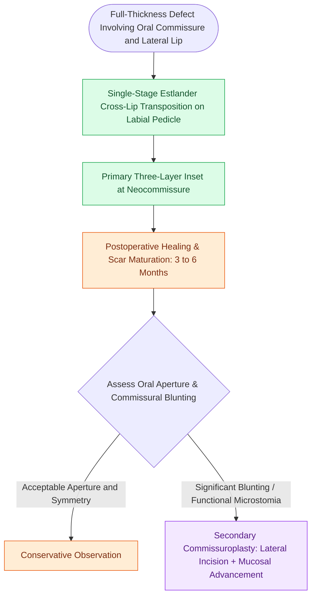

# Oral commissure reconstruction balances single-stage Estlander transpositions against staged commissuroplasty to prevent microstomia and incontinence

## Active Recall

> [!question]- What is the primary morphological deformity that develops following single-stage Estlander flap transposition for lateral lip defects?
> *Answer / Clinical Rationale*: **Rounding and blunting of the reconstructed oral commissure**, causing asymmetry of the oral stoma that becomes conspicuous when opening the mouth.

> [!question]- How does secondary commissuroplasty restore the sharp acute lateral angle of the oral commissure?
> *Answer / Clinical Rationale*: By performing a **horizontal lateral incision** extending to the planned new commissure, excising a small triangle of skin/subcutis, and **advancing superior and inferior mucosal slips** to line the neocollateral vermilion borders.

## Core Clinical & Mechanistic Principles
The oral commissure functions as a critical biomechanical pivot point where the orbicularis oris, buccinator, zygomaticus major, and depressor anguli oris decussate at the **modiolus**. Defect repair must preserve oral competence, prevent drooling, and maintain sufficient aperture for mastication and dental care.

When full-thickness defects involve the lateral third of the lip and the commissure:
- **Estlander Cross-Lip Transposition Flap**: The classic single-stage reconstructive choice. Tissue is transferred from the opposite (usually upper) lip on an axial pedicle containing the labial artery. Because the pedicle is pivoted directly into the newly constructed commissure, no separate pedicle division stage is needed. However, transposition rounds the lateral angle of the mouth and shifts the commissure medially, producing focal microstomia.
- **Baker Melolabial Modification**: In superiorly based Estlander flap designs, curving the flap apex so the donor site closure aligns neatly within the melolabial crease minimizes visible facial scarring.
- **Secondary Commissuroplasty Protocols**:
  - *Standard Mucosal Advancement*: A horizontal incision is made through the blunted neocommissure extending laterally to match the contralateral commissure distance. Oral mucosa is mobilized and advanced outward to re-create the vermilion margin.
  - *Interdigitating Flap (Dieffenbach/Converse)*: Incorporates small interdigitating mucosal vermilion flaps and vermilion-cutaneous transposition to re-establish an acute angular oral apex.
  - *Timing*: Typically performed 3 to 6 months following primary reconstruction once wound contraction has stabilized.

### Functional and Aesthetic Balances
1. **Sphincteric Competence vs Aperture**: Preserving the modiolus prevents oral incontinence. The Estlander flap reliably maintains competence because dynamic muscular decussation is reconstructed, even if aperture diameter is moderately reduced.
2. **Comparison with [[Karapandzic orbicularis oris myocutaneous rotation flaps preserve oral sphincter innervation|Karapandzic flaps]]**: While Karapandzic flaps distribute tension circumferentially around both commissures, Estlander concentrates transposition on the affected side, leaving the contralateral commissure unaffected.

## Connected Concepts & Graph Traversal
- **Cross-Lip Flap Comparison**: [[Abbe and Estlander cross-lip flaps are pedicled on the labial artery to repair lip defects|Abbe & Estlander Flaps]]
- **Cheek Advancement Alternative**: [[Gilles fan flaps and Webster-Bernard cheek advancements reconstruct large lower lip defects|Gilles Fan & Webster-Bernard Flaps]]
- **Aesthetic Subunits**: [[Gonzalez-Ulloa facial aesthetic subunits guide complete subunit reconstruction|Facial Aesthetic Subunits]]
- **Subtotal Reconstructive Ladder**: [[Near-total lip reconstruction combines functional local muscle flaps with microvascular free flaps|Near-Total Lip Reconstruction]]
- **Linear Advancement Biomechanics**: [[Advancement flaps recruit adjacent tissue laxity along a linear vector without rotation|Advancement Flaps]]
- **Delayed Burn Reconstruction**: [[Pediatric oral commissure electrical burns risk delayed labial artery hemorrhage and require dynamic microstomia splinting|Post-Burn Commissuroplasty]]
