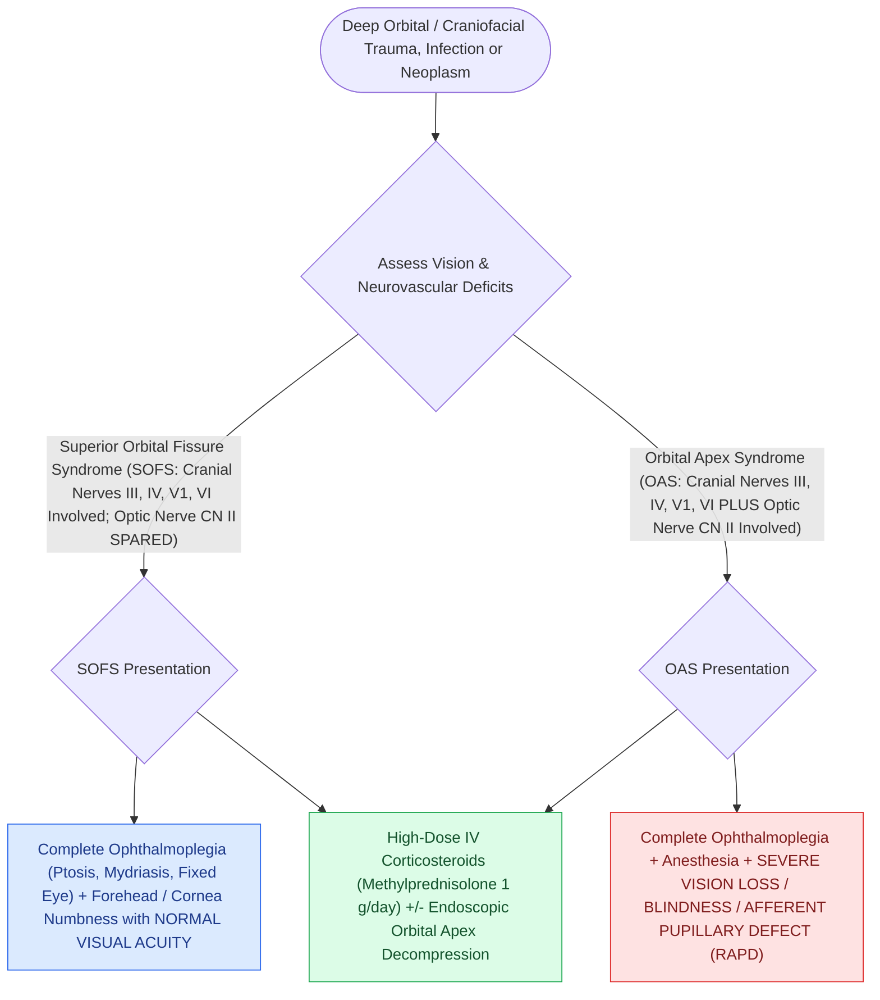

# Orbital apex syndrome and superior orbital fissure syndrome manifest with ophthalmoplegia and vision loss

## Active Recall

> [!question]- What single clinical finding distinguishes Orbital Apex Syndrome from Superior Orbital Fissure Syndrome?
> *Answer / Clinical Rationale*: **Visual loss / optic neuropathy (CN II involvement)**, which is present in Orbital Apex Syndrome but absent in Superior Orbital Fissure Syndrome.

> [!question]- What cranial nerves pass through the Superior Orbital Fissure?
> *Answer / Clinical Rationale*: **CN III (Oculomotor), CN IV (Trochlear), CN V1 (Ophthalmic division of trigeminal), and CN VI (Abducens)**.

## Core Clinical & Mechanistic Principles
[[Acute retrobulbar hematoma in facial trauma requires immediate bedside lateral canthotomy|Trauma]] or compressive lesions involving the superior orbital fissure and optic canal produce distinct, localized neuro-ophthalmological syndromes differentiated by the presence or absence of **Optic Nerve (CN II) visual impairment**.

### Emergency Management Paradigm
- **High-Resolution CT**: Evaluate for displaced bony spicules compressing the optic canal or orbital apex.
- **Decompression**: If bony impingement is present, **urgent endoscopic transethmoidal/transsphenoidal optic nerve decompression** is indicated.

## Connected Concepts & Graph Traversal
- **Retrobulbar Emergency**: [[Acute retrobulbar hematoma in facial trauma requires immediate bedside lateral canthotomy|Retrobulbar Hematoma]]
- **Blowout Trauma**: [[Pediatric white-eyed blowout fractures cause muscle entrapment requiring emergent surgical release|Blowout Fractures]]
- **ZMC Buttress**: [[Zygomaticomaxillary complex fractures disrupt four buttress articulations requiring multi-point reduction|ZMC Fractures]]
- **Diagnostic Evaluation**: [[Coronoidectomy relieves severe trismus caused by temporalis impingement under displaced zygomatic arch|Mandibular Coronoidectomy]]
- **Anatomical Foundation**: [[Panfacial fracture reconstruction proceeds from known stable peripheral buttresses to central occlusion|Panfacial Fracture Sequencing]]
- **Surgical Craft**: [[Maxillomandibular fixation MMF using arch bars, hybrid systems, and IMF screws re-establishes occlusion|Maxillomandibular Fixation (MMF / IMF)]]
