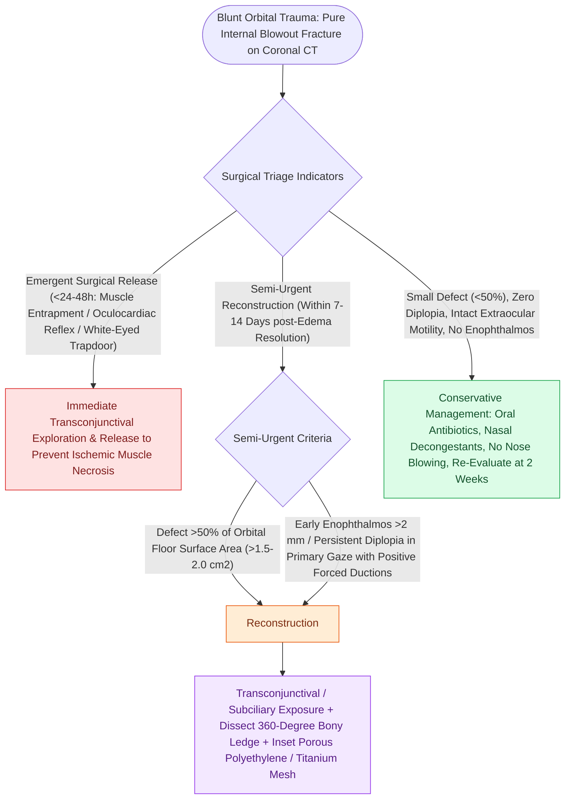

# Orbital floor blowout fractures with muscle entrapment or significant enophthalmos mandate reconstruction

## Active Recall

> [!question]- What clinical criteria establish the definitive surgical indications for repairing an isolated adult orbital floor blowout fracture?
> *Answer / Clinical Rationale*: (1) **Persistent symptomatic diplopia** within primary or down-gaze fields of view with a positive forced duction test; (2) **Significant early enophthalmos ($>2\text{ mm}$)** or hypoglobus; (3) **Large orbital floor fracture defect involving $>50\%$ of the orbital floor area** (or $>1.5\text{ cm}^2$, which carries a high risk for late fat atrophy and post-traumatic enophthalmos).

> [!question]- Why is the pediatric "white-eyed blowout fracture" considered a true surgical emergency requiring reduction within 24 to 48 hours?
> *Answer / Clinical Rationale*: Due to greater bone elasticity, pediatric orbital floors undergo greenstick "trapdoor" buckling that snaps shut, tightly entrapping the **inferior rectus / inferior oblique muscle complex and its autonomic nerve fibers**. This produces rapid ischemic muscle necrosis, permanent fibrosis, and severe **oculocardiac reflex** (profound bradycardia, syncope, nausea, and vomiting).

> [!question]- Why is identification of the posterior bony ledge essential during orbital floor reconstruction, and what intraoperative check must follow implant seating?
> *Answer / Clinical Rationale*: The posterior orbital floor slopes upward toward the apex; failing to seat the implant on the **stable posterior bony ledge** (palatine/ethmoid ledge anterior to the optic canal) leads to posterior implant drop into the maxillary sinus and recurrent enophthalmos. Immediately after implant seating, a **forced duction test** must be performed to confirm free passive globe excursion and rule out iatrogenic muscle/periorbital entrapment.

## Core Clinical & Mechanistic Principles
**Orbital floor blowout fractures** occur when hydraulic pressure or direct buckling forces to the orbital rim transmit energy to the thin bones of the orbital floor (maxillary bone medial to the infraorbital groove) and medial orbital wall (lamina papyracea):

- **Biomechanical Mechanisms**:
  - *Hydraulic Theory*: Blunt globe compression abruptly elevates intraorbital hydrostatic pressure, blowing out the thinnest bony walls.
  - *Buckling Theory*: Direct impact to the inferior orbital rim transmits a compressive stress wave along the orbital floor, causing structural collapse without rim disruption.
- **Consequences of Orbital Floor Collapse**:
  - Herniation of orbital fat and soft tissue into the maxillary sinus.
  - Increase in total orbital cavity volume: Each **$1\text{ cm}^3$ volume expansion** results in approximately **$1\text{ mm}$ of posterior globe displacement (enophthalmos)**.
  - Mechanical restriction of vertical gaze (diplopia on up-gaze and down-gaze) due to perimuscular fibrous connective tissue tethering.

### Surgical Technique & Craft Nuance
1. **Surgical Corridors**:
   - **Transconjunctival Approach** (pre-septal or retro-septal): Leaves no visible cutaneous scar; [[Acute retrobulbar hematoma in facial trauma requires immediate bedside lateral canthotomy|lateral canthotomy]] and inferior cantholysis can be added for wide exposure.
   - **Subciliary (Infraciliary) Approach**: Placed $2\text{ mm}$ below the lower lid lash line; carries a slightly higher risk of post-operative [[Lateral canthopexy and lateral tarsal strip suspension prevent post-blepharoplasty ectropion|ectropion]] or scleral show.
2. **Dissection & Herniation Reduction**:
   - Incise periorbita along the inferior orbital rim and elevate in a subperiosteal plane.
   - Trace the dissection posteriorly until the **stable posterior bony ledge** (anterior to the orbital apex and optic canal) is identified $360^\circ$ around the defect.
3. **Implant Selection & Placement**:
   - Pre-shaped or hand-bent **titanium mesh**, high-density porous polyethylene (Medpor®), or resorbable PLLA/PGA plates are contoured to recreate the gentle upward sloping "orbital hillock".
   - The implant must rest securely on the anterior, medial, and posterior bony ledges to prevent migration into the maxillary sinus.
4. **Mandatory Final Safeguards**:
   - Perform a **forced duction test** immediately after implant seating to confirm completely unhindered extraocular motility.
   - Re-approximate periorbita; close conjunctiva with buried absorbable sutures.
5. **Absolute Contraindication & Hyphema Timing**: Traumatic **hyphema** is an absolute contraindication to immediate elective blowout fracture repair. Surgical exploration must be delayed for **at least 5 days** under strict ophthalmologic care to permit clot stabilization and clearing. Orbital retraction and instrument manipulation in the presence of active hyphema causes acute spikes in intraocular pressure, risking secondary anterior chamber hemorrhage, corneal blood staining, and intractable secondary glaucoma.

## Connected Concepts & Graph Traversal
- **ZMC Tetrapod Fractures**: [[Zygomaticomaxillary complex fractures disrupt four buttress articulations requiring multi-point reduction|ZMC Complex Trauma]]
- **Pediatric Entrapment Emergency**: [[Pediatric white-eyed blowout fractures cause muscle entrapment requiring emergent surgical release|Pediatric White-Eyed Blowout]]
- **Acute Compartment Rescue**: [[Acute retrobulbar hematoma in facial trauma requires immediate bedside lateral canthotomy|Retrobulbar Hematoma Rescue]]
- **🔗 Medial Wall Fractures (Sinus)**: [[Lamina papyracea dehiscence predisposes to orbital fat herniation and medial rectus injury|Lamina Papyracea Dehiscence & Orbit]]
- **Anatomical Foundation**: [[The Zitelli bilobed flap restricts rotation to ninety degrees to prevent pincushioning|Zitelli Bilobed Flap]]
