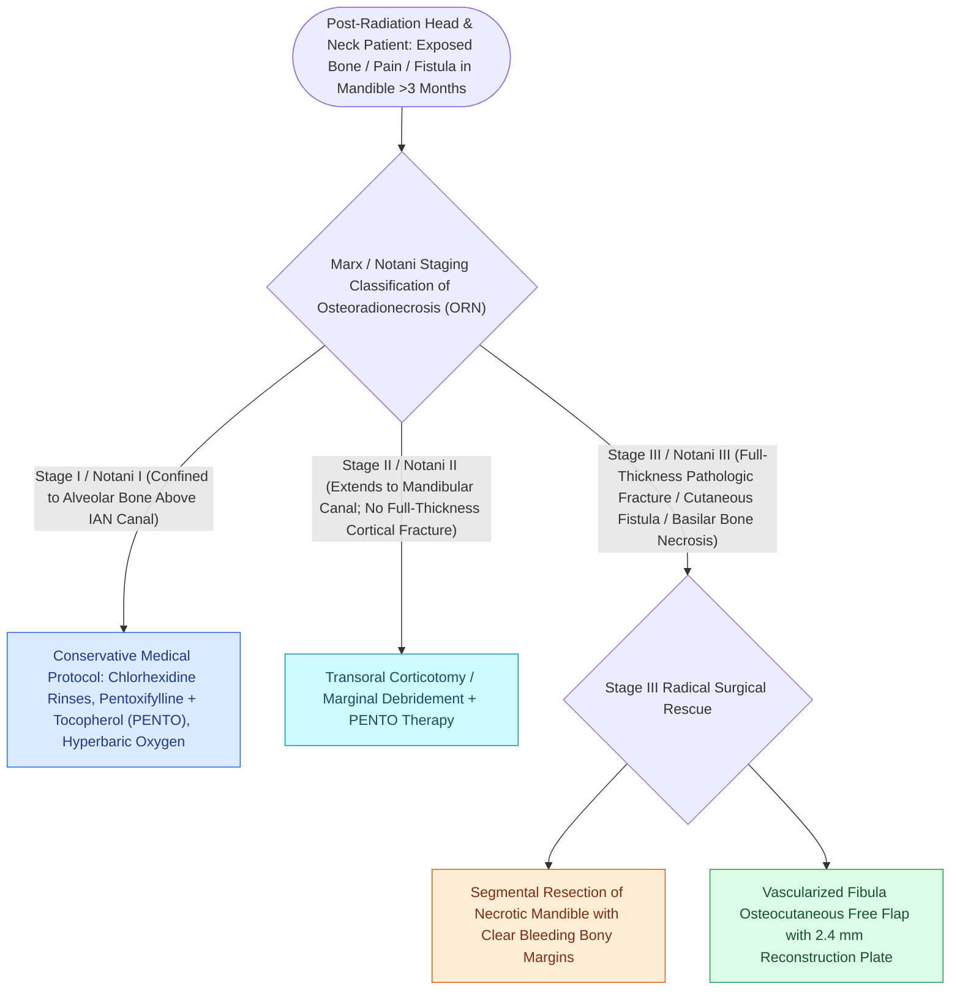

# Osteoradionecrosis of the mandible requires radical bony debridement and vascularized fibula free flap repair

## Active Recall

> [!question]- What is Marx's classic '3H' triad describing the pathophysiology of osteoradionecrosis?
> *Answer / Clinical Rationale*: **Hypocellular, Hypovascular, and Hypoxic** tissue bed resulting from radiation-induced obliterative endarteritis.

> [!question]- Why is a vascularized bone free flap (Fibula) superior to non-vascularized bone grafts in ORN reconstruction?
> *Answer / Clinical Rationale*: Non-vascularized bone grafts fail completely and necrose in irradiated, hypoxic wound beds; **a vascularized fibula flap brings its own independent axial blood supply**, ensuring primary bone union and soft tissue healing.

## Core Clinical & Mechanistic Principles
**Mandibular Osteoradionecrosis (ORN)** is a severe, debilitating complication of head and neck radiotherapy ($>60\text{ Gy}$) characterized by exposed, necrotic bone persisting for $>3\text{ months}$ without tumor recurrence.

Pathophysiologically, radiation induces **endothelial injury, microvascular thrombosis, and tissue hypoxia (Marx's 3H principle: Hypocellular, Hypovascular, Hypoxic)**, leading to secondary radiation-induced fibroatrophic disease. Stage III full-thickness pathologic fractures or cutaneous fistulae mandate segmental mandibulectomy to bleeding bony margins and reconstruction with a **[[The fibula free flap provides vascularized cortical bone for composite mandibular reconstruction|vascularized fibula osteocutaneous free flap]]** while [[Preserving the distal five centimeters of the fibula prevents ankle instability and talar tilt|preserving the distal fibular strut]].

### The Pentoxifylline & Tocopherol Protocol (PENTOCLO)
- **Pentoxifylline**: Methylxanthine derivative; improves erythrocyte flexibility, decreases blood viscosity, and downregulates TNF-$\alpha$.
- **Tocopherol (Vitamin E)**: Potent antioxidant that neutralizes reactive oxygen species and halts radiation fibrosis.

## Connected Concepts & Graph Traversal
- **Workhorse Flap**: [[The fibula free flap provides vascularized cortical bone for composite mandibular reconstruction|Fibula Free Flap]]
- **Distal Safety**: [[Preserving the distal five centimeters of the fibula prevents ankle instability and talar tilt|Fibula Harvest Safety]]
- **Microvascular Salvage**: [[Microvascular free flap salvage requires urgent re-exploration within two hours of vascular compromise|Free Flap Salvage]]
- **Reconstructive Ladder**: [[Chimeric free flaps combine independent bone, muscle, and skin paddles on a common vascular branch|Chimeric Free Tissue Transfer]]
- **Surgical Craft**: [[Postoperative free flap anticoagulation and antiplatelet protocols balance thrombosis against hematoma|Microvascular Anticoagulation Protocols]]
