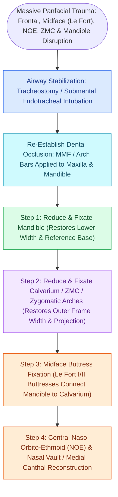

# Panfacial fracture reconstruction proceeds from known stable peripheral buttresses to central occlusion

## Active Recall

> [!question]- What is the foundational first step in the systematic reduction of panfacial fractures?
> *Answer / Clinical Rationale*: **Re-establishing dental occlusion via [[Maxillomandibular fixation MMF using arch bars, hybrid systems, and IMF screws re-establishes occlusion|MMF]] and rigid fixation of the mandible**, which provides a stable, measured template for the lower face.

> [!question]- What anatomical structure dictates the transverse facial width during panfacial reconstruction?
> *Answer / Clinical Rationale*: The **zygomatic arches and the zygomaticomaxillary buttresses**.

## Core Clinical & Mechanistic Principles
**Panfacial fractures** involve simultaneous disruption of all three facial tiers: the **upper face (frontal bone/NOE), midface ([[Le Fort I fractures separate the hard palate and require bilateral buttress plate fixation|Le Fort I]]–III, ZMC), and lower face (mandible)**.

Reconstruction must follow a systematic, step-by-step sequencing algorithm to restore three-dimensional facial **height, width, and projection**.

### The "Bottom-Up, Outside-In" Axiom
- Build the foundation (Mandible + Occlusion)  $\r\r\rightarrow$ Establish the outer frame (ZMC + Frontal)  $\r\r\rightarrow$ Connect the midface buttresses  $\r\r\rightarrow$ Fine-tune the central core (NOE + Orbit).

## Connected Concepts & Graph Traversal
- **Mandible Plating**: [[Champy lines of ideal osteosynthesis dictate monocortical miniplate fixation along mandibular tension zones|Champy's Mandible Plating]]
- **Le Fort Buttresses**: [[Le Fort II pyramidal and Le Fort III craniofacial disjunction fractures disrupt facial buttresses|Le Fort II & III Buttresses]]
- **ZMC Tetrapod**: [[Zygomaticomaxillary complex fractures disrupt four buttress articulations requiring multi-point reduction|ZMC Fixation]]
- **Pathological Mechanism**: [[Orbital apex syndrome and superior orbital fissure syndrome manifest with ophthalmoplegia and vision loss|Orbital Apex Syndrome (OAS)]]
- **Diagnostic Evaluation**: [[Coronoidectomy relieves severe trismus caused by temporalis impingement under displaced zygomatic arch|Mandibular Coronoidectomy]]
- **Critical Safety / Complication**: [[Osteoradionecrosis of the mandible requires radical bony debridement and vascularized fibula free flap repair|Mandibular Osteoradionecrosis (ORN)]]
