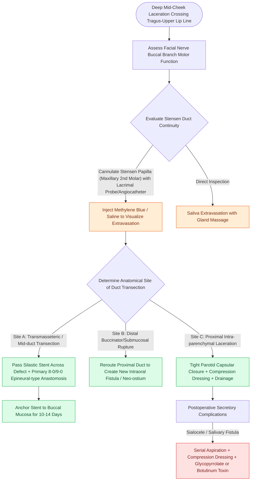

# Parotid duct laceration requires primary microsurgical repair over a silastic stent to prevent sialocele and salivary fistula

## Active Recall

> [!question]- What surface anatomical landmark defines the trajectory of Stensen's duct, and what neural structure is intimately co-located?
> *Answer / Clinical Rationale*: Stensen's (parotid) duct follows a straight trajectory along the **middle third of a line drawn from the tragus to the mid-portion of the upper lip** (or oral commissure). It courses horizontally across the superficial surface of the **masseter muscle**, turns abruptly medially at its anterior border, pierces the **buccinator muscle**, and opens into the oral cavity at the parotid papilla opposite the **maxillary second molar**. The **buccal branch of the facial nerve (CN VII)** and the **transverse facial artery** course in intimate parallel proximity; any injury to Stensen's duct mandates meticulous assessment for buccal branch palsy.

> [!question]- How is a suspected Stensen duct transection confirmed at the bedside or in the operating room?
> *Answer / Clinical Rationale*: Confirmation is performed by **cannulating Stensen's papilla intraorally** opposite the maxillary second molar using a **00 or 0 lacrimal probe or a 20- to 24-gauge plastic angiocatheter**. Injection of sterile normal saline or dilute **methylene blue** into the intraoral papilla will result in direct extravasation of colored fluid from the cut ends of the duct into the open facial wound. Alternatively, gentle external compression over the parotid parenchyma may express clear saliva through the proximal duct stump in the wound bed.

> [!question]- What is the surgical technique for Stensen duct anastomosis, how long is the stent maintained, and how is an intra-parenchymal injury managed?
> *Answer / Clinical Rationale*:
> - **Ductal Transection Repair**: A silastic catheter or pediatric feeding tube is passed through the oral papilla, across the distal duct stump, and threaded into the proximal duct lumen. The duct ends are approximated with interrupted **8-0 or 9-0 nylon or monofilament absorbable sutures** under loupe magnification. The stent is anchored to the oral buccal mucosa with a 4-0 suture and maintained for **10 to 14 days** to prevent cicatricial stricture.
> - **Intra-parenchymal Laceration (Proximal to Masseter)**: Ductal repair is not possible. The lacerated parotid parenchyma and parotid capsule are closed primarily with layered absorbable sutures, a drain or compression dressing is applied, and salivary flow is suppressed.

## Core Clinical & Mechanistic Principles

Penetrating lacerations crossing the mid-cheek along the vector connecting the tragus to the upper lip frequently transect Stensen's duct. Unrecognized or improperly managed ductal injuries lead to persistent **sialocele formation** (subcutaneous accumulation of saliva), **cutaneous salivary fistulae**, or chronic obstructive suppurative parotitis.

### Stensen Duct Anatomical Zones & Management Strategies

| Anatomical Zone | Boundaries & Relationships | Surgical Management Approach |
| :--- | :--- | :--- |
| **Zone 1: Intra-parenchymal / Posterior** | Emergence from anterior parotid border posterior to masseter muscle edge | Primary duct repair is generally impossible due to arborization; close parotid capsule tightly; drain wound; apply pressure dressing |
| **Zone 2: Transmasseteric / Middle** | Crossing superficial surface of masseter muscle; intimately associated with buccal nerve branch | Primary end-to-end microsurgical anastomosis over a silastic stent using **8-0 or 9-0 nylon**; stent secured for **$10\text{–}14\text{ days}$** |
| **Zone 3: Buccinator / Oral Submucosa** | Turning medially around anterior masseter, piercing buccinator, entering papilla | Primary repair or rerouting of proximal duct stump directly into oral cavity mucosa (**intraoral marsupialization / neo-ostium**) |

### Complication Management: Sialocele & Salivary Fistula

1. **Pathophysiology**:
   - Arises when severed parotid acini continue to secrete saliva into the subcutaneous tissue space following wound closure.
   - Creates a tense, fluctuating, non-tender cheek swelling (sialocele) or leaks saliva externally through the skin incision during mastication (external salivary fistula).
2. **Stepwise Treatment Algorithm**:
   - **Step 1 (First-Line Conservative)**: Serial percutaneous sterile needle aspirations combined with continuous elastic compressive pressure dressings and an antisialagogue diet (avoid citrus, sour foods, and gum chewing).
   - **Step 2 (Pharmacological Secretory Suppression)**:
     - **Oral Anticholinergics**: Glycopyrrolate ($1\text{–}2\text{ mg}$ PO BID to TID) or scopolamine patches to suppress parasympathetic secretomotor drive.
     - **Intra-parenchymal Botulinum Toxin Injection**: Injection of **$20\text{–}50\text{ units}$ of OnabotulinumtoxinA** into the periductal parotid parenchyma induces chemical secretomotor denervation of acini, producing complete resolution of refractory sialoceles and fistulae within $3\text{ to }7\text{ days}$.
   - **Step 3 (Refractory Surgical Management)**: Complete surgical re-exploration, tympanic neurectomy (dividing Jacobsen's nerve on the promontory to abolish secretomotor parasympathetic drive), or formal superficial/total parotidectomy.

Comprehensive physiological and surgical principles connect these findings directly to [[Superficial parotidectomy dissects the facial nerve branches to resect the lateral salivary lobe|parotid dissection planes]].

## Connected Concepts & Graph Traversal
- **Facial Nerve Anatomy**: [[The marginal mandibular nerve courses deep to platysma over the facial vessels|Marginal Mandibular and Buccal Nerve Branches]]
- **Suture Reactivity**: [[Monofilament versus braided absorbable and non-absorbable sutures have distinct tissue reactivity|Fine Monofilament Suture Mechanics]]
- **Chemodenervation**: [[Cosmetic botulinum toxin treats dynamic rhytids through presynaptic acetylcholine blockade|Botulinum Toxin Secretomotor Blockade]]
- **Concomitant Neural Transection Repair**: [[Epineural neurorrhaphy and cable nerve grafting restore facial continuity within twelve months|Buccal Branch Epineural Neurorrhaphy]]
- **Cheek Surgical Plane & Parotid Fascia**: [[Cheek reconstruction employs deep SMAS plane elevation superficial to the zygomaticus major to restore volume contour defects while preserving the facial nerve|Parotid-Masseteric Fascia & Cheek SMAS]]
