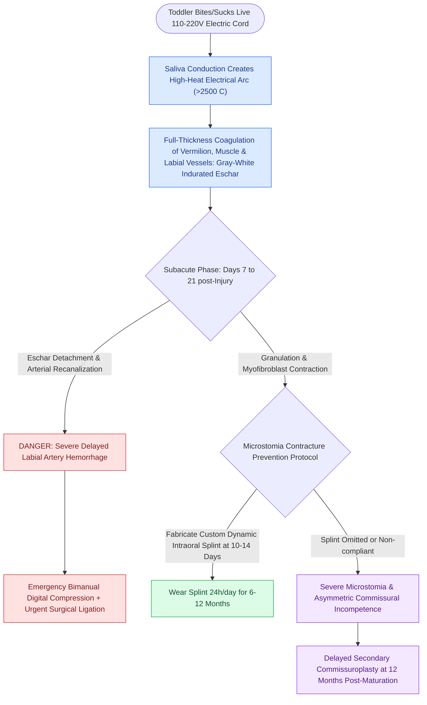

# Pediatric oral commissure electrical burns risk delayed labial artery hemorrhage and require dynamic microstomia splinting

## Active Recall

> [!question]- What is the typical patient demographic and biophysical mechanism of oral commissure electrical burns?
> *Answer / Clinical Rationale*: The classic demographic is **children under 4 years of age (toddlers)** who bite or chew on a live electrical cord or appliance extension plug. The biophysical mechanism is an **electrical arc injury** created by saliva bridging the electrical gap: saliva acts as an electrolyte-rich conductor, generating an intense electrical arc exceeding **$2500^\circ\text{C}$ to $3000^\circ\text{C}$**. This produces immediate full-thickness thermal and coagulation necrosis involving the vermilion, orbicularis oris muscle, oral commissure, and labial arteries.

> [!question]- Why is there a catastrophic risk of hemorrhage at 1 to 3 weeks post-injury, and what instructions must parents receive?
> *Answer / Clinical Rationale*: At **7 to 21 days (1 to 3 weeks)** post-injury, the necrotic coagulated eschar sloughs from the commissure. The underlying **superior and inferior labial arteries**, which were thrombosed during the initial electrical arc, undergo enzymatic lysis and recanalization. When the eschar detaches, sudden, pulsatile, **life-threatening arterial hemorrhage** can occur. Parents must be explicitly trained in **emergency bimanual digital pressure**: pinching the affected lip and commissure between the thumb inside the mouth and the index finger outside over the labial artery while calling emergency medical services.

> [!question]- Why is immediate surgical debridement contraindicated, and what is the standard protocol for microstomia prevention?
> *Answer / Clinical Rationale*: Immediate debridement is contraindicated because the true border between viable and nonviable tissue cannot be determined acutely, and early excision results in **unnecessary loss of orbicularis oris muscle and severe oral incompetence**. Conservative management with topical antibiotic ointment is maintained until the eschar spontaneously separates. To prevent severe cicatricial contracture and microstomia, **custom dynamic intraoral microstomia splints** are initiated within **10 to 14 days** of injury and worn **24 hours per day for 6 to 12 months** (removed only for eating and oral hygiene). Secondary reconstructive commissuroplasty is delayed until scar maturation at **12 months**.

## Core Clinical & Mechanistic Principles

Oral commissure burns in the pediatric population represent unique thermal-electrical injuries characterized by three distinct clinical phases: acute arc coagulative necrosis, subacute eschar separation with lethal hemorrhage risk, and chronic cicatricial microstomia contracture.

### Three-Phase Clinical Evolution Ledger

| Clinical Phase | Timing Post-Burn | Pathophysiology & Presentation | Mandatory Clinical Action |
| :--- | :--- | :--- | :--- |
| **Phase 1: Acute Coagulation** | Hours to Day 3 | Massive painless perioral edema; central depressed, painless, yellowish-white or gray charred necrotic eschar at commissure | Airway evaluation; conservative wound care (bacitracin ointment); **do not excise eschar** |
| **Phase 2: Eschar Separation** | Days 7 to 21 (1–3 weeks) | Enzymatic liquefaction and sloughing of eschar; exposes thrombosed labial arteries prone to rupture | Instruct parents on **bimanual digital compression**; bedside suture ligation set ready |
| **Phase 3: Cicatricial Maturation** | 3 Weeks to 12 Months | Intense myofibroblastic contracture pulling the oral commissure medially and vertically, causing severe microstomia | Continuous **dynamic microstomia splinting** for 6–12 months; secondary commissuroplasty after 1 year |

### Splinting Protocol vs Secondary Reconstruction

1. **Conservative Management & Dynamic Splinting**:
   - The cornerstone of modern management is **non-operative healing combined with oral splinting**.
   - Custom acrylic or thermoplastic dynamic commissure splints (e.g., modified microstomia arch with lateral commissural posts) exert continuous lateral distraction on the healing oral aperture.
   - Initiated as soon as acute edema resolves and epithelial margins begin healing ($\sim 10\text{–}14\text{ days}$).
   - Must be worn **$24\text{ hours/day}$ for the first 6 months**, tapering to nighttime wear for an additional 6 months until scar maturation is complete. This avoids surgical intervention in **over $50\%\text{ to }70\%$** of cases.

2. **Secondary Surgical Reconstruction (Delayed $\ge 12\text{ Months}$)**:
   - Reserved for patients with persistent microstomia, asymmetric oral aperture, or deficient vermilion after complete scar maturation.
   - **Techniques**:
     - *Converse Commissuroplasty*: Re-creates the lateral commissural apex using triangular vermilion advancement flaps.
     - *Estlander Flap*: Transposes a full-thickness triangular flap from the opposite (uninvolved) lip based on the labial artery to restore commissural volume.
     - *Vermilion mucosal advancement / buccal mucosal sliding flaps*: Replaces lost vermilion bulk.

Comprehensive physiological and surgical principles connect these findings directly to [[Inspiratory, biphasic, and expiratory stridor localize pediatric airway obstruction to supraglottic, subglottic, and tracheobronchial subsites|pediatric airway stabilization]].

## Connected Concepts & Graph Traversal
- **Vascular Anatomy**: [[The facial artery and facial vein provide the primary vascular supply to the anterior face|Facial and Labial Artery Anatomy]]
- **Cross-Lip Flaps**: [[Abbe and Estlander cross-lip flaps are pedicled on the labial artery to repair lip defects|Abbe and Estlander Lip Flaps]]
- **Orbicularis Anatomy**: [[Karapandzic orbicularis oris myocutaneous rotation flaps preserve oral sphincter innervation|Karapandzic Sphincteric Flaps]]
- **Lip Reconstruction**: [[Near-total lip reconstruction combines functional local muscle flaps with microvascular free flaps|Near-Total Lip Reconstruction]]
- **Scar Biomechanics**: [[Relaxed skin tension lines minimize scar hypertrophy along perpendicular muscular vectors|RSTL and Scar Contracture]]
