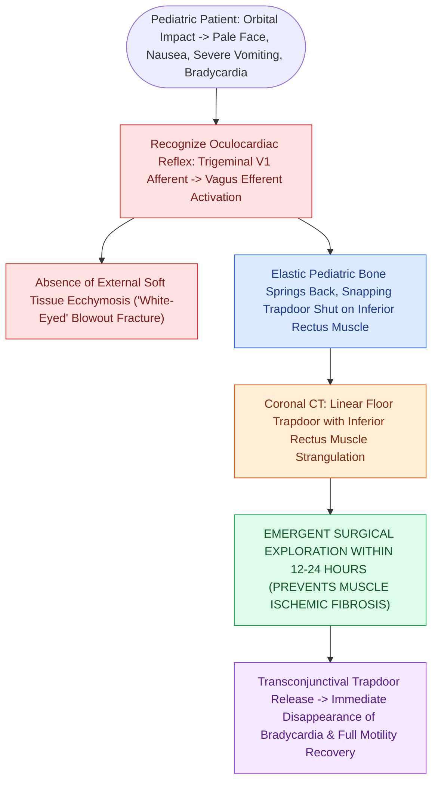

# Pediatric white-eyed blowout fractures cause muscle entrapment requiring emergent surgical release

## Active Recall

> [!question]- Why is a pediatric 'white-eyed' trapdoor fracture considered an emergent surgical indication within hours, whereas adult blowout fractures can wait days?
> *Answer / Clinical Rationale*: In pediatric greenstick trapdoors, the bone snaps shut and strangulates the **inferior rectus muscle blood supply**, leading to irreversible ischemic muscle necrosis and permanent fibrotic diplopia within 24–48 hours.

> [!question]- What physiological reflex is triggered by traction on an entrapped extraocular muscle?
> *Answer / Clinical Rationale*: The **oculocardiac reflex** (CN V1 afferent  $\r\r\rightarrow$ CN X efferent), manifesting with profound bradycardia, nausea, vomiting, and syncope.

## Core Clinical & Mechanistic Principles
A **Pediatric "White-Eyed" Blowout Fracture** is a true, sight- and muscle-threatening surgical emergency that requires **emergent surgical release within hours**.

Because pediatric bone is highly elastic and compliant (greenstick properties), sudden hydraulic orbital pressure causes the [[Orbital floor blowout fractures with muscle entrapment or significant enophthalmos mandate reconstruction|orbital floor]] to fracture downward, allowing orbital contents to prolapse. The elastic bone immediately **snaps back into position (trapdoor mechanism)**, tightly incarcerating the **inferior rectus muscle** and surrounding periorbital tissue.

### The Oculocardiac Reflex Mechanism
- Afferent limb: **Ophthalmic division of trigeminal nerve (CN V1)** via ciliary ganglion.
- Efferent limb: **Vagus nerve (CN X)** to cardiac sinoatrial node.
- Traction on the entrapped inferior rectus triggers severe, life-threatening **bradycardia, heart block, or asystole**.

## Connected Concepts & Graph Traversal
- **Adult Reconstruction**: [[Orbital floor blowout fractures with muscle entrapment or significant enophthalmos mandate reconstruction|Orbital Floor Reconstruction]]
- **Ophthalmic Emergency**: [[Acute retrobulbar hematoma in facial trauma requires immediate bedside lateral canthotomy|Retrobulbar Hematoma]]
- **Muscle Anatomy**: [[Lower blepharoplasty addresses fat herniation while preserving the inferior oblique muscle|Inferior Oblique & Rectus]]
- **Diagnostic Evaluation**: [[Champy lines of ideal osteosynthesis dictate monocortical miniplate fixation along mandibular tension zones|Champy's Principle of Osteosynthesis]]
- **Anatomical Foundation**: [[The Zitelli bilobed flap restricts rotation to ninety degrees to prevent pincushioning|Zitelli Bilobed Flap]]
