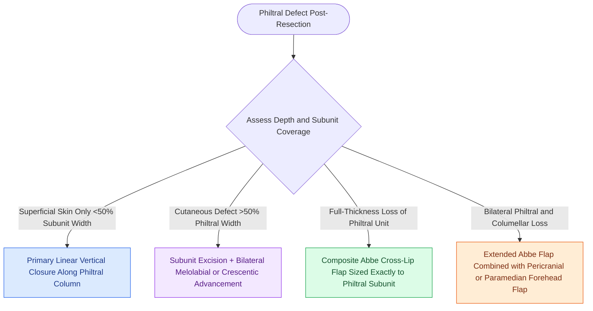

# Philtral subunit reconstruction requires Abbe cross-lip flaps or bilateral melolabial advancement to restore three-dimensional contour

## Active Recall

> [!question]- Why is whole-subunit excision and replacement favored over partial repair for defects encompassing greater than 50% of the philtrum?
> *Answer / Clinical Rationale*: Replacing the entire philtral subunit places scars along the **natural philtral columns and columellar base**, eliminating distracting central planar scars and recreating the **central philtral depression (dimple) and Cupid's bow peak symmetry**.

> [!question]- When designing an Abbe cross-lip flap to repair a complete philtral defect, how should flap width be calculated?
> *Answer / Clinical Rationale*: The flap is designed to **match the exact width of the normal philtrum** (or half the defect width if treating broader composite lower lip loss), maintaining harmonic volumetric proportions between upper and lower lips.

## Core Clinical & Mechanistic Principles
The philtrum constitutes the central organizing aesthetic subunit of the upper lip, bounded superiorly by the columellar-labial junction, laterally by the raised philtral columns, and inferiorly by the Cupid's bow peaks and central vermilion tubercle. Surgical repair requires respecting [[Gonzalez-Ulloa facial aesthetic subunits guide complete subunit reconstruction|facial aesthetic subunits]] to avoid unnatural flattened contours or displaced peaks.

For full-thickness or deep cutaneous defects:
- **Full Philtral Subunit Abbe Flap**: When a defect involves $>50\%$ of the philtrum, excising residual philtral skin to convert the wound into a complete aesthetic subunit defect produces superior cosmetic outcomes. A full-thickness cross-lip flap matching the exact triangular or trapezoidal dimensions of the philtrum is harvested from the central lower lip, pedicled on a labial artery. Rotation into the defect restores the central dimple, vermilion tubercle, and philtral column symmetry.
- **Bilateral Symmetrical Advancement Flaps**: For central defects where cross-lip surgery is contraindicated, bilateral medial advancement flaps can be used. Incisions along the alar-facial sulci and subnasal creases recruit lateral lip skin. Flaps must be designed symmetrically (mirror-image) to prevent lateral deviation of the upper lip midline.
- **Subcutaneous Pedicled Melolabial Island Flaps**: In older patients with significant perioral skin laxity, unilateral or bilateral island flaps mobilized from the melolabial crease can be tunneled or transposed to resurface the cutaneous philtrum.
- **Preservation of the Cupid's Bow**: Any advancement crossing the vermilion border risks distorting Cupid's bow peaks. Precise surgical alignment of the white roll (pars peripheralis of the orbicularis oris) is paramount.

### Technical Considerations for Upper Lip Symmetry
1. **Columellar Base Anchoring**: Deep anchoring tacking sutures from deep dermis to anterior nasal spine and cartilaginous septum prevent downward tethering or alar spreading.
2. **Pedicle Inset Timing**: The Abbe pedicle across the oral aperture is safely divided at 2 to 3 weeks postoperatively under local anesthesia.

## Connected Concepts & Graph Traversal
- **Cross-Lip Workhorse**: [[Abbe and Estlander cross-lip flaps are pedicled on the labial artery to repair lip defects|Abbe & Estlander Flaps]]
- **Innervated Circumoral Rotation**: [[Karapandzic orbicularis oris myocutaneous rotation flaps preserve oral sphincter innervation|Karapandzic Flap]]
- **Cheek Advancement Alternative**: [[Gilles fan flaps and Webster-Bernard cheek advancements reconstruct large lower lip defects|Gilles Fan & Webster-Bernard Flaps]]
- **Linear Advancement Biomechanics**: [[Advancement flaps recruit adjacent tissue laxity along a linear vector without rotation|Advancement Flaps]]
- **Near-Total Lip Reconstruction**: [[Near-total lip reconstruction combines functional local muscle flaps with microvascular free flaps|Near-Total Lip Reconstruction]]
