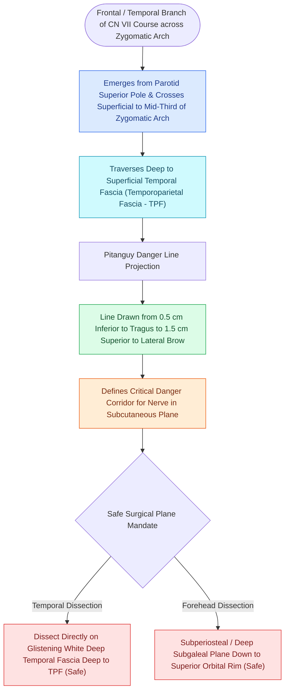

# Pitanguy's line defines the danger zone for the frontal branch of the facial nerve

## Active Recall

> [!question]- In what fascial layer does the frontal branch of the facial nerve travel as it crosses the zygomatic arch?
> *Answer / Clinical Rationale*: In the **innominate fascia / sub-temporoparietal fascia (sub-TPF)**, running strictly superficial to the deep temporal fascia proper.

> [!question]- What surface anatomical landmarks define Pitanguy's line?
> *Answer / Clinical Rationale*: A line drawn from **$0.5\text{ cm}$ below the tragus** to **$1.5\text{ cm}$ superior to the lateral brow**.

## Core Clinical & Mechanistic Principles
The **frontal (temporal) branch of the facial nerve (CN VII)** innervates the frontalis, upper orbicularis oculi, and corrugator supercilii muscles. Its [[The superficial musculoaponeurotic system divides facial fat into distinct surgical planes|superficial]] course across the zygomatic arch makes it the **most vulnerable motor nerve in upper facial and brow rejuvenation surgery**.

### Safe Surgical Dissection Planes
1. **Deep to the Nerve (Deep Temporal Fascia Proper)**:
   - Dissecting directly on the **glistening white surface of the deep temporal fascia (DTF)** keeps the nerve safely elevated in the superficial flap.
2. **Subperiosteal Plane**:
   - Dissecting strictly beneath the periosteum over the zygomatic arch and lateral orbital rim.

## Critical Surgical Traps & Brow Ptosis
- **Pitanguy's Line**: A line drawn from **$0.5\text{ cm}$ inferior to the tragus** to a point **$1.5\text{ cm}$ superior to the lateral brow**.
- **Transection Consequence**: Laceration of the frontal branch causes immediate, permanent **unilateral brow ptosis**, inability to elevate the forehead, and loss of upper facial symmetry.

## Connected Concepts & Graph Traversal
- **Browlift Landmark**: [[The sentinel vein marks the trajectory of the frontal branch of the facial nerve|Sentinel Vein & Browlift]]
- **Endoscopic Technique**: [[Endoscopic browlift releases the conjoint tendon and arcus marginalis along the supraorbital rim|Endoscopic Browlift]]
- **SMAS Continuity**: [[The superficial musculoaponeurotic system divides facial fat into distinct surgical planes|SMAS & TPF Continuity]]
- **Diagnostic Evaluation**: [[Facial synkinesis is managed with selective neurolysis, myectomy, and botulinum toxin titration|Facial Synkinesis Treatment]]
- **Facial Nerve Danger Zone**: [[Parotid duct laceration requires primary microsurgical repair over a silastic stent to prevent sialocele and salivary fistula|Buccal Branch and Stensen Duct]]
- **Critical Safety / Danger Zone**: [[Cheek reconstruction employs deep SMAS plane elevation superficial to the zygomaticus major to restore volume contour defects while preserving the facial nerve|Deep SMAS Plane Cheek Reconstruction]]
- **Anatomical Foundation**: [[Forehead reconstruction requires subcutaneous or subfrontalis dissection planes to prevent motor paralysis of the frontalis muscle|Subfrontalis Dissection Plane]]
