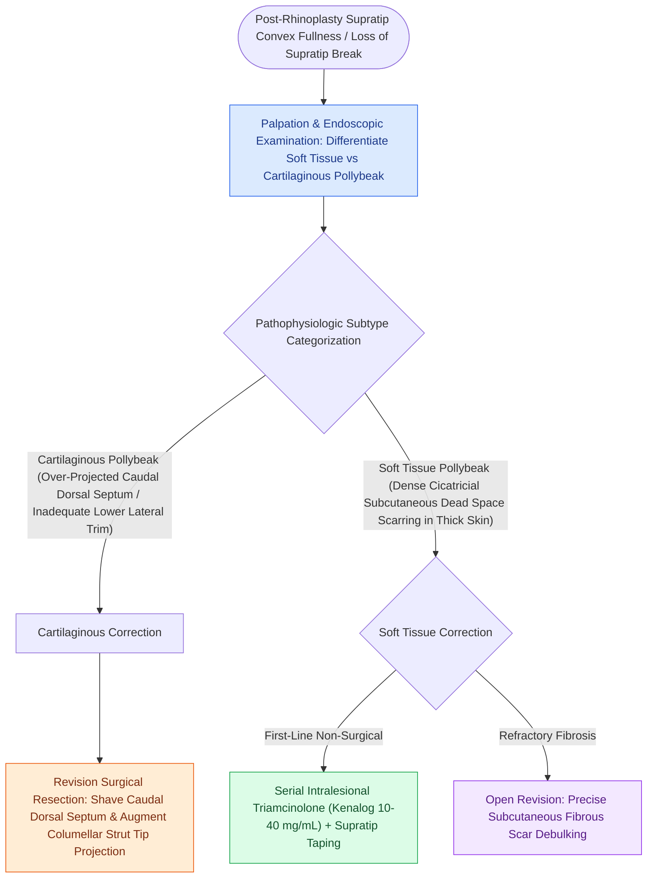

# Pollybeak deformities arise from cartilaginous over-projection or supratip soft tissue fibrosis

## Active Recall

> [!question]- How can the surgeon clinically differentiate a cartilaginous pollybeak from a soft-tissue pollybeak on examination?
> *Answer / Clinical Rationale*: A **cartilaginous pollybeak** feels firm, rigid, and non-compressible on palpation (due to prominent anterior septal cartilage). A **soft-tissue pollybeak** is soft, compressible, and spongy (due to subcutaneous fibrotic scar accumulation).

> [!question]- What complication can occur from superficial intradermal injection of triamcinolone for supratip scar reduction?
> *Answer / Clinical Rationale*: **Dermal atrophy, skin thinning, telangiectasias, and permanent hypopigmentation**.

## Core Clinical & Mechanistic Principles
A **pollybeak deformity** is an undesirable postoperative rhinoplasty outcome characterized by an excessive fullness or convexity of the **supratip region**, resembling a parrot’s beak. It destroys the normal aesthetic supratip break.

### Prevention & Triamcinolone Protocol
- **Dead Space Elimination**: Meticulous taping and supratip pressure splinting for 2–3 weeks postoperatively in thick-skinned patients.
- **Steroid Infiltration**: Infiltrate **$0.1\text{–}0.2\text{ mL}$ of Kenalog-10 (Triamcinolone $10\text{ mg/mL}$)** into the deep subcutaneous plane at 4–6 week intervals. Avoid superficial intradermal injection to [[Spreader grafts restore internal nasal valve patency and prevent inverted-V deformity|prevent]] dermal atrophy, telangiectasias, and hypopigmentation.

## Connected Concepts & Graph Traversal
- **Tip Dynamics**: [[The Anderson tripod theory governs nasal tip projection, rotation, and support dynamics|Anderson Tripod Theory]]
- **Dorsal Restoration**: [[Spreader grafts restore internal nasal valve patency and prevent inverted-V deformity|Spreader Grafts]]
- **Structural Control**: [[Tongue-in-groove and septal extension grafts provide rigid columellar and tip stabilization|Tongue-in-Groove]]
- **Anatomical Foundation**: [[Cephalic trim of lower lateral cartilages must preserve at least six millimeters of lateral crus|Cephalic Trim 6-mm Rule]]
- **High-Stakes Safety**: [[High-stakes FPRS complications require proactive landmarking and emergency rescue protocols|FPRS Complication Matrix]]
