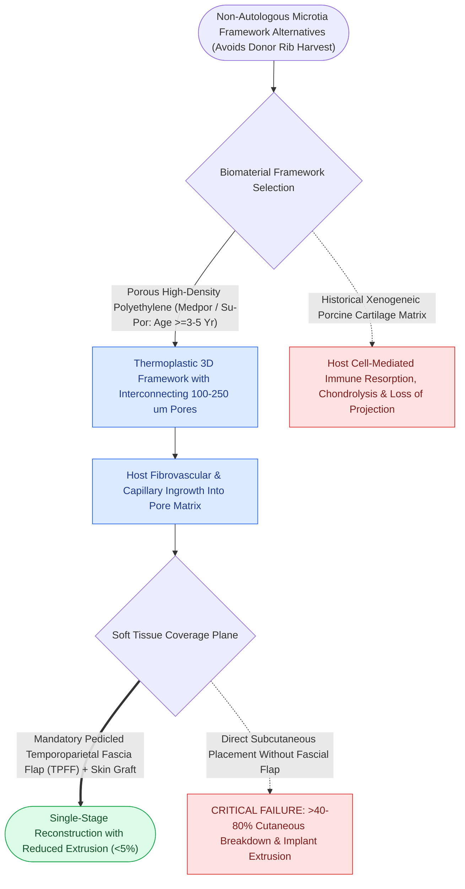

# Porcine and porous polyethylene Medpor frameworks provide synthetic alternatives in microtia repair

## Active Recall

> [!question]- Why must a Medpor synthetic auricular framework be enveloped in a [[Pitanguy's line defines the danger zone for the frontal branch of the facial nerve|temporoparietal fascia]] flap (TPFF)?
> *Answer / Clinical Rationale*: Synthetic porous polyethylene requires **immediate, robust vascularized tissue coverage** to prevent high rates of skin necrosis, infection, and framework extrusion.

> [!question]- At what age can Medpor microtia reconstruction be performed compared to autologous rib reconstruction?
> *Answer / Clinical Rationale*: Medpor can be performed as early as **$3\text{ to }5\text{ years}$ of age** (because it does not require donor rib growth), whereas autologous rib requires waiting until age **$6\text{ to }10\text{ years}$** (chest circumference $>60\text{ cm}$).

## Core Clinical & Mechanistic Principles
While autologous costal cartilage (Brent/Nagata) remains the global gold standard, **Porous Polyethylene (Medpor / Su-Por)** frameworks provide a pre-formed, synthetic alternative for [[Microtia reconstruction spans staged autologous costal cartilage frameworks and porous polyethylene implants|microtia reconstruction]] that eliminates **donor site rib harvest morbidity and can be performed at an earlier age ($3\text{–}5\text{ years}$)**.

### Autologous Rib vs Medpor Frameworks
- **Autologous Rib (Brent/Nagata)**: Living tissue; highly resistant to trauma and lifelong extrusion; requires waiting until age 6–10 (chest circumference $>60\text{ cm}$).
- **Medpor**: Synthetic biomaterial; lifelong risk of exposure/extrusion upon blunt trauma; requires immediate vascular coverage.

## Connected Concepts & Graph Traversal
- **Autologous Standard**: [[Microtia autologous costal cartilage framework stages balance four-stage Brent and two-stage Nagata reconstruction protocols|Brent & Nagata Microtia]]
- **Fascial Flap**: [[Endoscopic browlift releases the conjoint tendon and arcus marginalis along the supraorbital rim|Temporal Fascial Anatomy]]
- **Otoplasty Sutures**: [[Mustarde and Furnas sutures correct antihelical effacement and conchal hypertrophy|Otoplasty Sutures]]
- **Diagnostic Evaluation**: [[Composite chondrocutaneous auricular graft transfers reconstruct complex alar and helical defects|Composite Auricular Graft]]
- **Anatomical Foundation**: [[Microtia reconstruction spans staged autologous costal cartilage frameworks and porous polyethylene implants|Microtia Reconstruction]]
