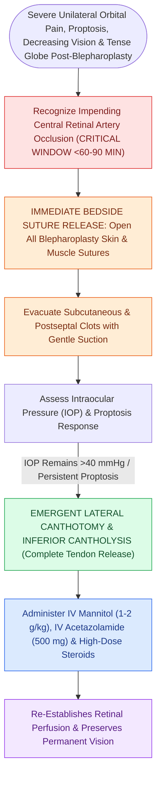

# Post-blepharoplasty retrobulbar hematoma requires immediate bedside decompression to prevent blindness

## Active Recall

> [!question]- What is the immediate bedside surgical rescue maneuver for an acute retrobulbar hematoma?
> *Answer / Clinical Rationale*: Immediate **opening of surgical wounds followed by lateral canthotomy and complete inferior cantholysis** to decompress intraorbital pressure.

> [!question]- What intraoperative error during blepharoplasty fat excision most commonly precipitates retrobulbar hemorrhage?
> *Answer / Clinical Rationale*: Inadequate cauterization of the **arteriole within a fat pedicle (particularly the medial fat pad)**, allowing the bleeding vessel to retract deep into the retrobulbar orbital space.

## Core Clinical & Mechanistic Principles
**Retrobulbar hematoma** following upper or [[Lower blepharoplasty addresses fat herniation while preserving the inferior oblique muscle|lower blepharoplasty]] occurs in approximately **$0.04\text{–}0.05\%$ of cases**, most commonly caused by **retraction and bleeding of a transected fat pedicle artery** (especially the medial fat pad artery) deep into the retro-ocular cone.

Permanent ischemic blindness ensues within **$60\text{–}90\text{ minutes}$** if intraocular pressure (IOP) is not immediately relieved.

### Prevention During Fat Excision
- Always clamp fat pedicles prior to excision; apply meticulous bipolar cautery to the cut stump before releasing traction, allowing the stump to retract under direct visualization without bleeding.

## Connected Concepts & Graph Traversal
- **Surgical Technique**: [[Acute retrobulbar hematoma in facial trauma requires immediate bedside lateral canthotomy|Lateral Canthotomy Technique]]
- **Lower Blepharoplasty**: [[Lower blepharoplasty addresses fat herniation while preserving the inferior oblique muscle|Lower Blepharoplasty]]
- **Complication Matrix**: [[High-stakes FPRS complications require proactive landmarking and emergency rescue protocols|High-Stakes FPRS Matrix]]
- **Diagnostic Evaluation**: [[Lateral canthopexy and lateral tarsal strip suspension prevent post-blepharoplasty ectropion|Lateral Tarsal Strip (LTS)]]
- **High-Stakes Safety**: [[Pollybeak deformities arise from cartilaginous over-projection or supratip soft tissue fibrosis|Pollybeak Deformity]]
