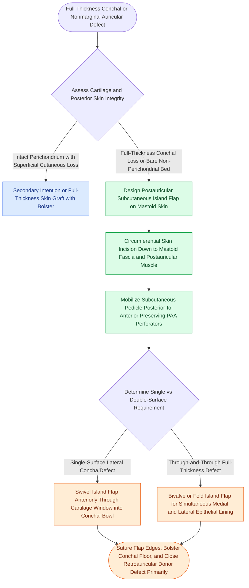

# Postauricular revolving door subcutaneous island flaps provide single-stage reconstruction of full-thickness conchal and nonmarginal auricular defects

## Active Recall

> [!question]- What anatomical structure supplies the central vascular axis of the postauricular revolving door island flap?
> *Answer / Clinical Rationale*: The flap is pedicled on a thick subcutaneous tissue stalk containing the **auricular branch of the posterior auricular artery** and perforators traveling through or around the **postauricular muscle**, mobilized from the mastoid periosteum.

> [!question]- How can the postauricular island flap be modified when repairing a through-and-through defect involving both lateral and medial auricular skin?
> *Answer / Clinical Rationale*: The island flap can be **bivalved or folded on itself** (or de-epithelialized centrally), allowing one portion to resurface the posterior/medial skin and the folded portion to project anteriorly through the cartilage window to resurface the lateral conchal bowl or antihelix.

## Core Clinical & Mechanistic Principles
Cutaneous and composite defects of the conchal bowl, antihelix, and triangular fossa frequently result from Mohs micrographic surgery for cutaneous carcinomas. While superficial defects with intact perichondrium can be left to granulate or resurfaced with full-thickness skin grafts, deep defects with denuded or absent cartilage heal with prolonged crusting, chondritis, or contracture. The **postauricular revolving door subcutaneous island flap** (originally described by Masson and popularized by Owens) offers a robust, single-stage autologous solution utilizing [[Rotation flaps redistribute closing tension along a curvilinear arc of rotation|transpositional and rotational tissue recruitment]].

### Surgical Technique and Vascular Anatomy
1. **Vascular Anatomy**:
   - The flap is based on the rich arcade of the **posterior auricular artery (PAA)** and its deep perforators, which ascend along the mastoid fascia and supply the retroauricular skin.
   - The pedicle is composed of deep subcutaneous fibrofatty tissue and the **postauricular muscle**, providing dependable axial and perforator perfusion.
2. **Flap Design & Elevation**:
   - The skin island is marked on the mastoid and postauricular skin directly behind the defect, sized precisely to the dimensions of the conchal or antihelical deficit.
   - Incisions are carried circumferentially through skin and subcutaneous fat down to the deep mastoid fascia.
   - Posteriorly, the mastoid periosteum is incised, and subfascial undermining proceeds from posterior to anterior toward the retroauricular sulcus. Care is taken to preserve the vascular pedicle entering the island from the inferior and deep medial directions.
3. **Transcartilaginous Transposition ("Revolving Door")**:
   - The skin island is mobilized through the existing cartilaginous conchal window (or an engineered cartilaginous fenestration in antihelical defects).
   - The flap swivels $90^\circ\text{ to }180^\circ$ through the cartilage defect like a revolving door, presenting its epithelial surface anteriorly to line the lateral conchal bowl.
4. **Bivalving and Folded Modifications**:
   - When a full-thickness defect involves both the lateral concha and the posterior medial auricular skin, the island flap can be bivalved or folded on itself.
   - One half of the folded island resurfaces the posterior auricular cutaneous defect, while the folded deepithelialized segment carries the other half anteriorly through the cartilage window to line the concha, restoring both lamellae in a single operation.
5. **Donor Site Closure & Inset**:
   - The retroauricular donor defect is closed primarily with wide undermining of the adjacent cervical and scalp skin, concealing the scar entirely within the postauricular crease.
   - The anterior conchal inset is secured with 5-0 fast-absorbing or nylon sutures, and a light xeroform bolster maintains intimate adherence against the mastoid floor.

### Complications and Caveats
- **Pedicle Constriction**: If the cartilaginous window is too narrow, the thick subcutaneous vascular pedicle can be choked, causing venous congestion and flap necrosis. The cartilage borders must be trimmed generously to ensure an unconstricted aperture.
- **Sulcus Blunting**: Designing the skin island too far anteriorly onto the posterior auricular conchal wall will efface the postauricular sulcus during primary donor closure. The island should center predominantly over the mastoid scalp.
- **Excessive Bolster Pressure**: Tight tie-over bolsters can compromise cutaneous microcirculation in the newly transferred island. Bolsters must provide gentle contour support rather than high compression.

## Connected Concepts & Graph Traversal
- **Skin Grafting Alternatives**: [[Full-thickness and split-thickness skin grafts differ in primary contraction and vascular take|Full-Thickness vs Split-Thickness Skin Grafts]]
- **🔗 Infectious Complication (Otology)**: [[Acute perichondritis of the auricle requires antipseudomonal therapy to prevent cartilage necrosis|Auricular Perichondritis Prevention]]
- **Conchal Otoplasty Anatomy**: [[Mustarde and Furnas sutures correct antihelical effacement and conchal hypertrophy|Conchal Bowl Anatomy & Furnas Sutures]]
- **Perforator Angiosomes**: [[Facial angiosomes and perforator choke zones determine cutaneous flap survival boundaries|Angiosomes and Choke Zones]]
- **Marginal Auricular Reconstructive Alternative**: [[Antia-Buch helical rim chondrocutaneous advancement flaps mobilize the helical margin and lobule to close defects up to two centimeters|Antia-Buch Flap]]
