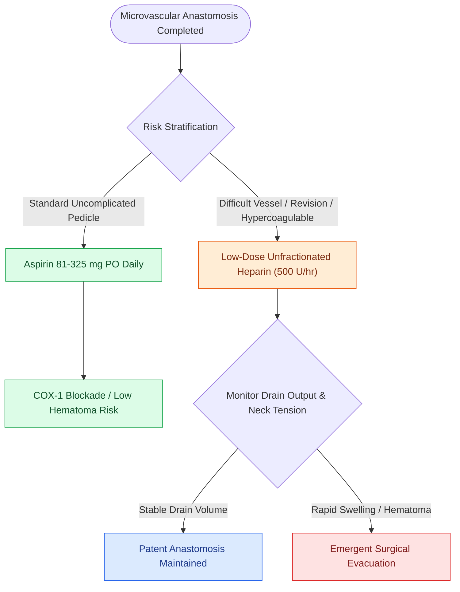

# Postoperative free flap anticoagulation and antiplatelet protocols balance thrombosis against hematoma

## Active Recall

> [!question]- What is the standard first-line antiplatelet agent used for routine postoperative microvascular maintenance?
> *Answer / Clinical Rationale*: **Aspirin (81 to 325 mg PO daily)**, which irreversibly acetylates platelet cyclooxygenase-1 (COX-1) to block Thromboxane A2 synthesis.

> [!question]- Why is aggressive therapeutic systemic heparinization not routinely used in uncomplicated head and neck free flaps?
> *Answer / Clinical Rationale*: It significantly increases the rate of **postoperative neck hematoma formation (up to $15\text{–}20\%$)**, which mechanically compresses the thin-walled venous anastomosis, without providing a statistically significant increase in flap survival over aspirin alone.

## Core Clinical & Mechanistic Principles
Postoperative pharmacological management in microvascular surgery must balance the prevention of **microvascular anastomotic thrombosis** (governed by Virchow's Triad: endothelial shearing, stasis at the vessel junction, and systemic hypercoagulability) against the catastrophic risk of an **expanding cervical hematoma**, which directly compresses the low-pressure venous pedicle causing secondary venous outflow occlusion and [[Microvascular free flap salvage requires urgent re-exploration within two hours of vascular compromise|acute flap compromise]].

- **Standard Postoperative Antiplatelet Strategy**:
  - **Aspirin (81 to 325 mg PO daily)**: First-line maintenance for 14–30 days. Irreversibly acetylates platelet cyclooxygenase-1 (COX-1), blocking Thromboxane $A_2$ synthesis with minimal incremental hematoma risk.
  - **Subcutaneous Heparin (5,000 U SC q8–12h) or Enoxaparin (40 mg SC daily)**: Standard deep venous thrombosis (DVT) and pulmonary embolism chemoprophylaxis without therapeutic systemic anticoagulation.
- **Therapeutic Heparin Indications**:
  - Reserved strictly for difficult microvascular conditions: intraoperative thrombectomy, revision of an obstructed vessel, low-flow venous systems, or [[Vein grafts harvested from the great saphenous vein bridge long pedicle gaps in revision microvascular surgery|interposition vein grafts]].
  - Continuous low-dose unfractionated heparin ($500\text{ units/hr}$ without loading bolus) minimizes hematoma risk while maintaining patency, tracked closely via [[Implantable Doppler probes provide continuous real-time monitoring of microvascular free flap pedicles|implantable Doppler monitoring]].

### The Dextran Decline & High-Stakes Hazards
- Low-molecular-weight Dextran-40 reduces erythrocyte aggregation and blood viscosity, but is associated with **high rates of acute non-cardiogenic pulmonary edema, acute tubular necrosis, and anaphylaxis**, and is largely abandoned in modern reconstructive surgery.

## Connected Concepts & Graph Traversal
- **Emergency Salvage Protocol**: [[Microvascular free flap salvage requires urgent re-exploration within two hours of vascular compromise|Free Flap Salvage Re-exploration]]
- **Continuous Perfusion Monitoring**: [[Implantable Doppler probes provide continuous real-time monitoring of microvascular free flap pedicles|Implantable Doppler Probes]]
- **Pedicle Interposition Grafting**: [[Vein grafts harvested from the great saphenous vein bridge long pedicle gaps in revision microvascular surgery|Great Saphenous Vein Grafts]]
- **Bony Reconstruction Target**: [[Osteoradionecrosis of the mandible requires radical bony debridement and vascularized fibula free flap repair|Fibula Free Flap in Mandibular ORN]]
- **Complex Composite Design**: [[Chimeric free flaps combine independent bone, muscle, and skin paddles on a common vascular branch|Chimeric Free Tissue Transfer]]
